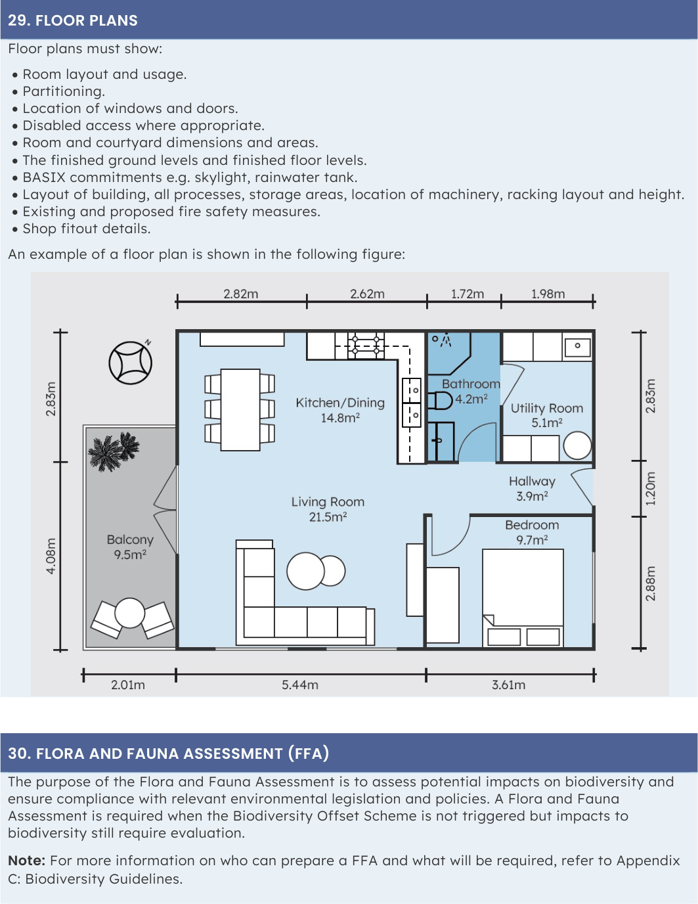

## 28. FLOOD IMPACT ASSESSMENT (FIA)

A report that measures and then details the impacts of flooding on a particular parcel of land. This report is prepared to by a qualified professional consultant. Flood Impact Assessments are to be prepared in accordance with the ‘Flood Impact and Risk Assessment’ – Flood Risk Management Guideline LU01 of the NSW Flood Risk Management Manual.

> [Picture on page 18: a picture, saved as a picture (images/appendix-a-application-requirements-other-development-page-18-1.gif, 150 dpi).]
> Words printed on the picture (title and legend, copied from the PDF):
> • Partitioning.
