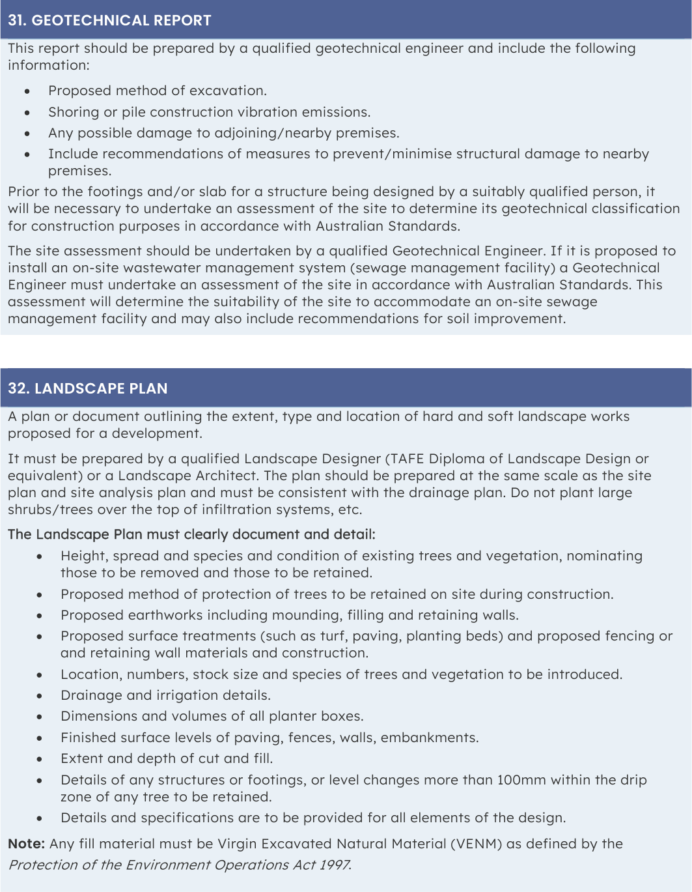

## 30. FLORA AND FAUNA ASSESSMENT (FFA)

The purpose of the Flora and Fauna Assessment is to assess potential impacts on biodiversity and ensure compliance with relevant environmental legislation and policies. A Flora and Fauna Assessment is required when the Biodiversity Offset Scheme is not triggered but impacts to biodiversity still require evaluation. Note: For more information on who can prepare a FFA and what will be required, refer to Appendix

> [Picture on page 19: a picture, saved as a picture (images/appendix-a-application-requirements-other-development-page-19-1.gif, 150 dpi).]
> Words printed on the picture (title and legend, copied from the PDF):
> information:
> • Proposed method of excavation.
> • Shoring or pile construction vibration emissions.
> • Any possible damage to adjoining/nearby premises.
> • Include recommendations of measures to prevent/minimise structural damage to nearby
> premises.
