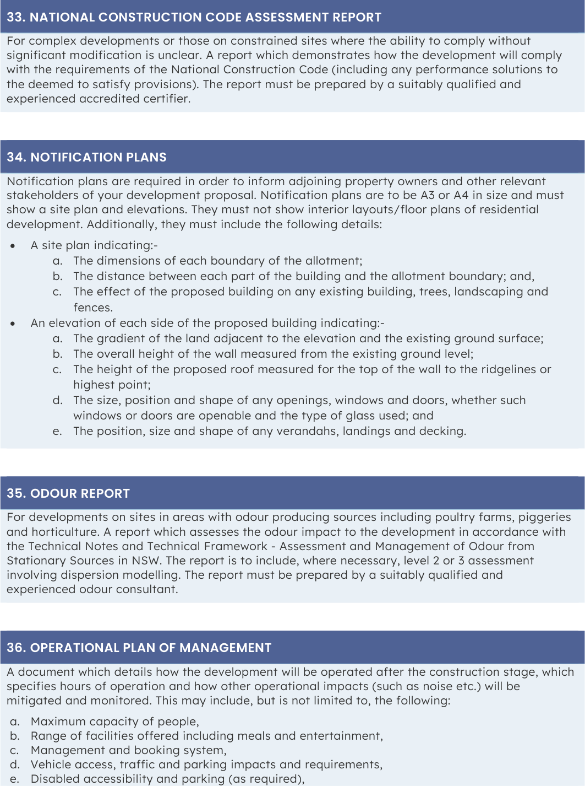

## 32. LANDSCAPE PLAN

A plan or document outlining the extent, type and location of hard and soft landscape works proposed for a development. It must be prepared by a qualified Landscape Designer (TAFE Diploma of Landscape Design or equivalent) or a Landscape Architect. The plan should be prepared at the same scale as the site plan and site analysis plan and must be consistent with the drainage plan. Do not plant large shrubs/trees over the top of infiltration systems, etc. The Landscape Plan must clearly document and detail:

those to be removed and those to be retained.

and retaining wall materials and construction.

zone of any tree to be retained.

Note: Any fill material must be Virgin Excavated Natural Material (VENM) as defined by the Protection of the Environment Operations Act 1997.

> [Picture on page 20: a picture, saved as a picture (images/appendix-a-application-requirements-other-development-page-20-1.gif, 150 dpi).]
> Words printed on the picture (title and legend, copied from the PDF):
> experienced accredited certifier.
