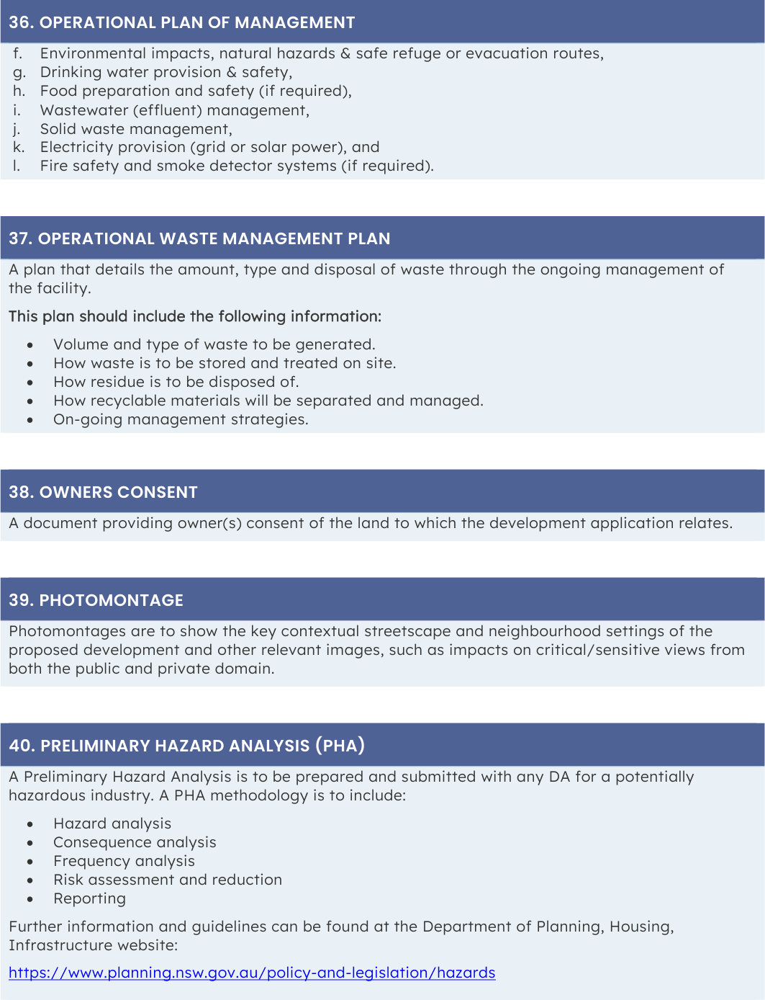

## 36. OPERATIONAL PLAN OF MANAGEMENT

A document which details how the development will be operated after the construction stage, which specifies hours of operation and how other operational impacts (such as noise etc.) will be mitigated and monitored. This may include, but is not limited to, the following:

a. Maximum capacity of people,

b. Range of facilities offered including meals and entertainment,

c. Management and booking system,

d. Vehicle access, traffic and parking impacts and requirements,

e. Disabled accessibility and parking (as required),

> [Picture on page 21: a picture, saved as a picture (images/appendix-a-application-requirements-other-development-page-21-1.gif, 150 dpi).]
> Words printed on the picture (title and legend, copied from the PDF):
> i. Wastewater (effluent) management,
> j. Solid waste management,
