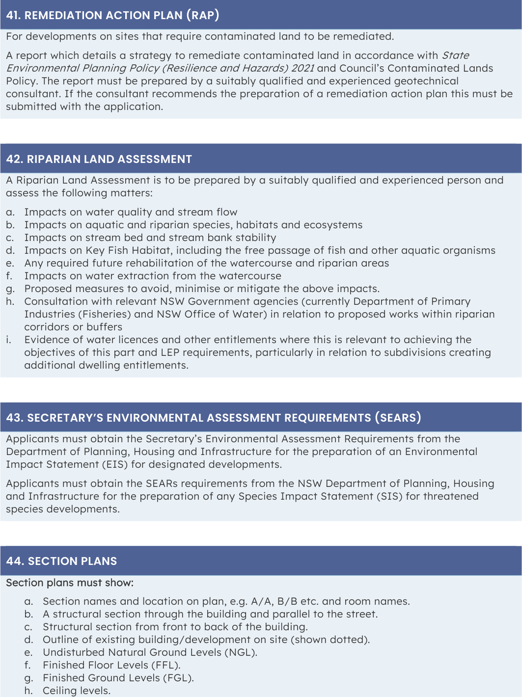

## 40. PRELIMINARY HAZARD ANALYSIS (PHA)

A Preliminary Hazard Analysis is to be prepared and submitted with any DA for a potentially hazardous industry. A PHA methodology is to include:

Further information and guidelines can be found at the Department of Planning, Housing,

> [Picture on page 22: a picture, saved as a picture (images/appendix-a-application-requirements-other-development-page-22-1.gif, 150 dpi).]
> Words printed on the picture (title and legend, copied from the PDF):
> submitted with the application.
