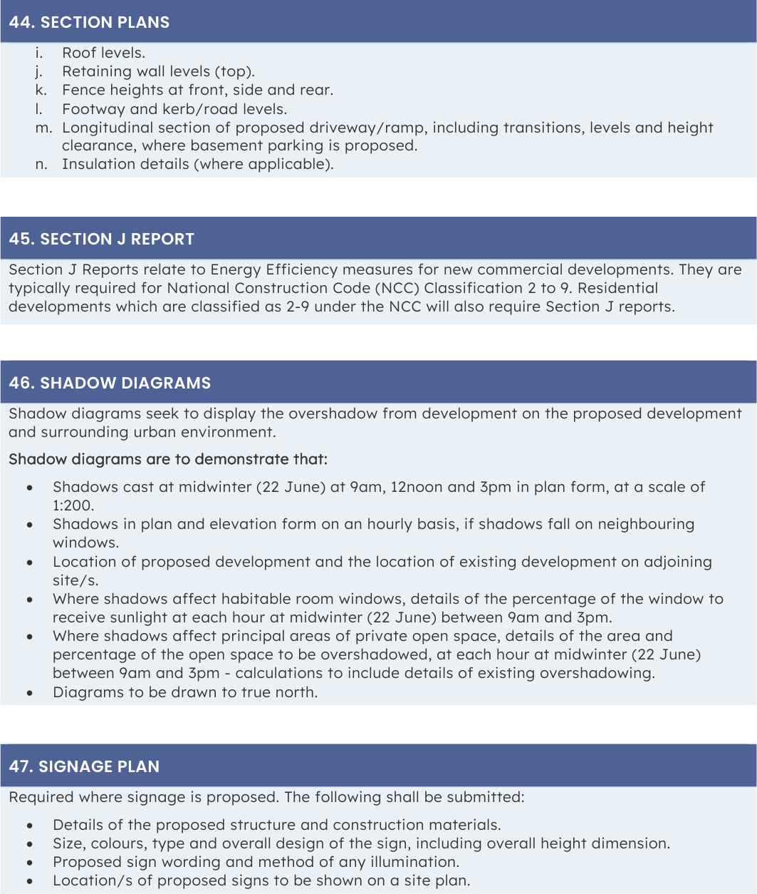

## 44. SECTION PLANS

a. Section names and location on plan, e.g. A/A, B/B etc. and room names.

b. A structural section through the building and parallel to the street.

c. Structural section from front to back of the building.

d. Outline of existing building/development on site (shown dotted).

e. Undisturbed Natural Ground Levels (NGL).

f. Finished Floor Levels (FFL).

g. Finished Ground Levels (FGL).

> [Picture on page 23: a picture, saved as a picture (images/appendix-a-application-requirements-other-development-page-23-1.gif, 150 dpi).]
> Words printed on the picture (title and legend, copied from the PDF):
> i. Roof levels.
