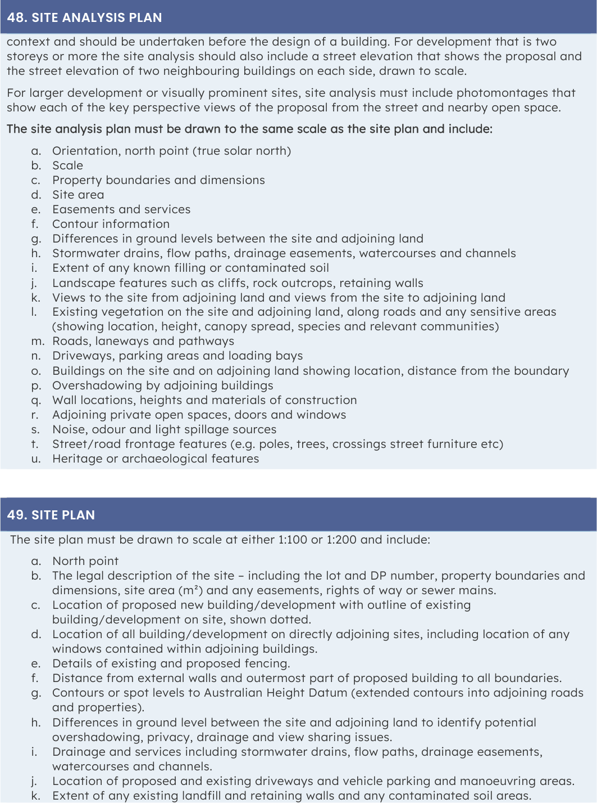

## 48. SITE ANALYSIS PLAN

The site analysis plan must show the relevant details of the site and its relationship to the street and neighbouring development. A site analysis is essential in order to understand the site and its

> [Picture on page 24: a picture, saved as a picture (images/appendix-a-application-requirements-other-development-page-24-1.gif, 150 dpi).]
> Words printed on the picture (title and legend, copied from the PDF):
> b. Scale
> d. Site area
> e. Easements and services
> f. Contour information
