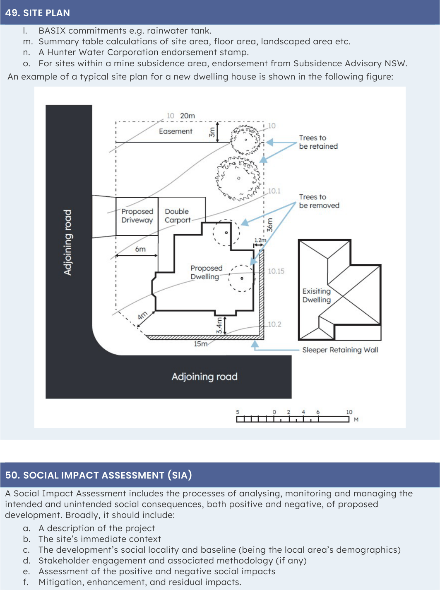

## 49. SITE PLAN

The site plan must be drawn to scale at either 1:100 or 1:200 and include:

b. The legal description of the site – including the lot and DP number, property boundaries and

dimensions, site area (m²) and any easements, rights of way or sewer mains.

c. Location of proposed new building/development with outline of existing

building/development on site, shown dotted.

d. Location of all building/development on directly adjoining sites, including location of any

windows contained within adjoining buildings.

e. Details of existing and proposed fencing.

f. Distance from external walls and outermost part of proposed building to all boundaries.

g. Contours or spot levels to Australian Height Datum (extended contours into adjoining roads

h. Differences in ground level between the site and adjoining land to identify potential

overshadowing, privacy, drainage and view sharing issues.

i. Drainage and services including stormwater drains, flow paths, drainage easements,

j. Location of proposed and existing driveways and vehicle parking and manoeuvring areas.

k. Extent of any existing landfill and retaining walls and any contaminated soil areas.

> [Picture on page 25: a picture, saved as a picture (images/appendix-a-application-requirements-other-development-page-25-1.gif, 150 dpi).]
