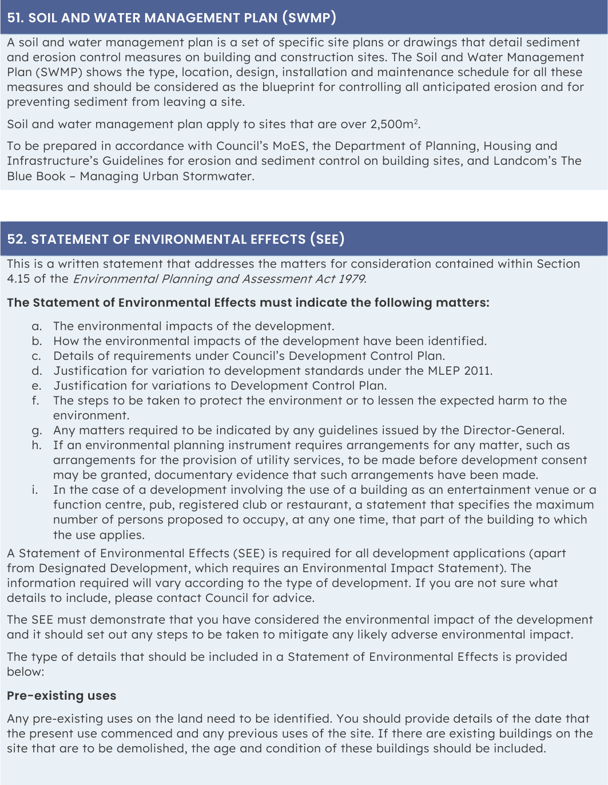

## 50. SOCIAL IMPACT ASSESSMENT (SIA)

A Social Impact Assessment includes the processes of analysing, monitoring and managing the intended and unintended social consequences, both positive and negative, of proposed development. Broadly, it should include:

a. A description of the project

b. The site’s immediate context

c. The development’s social locality and baseline (being the local area’s demographics)

d. Stakeholder engagement and associated methodology (if any)

e. Assessment of the positive and negative social impacts

f. Mitigation, enhancement, and residual impacts.

> [Picture on page 26: a picture, saved as a picture (images/appendix-a-application-requirements-other-development-page-26-1.gif, 150 dpi).]
