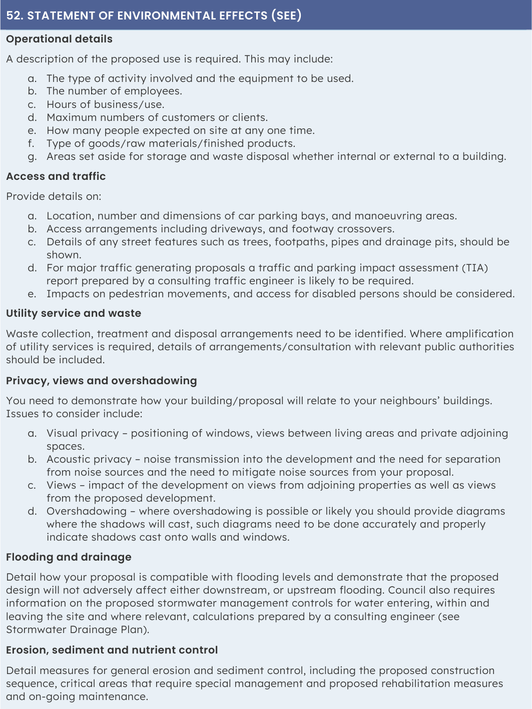

## 52. STATEMENT OF ENVIRONMENTAL EFFECTS (SEE)

This is a written statement that addresses the matters for consideration contained within Section

4.15 of the Environmental Planning and Assessment Act 1979.

#### The Statement of Environmental Effects must indicate the following matters:

a. The environmental impacts of the development.

b. How the environmental impacts of the development have been identified.

c. Details of requirements under Council’s Development Control Plan.

d. Justification for variation to development standards under the MLEP 2011.

e. Justification for variations to Development Control Plan.

f. The steps to be taken to protect the environment or to lessen the expected harm to the

g. Any matters required to be indicated by any guidelines issued by the Director-General.

h. If an environmental planning instrument requires arrangements for any matter, such as

arrangements for the provision of utility services, to be made before development consent may be granted, documentary evidence that such arrangements have been made.

i. In the case of a development involving the use of a building as an entertainment venue or a

function centre, pub, registered club or restaurant, a statement that specifies the maximum number of persons proposed to occupy, at any one time, that part of the building to which

A Statement of Environmental Effects (SEE) is required for all development applications (apart from Designated Development, which requires an Environmental Impact Statement). The information required will vary according to the type of development. If you are not sure what details to include, please contact Council for advice. The SEE must demonstrate that you have considered the environmental impact of the development and it should set out any steps to be taken to mitigate any likely adverse environmental impact. The type of details that should be included in a Statement of Environmental Effects is provided

#### Pre-existing uses

Any pre-existing uses on the land need to be identified. You should provide details of the date that the present use commenced and any previous uses of the site. If there are existing buildings on the site that are to be demolished, the age and condition of these buildings should be included.

> [Picture on page 27: a picture, saved as a picture (images/appendix-a-application-requirements-other-development-page-27-1.gif, 150 dpi).]
> Words printed on the picture (title and legend, copied from the PDF):
> c. Hours of business/use.
> Provide details on:
> shown.
> should be included.
> Issues to consider include:
> spaces.
> from the proposed development.
> Stormwater Drainage Plan).
> and on-going maintenance.
