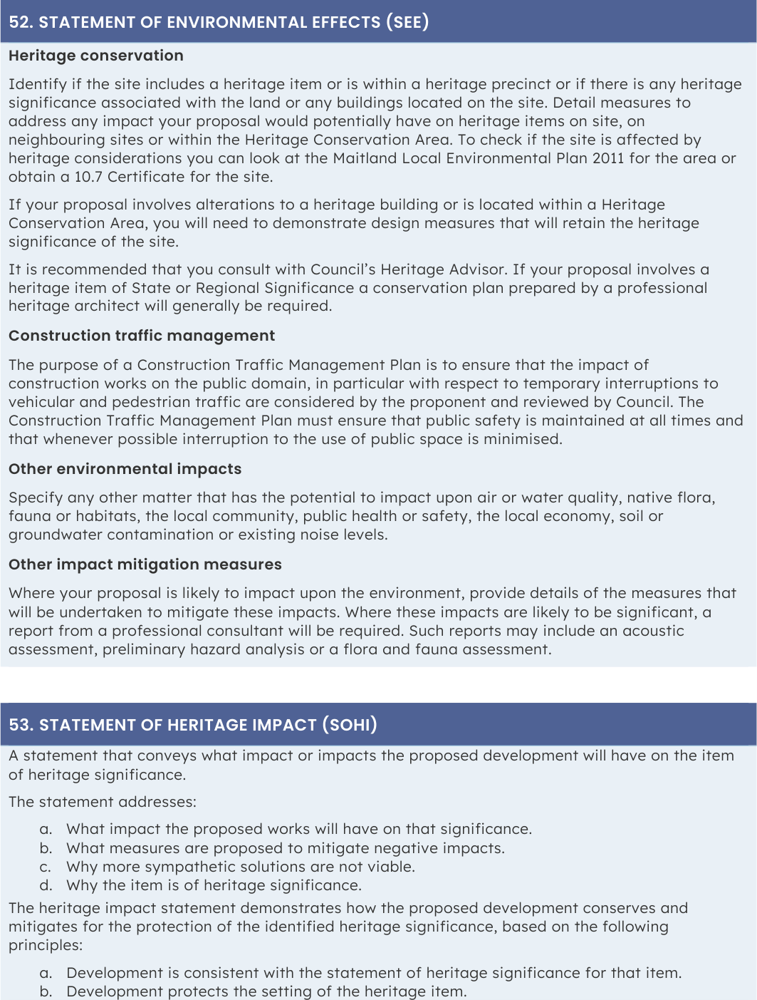

## 52. STATEMENT OF ENVIRONMENTAL EFFECTS (SEE)

#### Operational details

A description of the proposed use is required. This may include:

a. The type of activity involved and the equipment to be used.

b. The number of employees.

d. Maximum numbers of customers or clients.

e. How many people expected on site at any one time.

f. Type of goods/raw materials/finished products.

g. Areas set aside for storage and waste disposal whether internal or external to a building.

#### Access and traffic

a. Location, number and dimensions of car parking bays, and manoeuvring areas.

b. Access arrangements including driveways, and footway crossovers.

c. Details of any street features such as trees, footpaths, pipes and drainage pits, should be

d. For major traffic generating proposals a traffic and parking impact assessment (TIA)

report prepared by a consulting traffic engineer is likely to be required.

e. Impacts on pedestrian movements, and access for disabled persons should be considered.

#### Utility service and waste

Waste collection, treatment and disposal arrangements need to be identified. Where amplification of utility services is required, details of arrangements/consultation with relevant public authorities

#### Privacy, views and overshadowing

You need to demonstrate how your building/proposal will relate to your neighbours’ buildings.

a. Visual privacy – positioning of windows, views between living areas and private adjoining

b. Acoustic privacy – noise transmission into the development and the need for separation

from noise sources and the need to mitigate noise sources from your proposal.

c. Views – impact of the development on views from adjoining properties as well as views

d. Overshadowing – where overshadowing is possible or likely you should provide diagrams

where the shadows will cast, such diagrams need to be done accurately and properly indicate shadows cast onto walls and windows.

#### Flooding and drainage

Detail how your proposal is compatible with flooding levels and demonstrate that the proposed design will not adversely affect either downstream, or upstream flooding. Council also requires information on the proposed stormwater management controls for water entering, within and leaving the site and where relevant, calculations prepared by a consulting engineer (see

#### Erosion, sediment and nutrient control

Detail measures for general erosion and sediment control, including the proposed construction sequence, critical areas that require special management and proposed rehabilitation measures

> [Picture on page 28: a picture, saved as a picture (images/appendix-a-application-requirements-other-development-page-28-1.gif, 150 dpi).]
