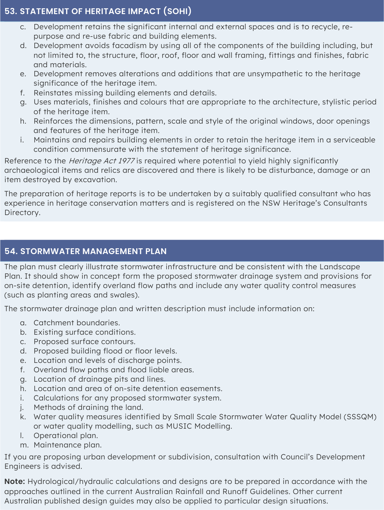

## 53. STATEMENT OF HERITAGE IMPACT (SOHI)

A statement that conveys what impact or impacts the proposed development will have on the item

a. What impact the proposed works will have on that significance.

b. What measures are proposed to mitigate negative impacts.

c. Why more sympathetic solutions are not viable.

d. Why the item is of heritage significance. The heritage impact statement demonstrates how the proposed development conserves and mitigates for the protection of the identified heritage significance, based on the following

a. Development is consistent with the statement of heritage significance for that item.

b. Development protects the setting of the heritage item.

> [Picture on page 29: a picture, saved as a picture (images/appendix-a-application-requirements-other-development-page-29-1.gif, 150 dpi).]
> Words printed on the picture (title and legend, copied from the PDF):
> and materials.
> of the heritage item.
> Directory.
