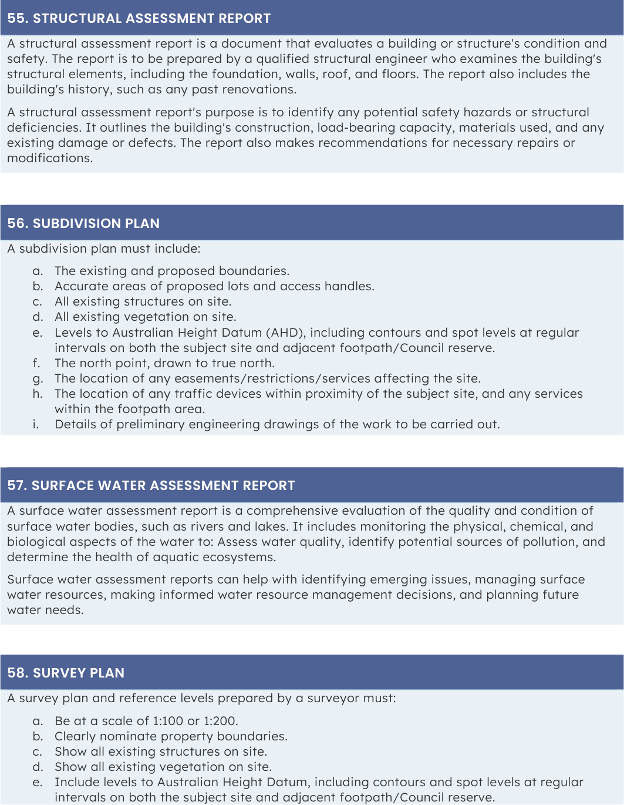

## 54. STORMWATER MANAGEMENT PLAN

The plan must clearly illustrate stormwater infrastructure and be consistent with the Landscape Plan. It should show in concept form the proposed stormwater drainage system and provisions for on-site detention, identify overland flow paths and include any water quality control measures (such as planting areas and swales). The stormwater drainage plan and written description must include information on:

d. Proposed building flood or floor levels.

e. Location and levels of discharge points.

f. Overland flow paths and flood liable areas.

g. Location of drainage pits and lines.

h. Location and area of on-site detention easements.

i. Calculations for any proposed stormwater system.

j. Methods of draining the land.

k. Water quality measures identified by Small Scale Stormwater Water Quality Model (SSSQM)

or water quality modelling, such as MUSIC Modelling.

If you are proposing urban development or subdivision, consultation with Council’s Development Engineers is advised. Note: Hydrological/hydraulic calculations and designs are to be prepared in accordance with the

approaches outlined in the current Australian Rainfall and Runoff Guidelines. Other current Australian published design guides may also be applied to particular design situations.

> [Picture on page 30: a picture, saved as a picture (images/appendix-a-application-requirements-other-development-page-30-1.gif, 150 dpi).]
> Words printed on the picture (title and legend, copied from the PDF):
> modifications.
