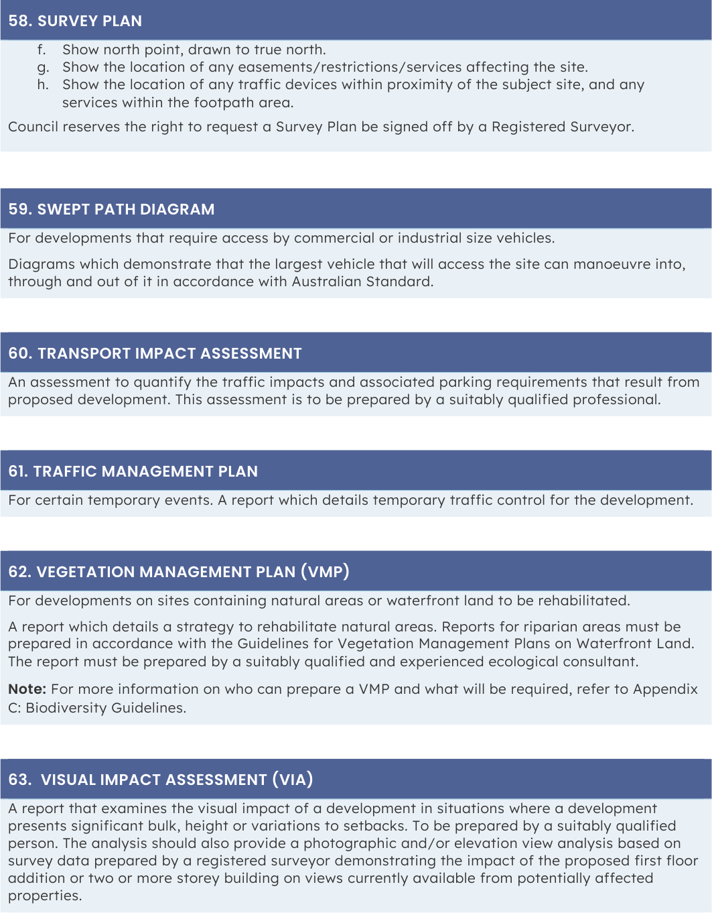

## 58. SURVEY PLAN

A survey plan and reference levels prepared by a surveyor must:

a. Be at a scale of 1:100 or 1:200.

b. Clearly nominate property boundaries.

c. Show all existing structures on site.

d. Show all existing vegetation on site.

e. Include levels to Australian Height Datum, including contours and spot levels at regular

intervals on both the subject site and adjacent footpath/Council reserve.

> [Picture on page 31: a picture, saved as a picture (images/appendix-a-application-requirements-other-development-page-31-1.gif, 150 dpi).]
