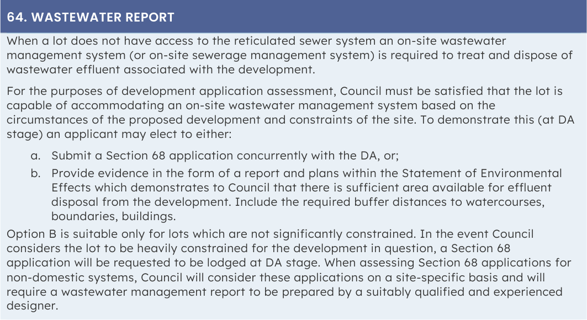

## 63.  VISUAL IMPACT ASSESSMENT (VIA)

A report that examines the visual impact of a development in situations where a development presents significant bulk, height or variations to setbacks. To be prepared by a suitably qualified person. The analysis should also provide a photographic and/or elevation view analysis based on survey data prepared by a registered surveyor demonstrating the impact of the proposed first floor addition or two or more storey building on views currently available from potentially affected

> [Picture on page 32: a picture, saved as a picture (images/appendix-a-application-requirements-other-development-page-32-1.gif, 150 dpi).]
> Words printed on the picture (title and legend, copied from the PDF):
> boundaries, buildings.
> designer.
