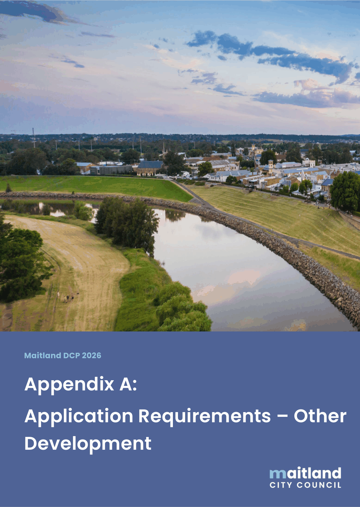
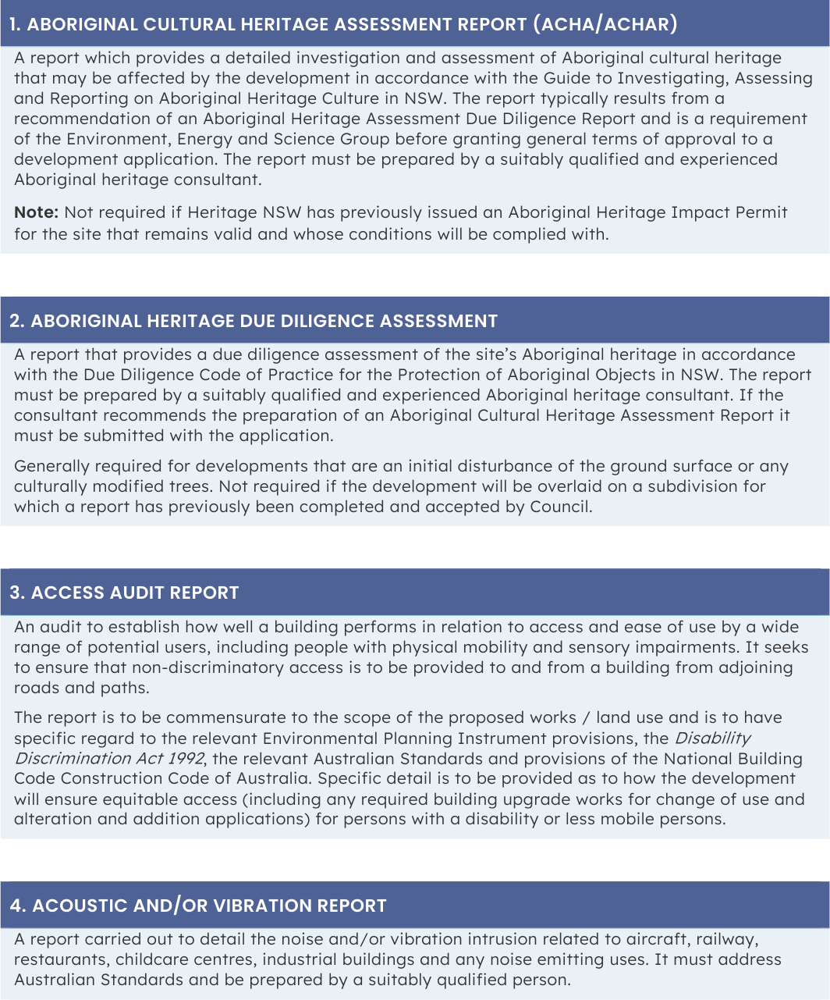

# Maitland Development Control Plan 2026 - Appendix A Application Requirements – Other Development

> This chapter is split into 74 section file(s), one per numbered heading, in the order they appear in the PDF.

Source PDF: [MDCP 2026 - Appendix A Application Requirements - Other Development.pdf](https://planfortomorrow.sharepoint.com/sites/Planfortomorrow/Shared%20Documents/00%20NSW-Planning-Resources/dcp/maitland-development-control-plan-2026/appendix-a-application-requirements-other-development/MDCP%202026%20-%20Appendix%20A%20Application%20Requirements%20-%20Other%20Development.pdf)

> [Picture on page 1: a picture, saved as a picture (images/appendix-a-application-requirements-other-development-page-1-1.gif, 150 dpi).]

#### Maitland DCP 2026

### Appendix A: Application Requirements – Other

### Development

### Table of Contents

Supporting document requirements – Matrix – All other Development ......................................................................... 4 Supporting information and documentation guide ................................................................................................. 9

1\. Aboriginal cultural heritage assessment report (ACHA/ACHAR) ................................................................... 9

2\. Aboriginal heritage due diligence assessment ..................................................................................................... 9

3\. Access audit report ........................................................................................................................................................ 9

4\. Acoustic and/or vibration report .............................................................................................................................. 9

5\. Agricultural Property Management Plan .............................................................................................................. 10

6\. Air quality Impact Assessment ................................................................................................................................ 10

7\. Arborist report ............................................................................................................................................................... 10

8\. Archaeological report .................................................................................................................................................. 11

9\. BASIX Certificate ........................................................................................................................................................... 11

10\. Biodiversity Development Assessment Report (BDAR) .................................................................................. 11

11\. Bulk earthworks plan .................................................................................................................................................. 11

12\. Bushfire assessment report (BAR) ........................................................................................................................ 12

13\. Civil Plans ...................................................................................................................................................................... 12

14\. Colour, Materials and Finishes Schedule ............................................................................................................. 13

15\. Construction Waste Management Plan ................................................................................................................ 13

16\. Contamination Report (PSI or DSI) ...................................................................................................................... 13

17\. Cost estimate report .................................................................................................................................................. 14

18\. CPTED Statement (Crime Risk Assessment) ...................................................................................................... 14

19\. Demolition plan ........................................................................................................................................................... 15

20\. Design Verification Statement Template ........................................................................................................... 15

21\. Driveway Profile .......................................................................................................................................................... 15

22\. Economic impact assessment ................................................................................................................................ 15

23\. Electromagnetic energy report .............................................................................................................................. 16

24\. Elevation plans ............................................................................................................................................................ 16

25\. Environmental impact statement ......................................................................................................................... 16

26\. Erosion and Sediment Control Plan (ESCP) ....................................................................................................... 16

27\. Flood evacuation / management plan (FEMP) ................................................................................................. 17

28\. Flood Impact Assessment (FIA) ............................................................................................................................ 17

29\. Floor plans .................................................................................................................................................................... 18

30\. Flora and fauna Assessment (FFA) ...................................................................................................................... 18

31\. Geotechnical report ................................................................................................................................................... 19

32\. Landscape plan ........................................................................................................................................................... 19

33\. National Construction Code Assessment Report ............................................................................................. 20

34\. Notification Plans ...................................................................................................................................................... 20

35\. Odour report ................................................................................................................................................................ 20

36\. Operational Plan of Management ........................................................................................................................ 20

37\. Operational Waste management plan ................................................................................................................ 21

38\. Owners consent ........................................................................................................................................................... 21

39\. Photomontage ............................................................................................................................................................. 21

40\. Preliminary Hazard Analysis (PHA) ...................................................................................................................... 21

41\. Remediation Action Plan (RAP) ............................................................................................................................. 22

42\. Riparian Land Assessment ...................................................................................................................................... 22

43\. Secretary’s Environmental Assessment Requirements (SEARS) ................................................................ 22

44\. Section Plans ............................................................................................................................................................... 22

45\. Section J report .......................................................................................................................................................... 23

46\. Shadow Diagrams ..................................................................................................................................................... 23

47\. Signage Plan ................................................................................................................................................................ 23

48\. Site analysis plan ....................................................................................................................................................... 23

49\. Site plan ........................................................................................................................................................................ 24

50\. Social Impact Assessment (SIA) .......................................................................................................................... 25

51\. Soil and Water Management Plan (SWMP) ........................................................................................................ 26

52\. Statement of Environmental Effects (SEE) ........................................................................................................ 26

53\. Statement of Heritage Impact (SOHI) ............................................................................................................... 28

54\. Stormwater Management Plan .............................................................................................................................. 29

55\. Structural assessment report ................................................................................................................................. 30

56\. Subdivision plan ......................................................................................................................................................... 30

57\. Surface Water Assessment Report ....................................................................................................................... 30

58\. Survey plan ................................................................................................................................................................... 30

59\. Swept path diagram .................................................................................................................................................. 31

60\. Transport impact assessment ................................................................................................................................ 31

61\. Traffic management plan ......................................................................................................................................... 31

62\. Vegetation management plan (VMP) ................................................................................................................... 31

63\. Visual impact assessment (VIA) ............................................................................................................................ 31

64\. Wastewater report ..................................................................................................................................................... 32

#### VERSION DATE ADOPTED

#### CHANGES

1.0

New DCP Appendix

### Supporting document requirements – Matrix – All other Development

#### Application requirements matrix

This Application Requirement Guideline shows documentation that must or may be provided with your Development Application based on the development type, as demonstrated in the Matrix below. Details on what is to be provided as part of each documentation is provided in the Supporting information and documentation guide section. The key for this is provided below and at the end of the matrix:

### O

### X

Information required. Application will

Information may be required

Information not required

not be accepted without this documentation

Note: Council at its discretion may request additional studies either not being identified under a specific development type or not identified at all within the matrix. This occurrence may be due to the unique elements of a proposed development or its scale and/or size.

#### Further information on development application requirements

The Department of Planning, Housing and Infrastructure (or current equivalent) has prepared an Application Requirements (2022) guideline for all development applications. This document provides explanation and additional information regarding conditions within the Environmental Planning and Assessment Act 1979 and Environmental Planning and Assessment Regulation 2021 applying to all development. This document should be read in conjunction with Council’s Application Requirements and be considered as a baseline only for supporting information to support development applications.

|  | (4 & DWELLINGS HOUSING ATTACHED MULTI-DWELLING MORE) OR | BUILDING FLAT RESIDENTIAL | OFFICE / RETAIL / COMMERCIAL | USE OF CHANGE | INDUSTRIAL | HOME / BUSINESS HOME INDUSTRY | AND/OR FACILITY COMMUNITY RECREATION | TOURISM | SIGNAGE | DEMOLITION | RETAINING AND EARTHWORKS WALLS | EVENT(S) TEMPORARY | LOTS) 10+ (OVER SUBDIVISION | ADDITIONS ECD) AND $1,000,000 ALTERATIONS (OVER |
|---|---|---|---|---|---|---|---|---|---|---|---|---|---|---|
| Aboriginal Cultural Heritage Assessment Report (ACHA) | O | O | O | X | O | X | O | O | X | O | O | X | O | O |
| Aboriginal Heritage Due Diligence Assessment | O | O | O | X | O | X | O | O | X | O | O | X | O | O |
| Access Audit Report | O |  |  | O |  | X | O |  | X | X | X | O | X | O |
| Acoustic and/or Vibration Report | O | O | O | O | O | O | O | O | X | X | O | O | O | O |
| Agricultural Property Management Plan | X | X | X | O | X | X | X | X | X | X | X | X | X | X |
| Air Quality Report | O | O | O | O |  | O | O | O | X | X | O | X | O | O |
| Arborist Report | O | O | O | X | O | X | O | O | O | O | O | X | O | O |
| Archaeological report | X | X | X | X | X | X | X | X | X | O | O | X | O | O |
| BASIX Certificate |  |  | X | O | X | X | X | X | X | X | X | X | X | O |
| Biodiversity Development Assessment Report (BDAR) | O | O | O | X | O | X | O | O | X | X | O | X | O | O |
| Bulk Earthworks Plan |  |  |  | X |  | X |  | O | X | O |  | X |  | O |
| Bushfire Assessment Report (BAR) | O | O | O | X | O | X | O | O | X | X | X | O | O | O |
| Civil Plans |  |  |  | X |  | X |  | O | O | X | O | O |  |  |
| Colour, Materials and Finishes Schedule |  |  |  | X |  | X |  | O |  | X | X | X | X | O |
| Construction Waste Management Plan |  |  |  | O |  | O |  | O |  |  |  | O |  |  |

|  | (4 & DWELLINGS HOUSING ATTACHED MULTI-DWELLING MORE) OR | BUILDING FLAT RESIDENTIAL | OFFICE / RETAIL / COMMERCIAL | USE OF CHANGE | INDUSTRIAL | HOME / BUSINESS HOME INDUSTRY | AND/OR FACILITY COMMUNITY RECREATION | TOURISM | SIGNAGE | DEMOLITION | RETAINING AND EARTHWORKS WALLS | EVENT(S) TEMPORARY | LOTS) 10+ (OVER SUBDIVISION | ADDITIONS ECD) AND $1,000,000 ALTERATIONS (OVER |
|---|---|---|---|---|---|---|---|---|---|---|---|---|---|---|
| Contamination Report (PSI or DSI) | O | O | O | X | O | X | O | O | X | O | O | X | O | O |
| Cost Estimate Report |  |  |  |  |  |  |  |  |  |  |  |  |  |  |
| CPTED Statement | O |  |  | O | O | X |  | O | X | X | X | O | X | O |
| Demolition Plan | O | O | O | X | O | X | O | O | O |  | O | X | O | O |
| Design Verification Statement | X |  | X | X | X | X | X | X | X | X | X | X | X | X |
| Driveway Profile |  |  | O | X |  | X | O | O | X | X | X | X | O | O |
| Economic Impact Assessment (EIA) | X | X | O | X | O | X | O | O | X | X | X | X | O | X |
| Elevation Plans |  |  |  | X |  | O |  | O |  | X | O | O | X |  |
| Erosion and Sediment Control Plan (ESCP) (if site is between 250m2 and 2,500m2) | A | A | A | A | A | A | A | A | A | A | A | A | A | A |
| Flood Impact Assessment | O | O | O | X | O | X | O | O | X | X | O | O | O | O |
| Floor Plans |  |  |  |  |  |  |  | O | X | X | X | O | X |  |
| Flora and Fauna Assessment (FFA) | O | O | O | X | O | X | O | O | X | X | O | X | O | O |
| Geotechnical Report | O | O | O | X | O | X | O | O | X | X | O | X | O | O |
| Landscape plan |  |  |  | X |  | X |  | O | X | X | X | X |  |  |
| National Construction Code Assessment Report | X | X | O | O | O | X | O | O | X | X | X | X | X | O |

|  | (4 & DWELLINGS HOUSING ATTACHED MULTI-DWELLING MORE) OR | BUILDING FLAT RESIDENTIAL | OFFICE / RETAIL / COMMERCIAL | USE OF CHANGE | INDUSTRIAL | HOME / BUSINESS HOME INDUSTRY | AND/OR FACILITY COMMUNITY RECREATION | TOURISM | SIGNAGE | DEMOLITION | RETAINING AND EARTHWORKS WALLS | EVENT(S) TEMPORARY | LOTS) 10+ (OVER SUBDIVISION | ADDITIONS ECD) AND $1,000,000 ALTERATIONS (OVER |
|---|---|---|---|---|---|---|---|---|---|---|---|---|---|---|
| Odour Report | O | O | O | X | O | O | O | O | X | X | X | X | O | X |
| Operational Plan of Management | X | X | O | O |  | O | O |  | X | X | X |  | X | O |
| Operational Waste Management Plan |  |  |  | X |  |  |  | O | X |  |  |  |  |  |
| Owner(s) Consent |  |  |  |  |  |  |  |  |  |  |  |  |  |  |
| Photomontage | O | O | O | X | O | X | O | O | O | X | X | X | X | O |
| Preliminary Hazard Analysis | X | X | O | X | O | X | X | X | X | X | X | X | X | O |
| Remediation Action Plan | O | O | O | O | O | X | O | O | X | O | O | X | O | O |
| Riparian Land Assessment | O | O | O | X | O | X | O | O | X | O | O | X | O | O |
| Section Plans |  |  |  | X |  | X |  | O | O | X | O | O | O |  |
| Section J report | X | X | O | X | O | X | O | O | X | X | X | X | X | O |
| Shadow Diagrams | O |  | O | X | O | X | O | O | O | X | X | X | X | O |
| Signage Plan | X | O |  | O | O | O | O | O |  | X | X | O | O | O |
| Site Analysis Plan |  |  |  |  |  |  |  |  | O |  |  |  |  |  |
| Site Plan |  |  |  |  |  |  |  |  |  |  |  |  |  |  |
| Social Impact Assessment (SIA) | X | O | O | X | O | X | O | O | X | X | X | X | O | O |
| Soil and Water Management Plan (SWMP) (if site is >2,500m2) | A | A | A | A | A | A | A | A | A | A | A | A | A | A |

|  | & DWELLINGS ATTACHED | (4 HOUSING MULTI-DWELLING | MORE) OR | BUILDING FLAT RESIDENTIAL | OFFICE / RETAIL / COMMERCIAL | USE OF CHANGE | INDUSTRIAL | HOME / BUSINESS HOME | INDUSTRY | AND/OR COMMUNITY | FACILITY RECREATION | TOURISM | SIGNAGE | DEMOLITION | RETAINING AND EARTHWORKS | WALLS | EVENT(S) TEMPORARY | LOTS) 10+ (OVER SUBDIVISION | ADDITIONS AND ALTERATIONS | ECD) $1,000,000 (OVER |
|---|---|---|---|---|---|---|---|---|---|---|---|---|---|---|---|---|---|---|---|---|
| Statement of Environmental |  |  |  |  |  |  |  |  |  |  |  |  |  |  |  |  |  |  |  |  |
| Effects (SEE) |  |  |  |  |  |  |  |  |  |  |  |  |  |  |  |  |  |  |  |  |
| Statement of Heritage Impact | O |  | O | O | X | O | O |  | O |  | O | O | O | O |  | O | O | O |  |  |
| (SoHI) |  |  |  |  |  |  |  |  |  |  |  |  |  |  |  |  |  |  |  |  |
| Stormwater Management Plan |  |  |  |  | X |  | X |  |  |  | O | X | X | X |  | O |  |  |  |  |
| Structural Assessment Report | X |  | X | X | O | X | O |  | X |  | X | X | O | X |  | X | X | O |  |  |
| Subdivision Plan | O |  | O | X | X | X | X |  | X |  | X | X | X | X |  | X |  | X |  |  |
| Surface Water Assessment | O |  | O | O | X | O | X |  | O |  | O | X | X | O |  | X | O | O |  |  |
| Report |  |  |  |  |  |  |  |  |  |  |  |  |  |  |  |  |  |  |  |  |
| Survey Plan |  |  |  |  | O |  |  |  |  |  |  | O |  |  |  | O |  | O |  |  |
| Swept path diagram | O |  |  |  | X |  | X |  | O |  | O | X | X | X |  | X | O | O |  |  |
| Transport Impact Assessment | O |  | O | O | X | O | X |  | O |  | O | X | O | O |  | O | O | O |  |  |
| (TIA) |  |  |  |  |  |  |  |  |  |  |  |  |  |  |  |  |  |  |  |  |
| Traffic Management Plan | O |  | O | O | X | O | X |  | O |  | O | X | O | O |  | O | O | O |  |  |
| Vegetation Management Plan | O |  | O | O | X | O | X |  | O |  | O | X | X | O |  | X | O | O |  |  |
| Visual Impact Assessment (VIA) | O |  |  | O | X | O | X |  | O |  | O | O | X | O |  | X | O | O |  |  |
| Wastewater Report | O |  | O | O | X | O | X |  | O |  | O | X | X | X |  | O | O | X |  |  |
|  |  |  |  |  | O Information may be required |  |  |  |  |  |  | X Information not required |  |  |  |  |  |  |  |  |
| Information required. Application will not be accepted without |  |  |  |  |  |  |  |  |  |  |  |  |  |  |  |  |  |  |  |  |
| this documentation |  |  |  |  |  |  |  |  |  |  |  |  |  |  |  |  |  |  |  |  |

### Supporting information and documentation guide

> [Picture on page 9: a picture, saved as a picture (images/appendix-a-application-requirements-other-development-page-9-2.gif, 150 dpi).]

<!-- sections -->
## Sections

1. [1 ABORIGINAL CULTURAL HERITAGE ASSESSMENT REPORT (ACHA/ACHAR)](01-aboriginal-cultural-heritage-assessment.md)
2. [2 ABORIGINAL HERITAGE DUE DILIGENCE ASSESSMENT](02-aboriginal-heritage-due-diligence.md)
3. [3 ACCESS AUDIT REPORT](03-access-audit-report.md)
4. [4 ACOUSTIC AND/OR VIBRATION REPORT](04-acoustic-and-or-vibration-report.md)
5. [5 AGRICULTURAL PROPERTY MANAGEMENT PLAN](05-agricultural-property-management-plan.md)
6. [6 AIR QUALITY IMPACT ASSESSMENT](06-air-quality-impact-assessment.md)
7. [7 ARBORIST REPORT](07-arborist-report.md)
8. [8 ARCHAEOLOGICAL REPORT](08-archaeological-report.md)
9. [9 BASIX CERTIFICATE](09-basix-certificate.md)
10. [10 BIODIVERSITY DEVELOPMENT ASSESSMENT REPORT (BDAR)](10-biodiversity-development-assessment.md)
11. [11 BULK EARTHWORKS PLAN](11-bulk-earthworks-plan.md)
12. [11 BULK EARTHWORKS PLAN](12-11-bulk-earthworks-plan.md)
13. [12 BUSHFIRE ASSESSMENT REPORT (BAR)](13-12-bushfire-assessment-report-bar.md)
14. [13 CIVIL PLANS](14-13-civil-plans.md)
15. [14 COLOUR, MATERIALS AND FINISHES SCHEDULE](15-14-colour-materials-and-finishes-schedule.md)
16. [15 CONSTRUCTION WASTE MANAGEMENT PLAN](16-15-construction-waste-management-plan.md)
17. [16 CONTAMINATION REPORT (PSI OR DSI)](17-16-contamination-report-psi-or-dsi.md)
18. [16 CONTAMINATION REPORT (PSI OR DSI)](18-16-contamination-report-psi-or-dsi.md)
19. [18 CPTED STATEMENT (CRIME RISK ASSESSMENT)](19-18-cpted-statement-crime-risk-assessment.md)
20. [19 DEMOLITION PLAN](20-19-demolition-plan.md)
21. [20 DESIGN VERIFICATION STATEMENT TEMPLATE](21-20-design-verification-statement-template.md)
22. [21 DRIVEWAY PROFILE](22-21-driveway-profile.md)
23. [22 ECONOMIC IMPACT ASSESSMENT](23-22-economic-impact-assessment.md)
24. [23 ELECTROMAGNETIC ENERGY REPORT](24-23-electromagnetic-energy-report.md)
25. [24 ELEVATION PLANS](25-24-elevation-plans.md)
26. [25 ENVIRONMENTAL IMPACT STATEMENT](26-25-environmental-impact-statement.md)
27. [26 EROSION AND SEDIMENT CONTROL PLAN (ESCP)](27-26-erosion-and-sediment-control-plan-escp.md)
28. [26 EROSION AND SEDIMENT CONTROL PLAN (ESCP)](28-26-erosion-and-sediment-control-plan-escp.md)
29. [27 FLOOD EVACUATION / MANAGEMENT PLAN (FEMP)](29-27-flood-evacuation-management-plan-femp.md)
30. [28 FLOOD IMPACT ASSESSMENT (FIA)](30-28-flood-impact-assessment-fia.md)
31. [29 FLOOR PLANS](31-29-floor-plans.md)
32. [30 FLORA AND FAUNA ASSESSMENT (FFA)](32-30-flora-and-fauna-assessment-ffa.md)
33. [31 GEOTECHNICAL REPORT](33-31-geotechnical-report.md)
34. [32 LANDSCAPE PLAN](34-32-landscape-plan.md)
35. [33 NATIONAL CONSTRUCTION CODE ASSESSMENT REPORT](35-33-national-construction-code-assessment.md)
36. [34 NOTIFICATION PLANS](36-34-notification-plans.md)
37. [35 ODOUR REPORT](37-35-odour-report.md)
38. [36 OPERATIONAL PLAN OF MANAGEMENT](38-36-operational-plan-of-management.md)
39. [36 OPERATIONAL PLAN OF MANAGEMENT](39-36-operational-plan-of-management.md)
40. [37 OPERATIONAL WASTE MANAGEMENT PLAN](40-37-operational-waste-management-plan.md)
41. [38 OWNERS CONSENT](41-38-owners-consent.md)
42. [39 PHOTOMONTAGE](42-39-photomontage.md)
43. [40 PRELIMINARY HAZARD ANALYSIS (PHA)](43-40-preliminary-hazard-analysis-pha.md)
44. [41 REMEDIATION ACTION PLAN (RAP)](44-41-remediation-action-plan-rap.md)
45. [42 RIPARIAN LAND ASSESSMENT](45-42-riparian-land-assessment.md)
46. [43 SECRETARY’S ENVIRONMENTAL ASSESSMENT REQUIREMENTS (SEARS)](46-43-secretary-s-environmental-assessment.md)
47. [44 SECTION PLANS](47-44-section-plans.md)
48. [44 SECTION PLANS](48-44-section-plans.md)
49. [45 SECTION J REPORT](49-45-section-j-report.md)
50. [46 SHADOW DIAGRAMS](50-46-shadow-diagrams.md)
51. [47 SIGNAGE PLAN](51-47-signage-plan.md)
52. [48 SITE ANALYSIS PLAN](52-48-site-analysis-plan.md)
53. [48 SITE ANALYSIS PLAN](53-48-site-analysis-plan.md)
54. [49 SITE PLAN](54-49-site-plan.md)
55. [49 SITE PLAN](55-49-site-plan.md)
56. [50 SOCIAL IMPACT ASSESSMENT (SIA)](56-50-social-impact-assessment-sia.md)
57. [51 SOIL AND WATER MANAGEMENT PLAN (SWMP)](57-51-soil-and-water-management-plan-swmp.md)
58. [52 STATEMENT OF ENVIRONMENTAL EFFECTS (SEE)](58-52-statement-of-environmental-effects-see.md)
59. [52 STATEMENT OF ENVIRONMENTAL EFFECTS (SEE)](59-52-statement-of-environmental-effects-see.md)
60. [52 STATEMENT OF ENVIRONMENTAL EFFECTS (SEE)](60-52-statement-of-environmental-effects-see.md)
61. [53 STATEMENT OF HERITAGE IMPACT (SOHI)](61-53-statement-of-heritage-impact-sohi.md)
62. [53 STATEMENT OF HERITAGE IMPACT (SOHI)](62-53-statement-of-heritage-impact-sohi.md)
63. [54 STORMWATER MANAGEMENT PLAN](63-54-stormwater-management-plan.md)
64. [55 STRUCTURAL ASSESSMENT REPORT](64-55-structural-assessment-report.md)
65. [56 SUBDIVISION PLAN](65-56-subdivision-plan.md)
66. [57 SURFACE WATER ASSESSMENT REPORT](66-57-surface-water-assessment-report.md)
67. [58 SURVEY PLAN](67-58-survey-plan.md)
68. [58 SURVEY PLAN](68-58-survey-plan.md)
69. [59 SWEPT PATH DIAGRAM](69-59-swept-path-diagram.md)
70. [60 TRANSPORT IMPACT ASSESSMENT](70-60-transport-impact-assessment.md)
71. [61 TRAFFIC MANAGEMENT PLAN](71-61-traffic-management-plan.md)
72. [62 VEGETATION MANAGEMENT PLAN (VMP)](72-62-vegetation-management-plan-vmp.md)
73. [63 VISUAL IMPACT ASSESSMENT (VIA)](73-63-visual-impact-assessment-via.md)
74. [64 WASTEWATER REPORT](74-64-wastewater-report.md)
