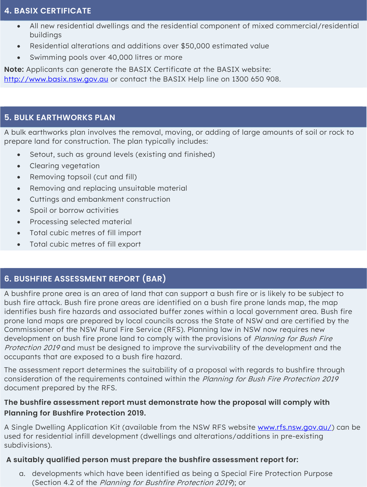

## 4. BASIX CERTIFICATE

A BASIX Certificate identifies the sustainability features required to be incorporated in the building design. These features may include sustainable design elements such as recycled water, rainwater tanks, AAA-rated showerheads and taps, native landscaping, heat pump or solar water heaters, gas space heaters, roof eaves / awnings and wall / ceiling insulation. The applicant must submit the BASIX Certificate with the Development Application or Complying Development Application. The plans and specifications must also identify the BASIX commitments that will be checked by a professional building certifier during construction. It is required for the following categories of development:

> [Picture on page 8: a picture, saved as a picture (images/appendix-b-application-requirements-minor-development-page-8-1.gif, 150 dpi).]
> Words printed on the picture (title and legend, copied from the PDF):
> • All new residential dwellings and the residential component of mixed commercial/residential
> buildings
> • Residential alterations and additions over $50,000 estimated value
> • Swimming pools over 40,000 litres or more
