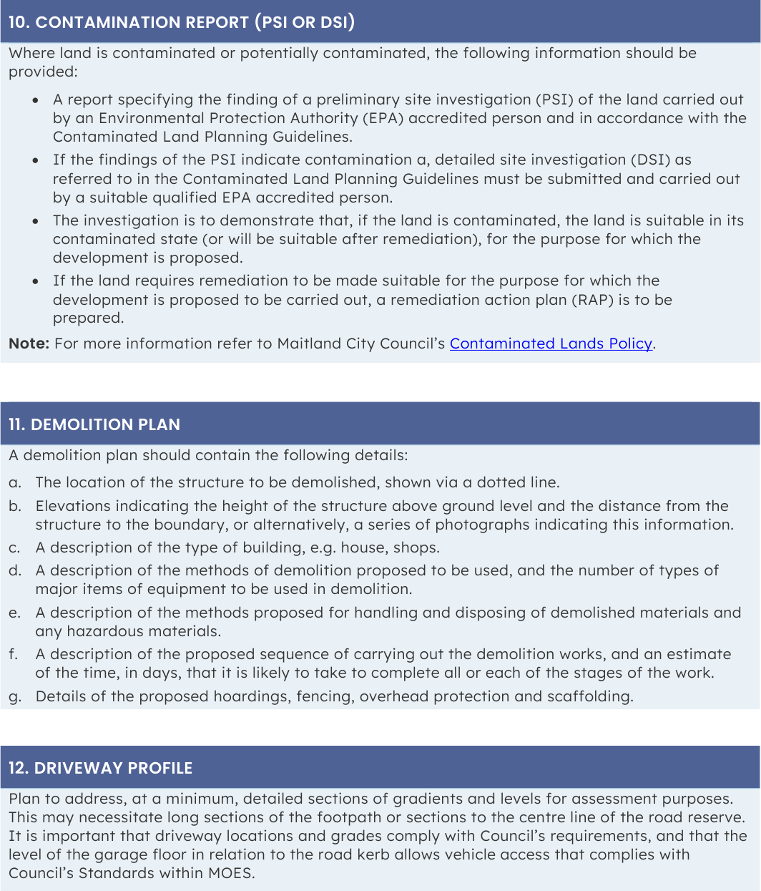

## 9. CONSTRUCTION WASTE MANAGEMENT PLAN

A Construction Waste Management Plan (CWMP) is required to be submitted with every development application which includes physical work, including demolition works and must:

a. the location of sorting area/s onsite where waste will be sorted for disposal or

b. the location of storage area/s where waste, soil, and material stockpiles will be stored

c. the location of a collection area clear of any obstructions,

from the site by weather conditions, such as wind or rain.

> [Picture on page 10: a picture, saved as a picture (images/appendix-b-application-requirements-minor-development-page-10-1.gif, 150 dpi).]
> Words printed on the picture (title and legend, copied from the PDF):
> provided:
> Contaminated Land Planning Guidelines.
> development is proposed.
> prepared.
