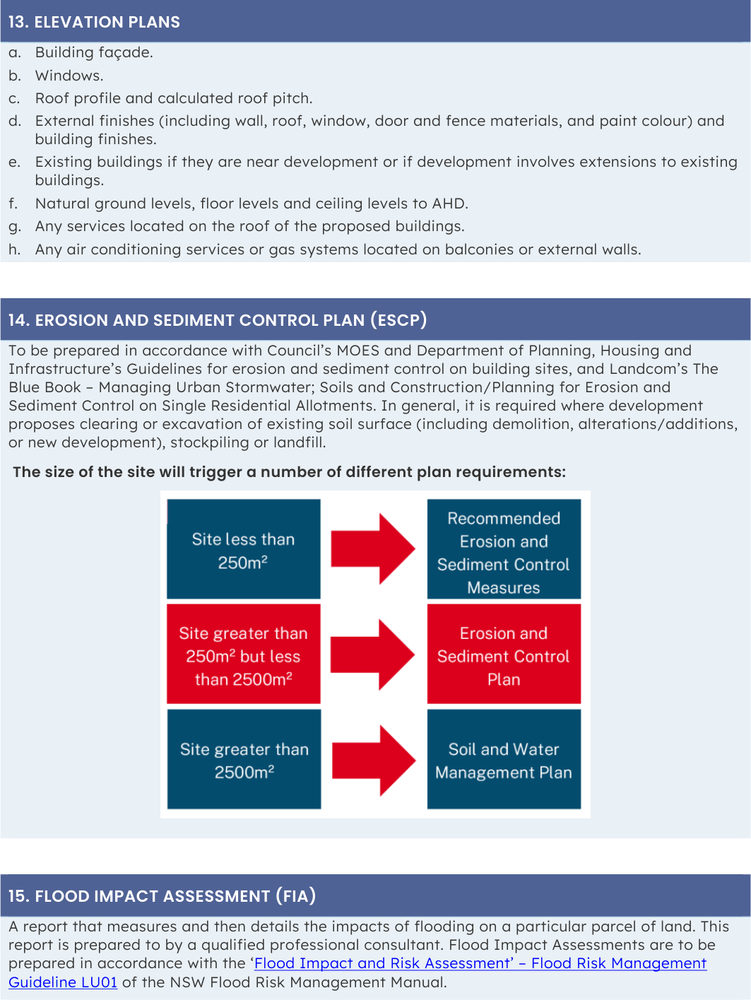

## 13. ELEVATION PLANS

Elevation plans must be provided for all four views of the building labelled with relevant orientation (e.g. north, southwest) and show:

> [Picture on page 11: a picture, saved as a picture (images/appendix-b-application-requirements-minor-development-page-11-1.gif, 150 dpi).]
> Words printed on the picture (title and legend, copied from the PDF):
> building finishes.
> buildings.
