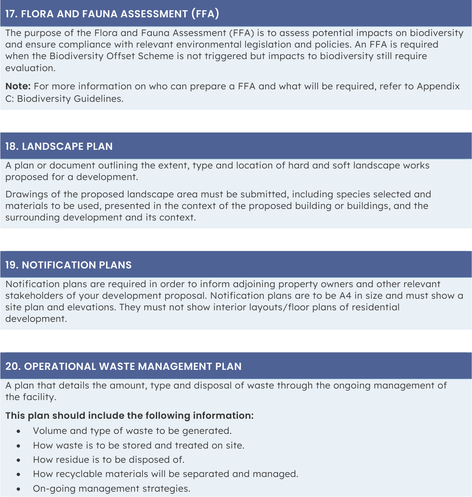

## 16. FLOOR PLANS

Floor plans must show:

a. Room layout and usage.

b. Partitioning.

c. Location of windows and doors.

d. Disabled access where appropriate.

e. Room and courtyard dimensions and areas.

f. The finished ground levels and finished floor levels.

g. BASIX commitments e.g. skylight, rainwater tank.

h. Layout of building, all processes, storage areas, location of machinery, racking layout and

i. Existing and proposed fire safety measures.

j. Shop fitout details. An example of a floor plan is shown in the following figure:

> [Picture on page 13: a picture, saved as a picture (images/appendix-b-application-requirements-minor-development-page-13-1.gif, 150 dpi).]
> Words printed on the picture (title and legend, copied from the PDF):
> C: Biodiversity Guidelines.
