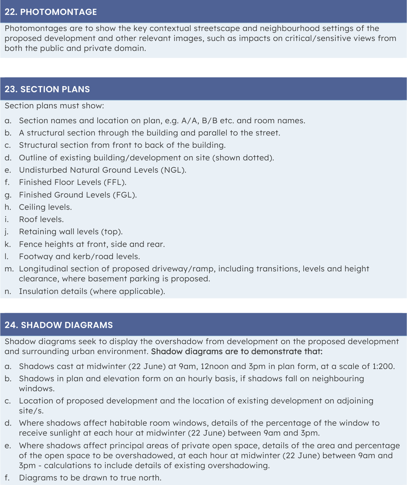

## 21. OWNERS CONSENT

A document providing owner(s) consent of the land to which the development application relates.

> [Picture on page 14: a picture, saved as a picture (images/appendix-b-application-requirements-minor-development-page-14-1.gif, 150 dpi).]
