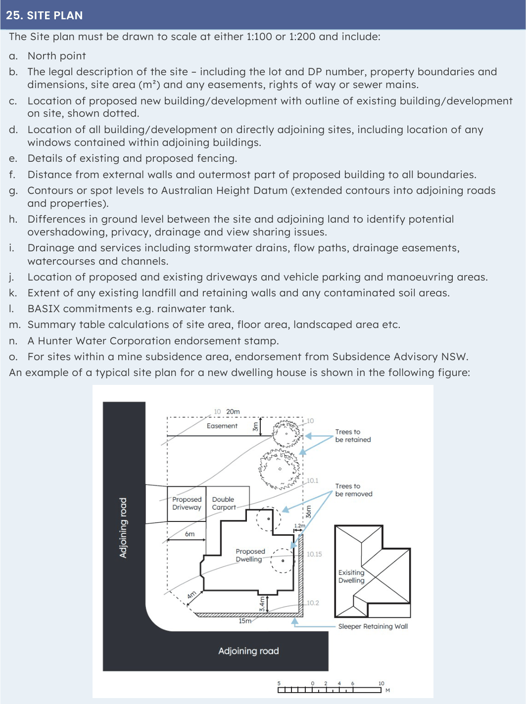

## 24. SHADOW DIAGRAMS

Shadow diagrams seek to display the overshadow from development on the proposed development and surrounding urban environment. Shadow diagrams are to demonstrate that:

a. Shadows cast at midwinter (22 June) at 9am, 12noon and 3pm in plan form, at a scale of 1:200.

b. Shadows in plan and elevation form on an hourly basis, if shadows fall on neighbouring

c. Location of proposed development and the location of existing development on adjoining

d. Where shadows affect habitable room windows, details of the percentage of the window to

receive sunlight at each hour at midwinter (22 June) between 9am and 3pm.

e. Where shadows affect principal areas of private open space, details of the area and percentage

of the open space to be overshadowed, at each hour at midwinter (22 June) between 9am and 3pm - calculations to include details of existing overshadowing.

f. Diagrams to be drawn to true north.

> [Picture on page 15: a picture, saved as a picture (images/appendix-b-application-requirements-minor-development-page-15-1.gif, 150 dpi).]
> Words printed on the picture (title and legend, copied from the PDF):
> on site, shown dotted.
> and properties).
> watercourses and channels.
