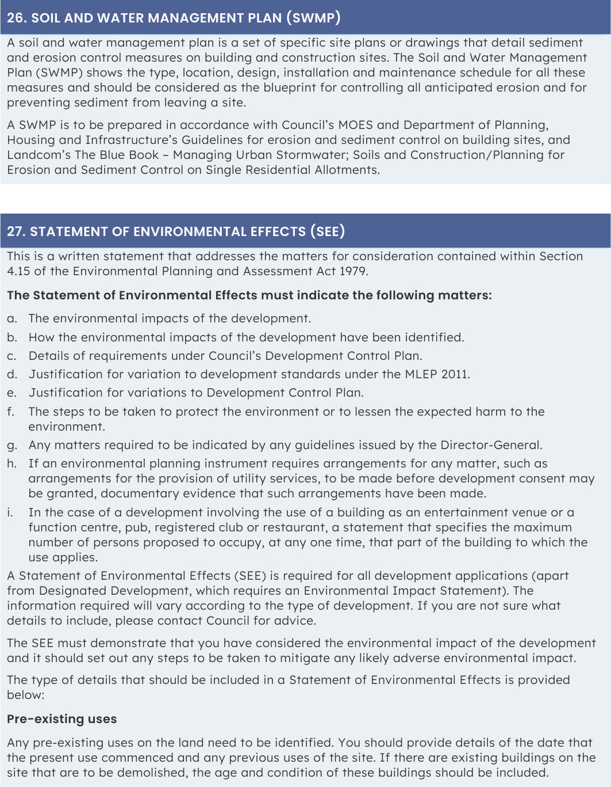

## 25. SITE PLAN

The Site plan must be drawn to scale at either 1:100 or 1:200 and include:

a. North point

b. The legal description of the site – including the lot and DP number, property boundaries and

dimensions, site area (m²) and any easements, rights of way or sewer mains.

c. Location of proposed new building/development with outline of existing building/development

d. Location of all building/development on directly adjoining sites, including location of any

windows contained within adjoining buildings.

e. Details of existing and proposed fencing.

f. Distance from external walls and outermost part of proposed building to all boundaries.

g. Contours or spot levels to Australian Height Datum (extended contours into adjoining roads

h. Differences in ground level between the site and adjoining land to identify potential

overshadowing, privacy, drainage and view sharing issues.

i. Drainage and services including stormwater drains, flow paths, drainage easements,

j. Location of proposed and existing driveways and vehicle parking and manoeuvring areas.

k. Extent of any existing landfill and retaining walls and any contaminated soil areas.

l. BASIX commitments e.g. rainwater tank.

m. Summary table calculations of site area, floor area, landscaped area etc.

n. A Hunter Water Corporation endorsement stamp.

o. For sites within a mine subsidence area, endorsement from Subsidence Advisory NSW. An example of a typical site plan for a new dwelling house is shown in the following figure:

> [Picture on page 16: a picture, saved as a picture (images/appendix-b-application-requirements-minor-development-page-16-1.gif, 150 dpi).]
