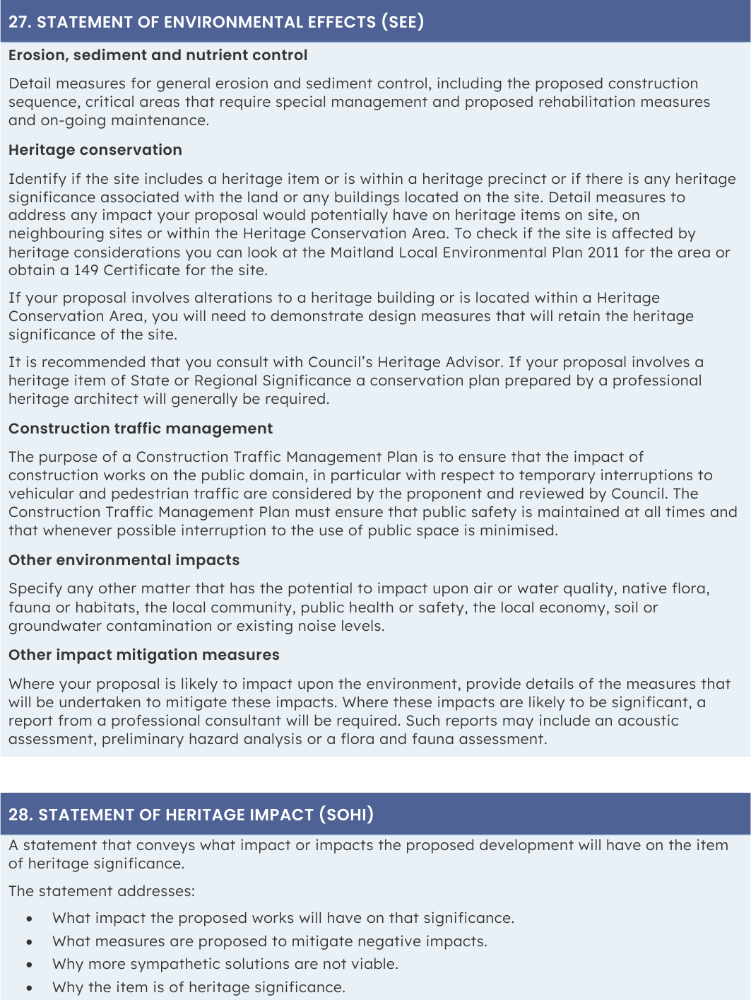

## 27. STATEMENT OF ENVIRONMENTAL EFFECTS (SEE)

#### Operational details

A description of the proposed use is required. This may include:

#### Access and traffic

prepared by a consulting traffic engineer is likely to be required.

#### Utility service and waste

Waste collection, treatment and disposal arrangements need to be identified. Where amplification of utility services is required, details of arrangements/consultation with relevant public authorities

#### Privacy, views and overshadowing

You need to demonstrate how your building/proposal will relate to your neighbours’ buildings. Issues to consider include:

a. visual privacy – positioning of windows, views between living areas and private adjoining

b. acoustic privacy – noise transmission into the development and the need for separation from

noise sources and the need to mitigate noise sources from your proposal.

c. views – impact of the development on views from adjoining properties as well as views from the

d. overshadowing – where overshadowing is possible or likely you should provide diagrams where

the shadows will cast, such diagrams need to be done accurately and properly indicate shadows cast onto walls and windows.

#### Flooding and drainage

Detail how your proposal is compatible with flooding levels and demonstrate that the proposed design will not adversely affect either downstream, or upstream flooding. Council also requires information on the proposed stormwater management controls for water entering, within and leaving the site and where relevant, calculations prepared by a consulting engineer (see

> [Picture on page 18: a picture, saved as a picture (images/appendix-b-application-requirements-minor-development-page-18-1.gif, 150 dpi).]
> Words printed on the picture (title and legend, copied from the PDF):
> and on-going maintenance.
