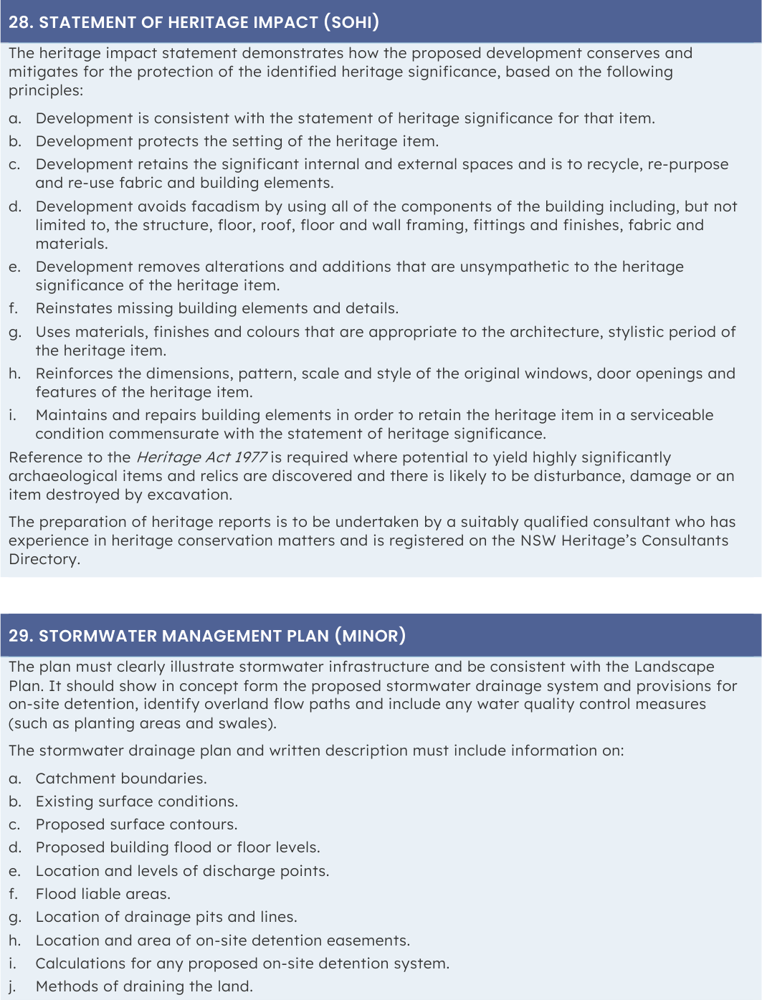

## 28. STATEMENT OF HERITAGE IMPACT (SOHI)

A statement that conveys what impact or impacts the proposed development will have on the item

> [Picture on page 19: a picture, saved as a picture (images/appendix-b-application-requirements-minor-development-page-19-1.gif, 150 dpi).]
> Words printed on the picture (title and legend, copied from the PDF):
> materials.
> the heritage item.
> Directory.
