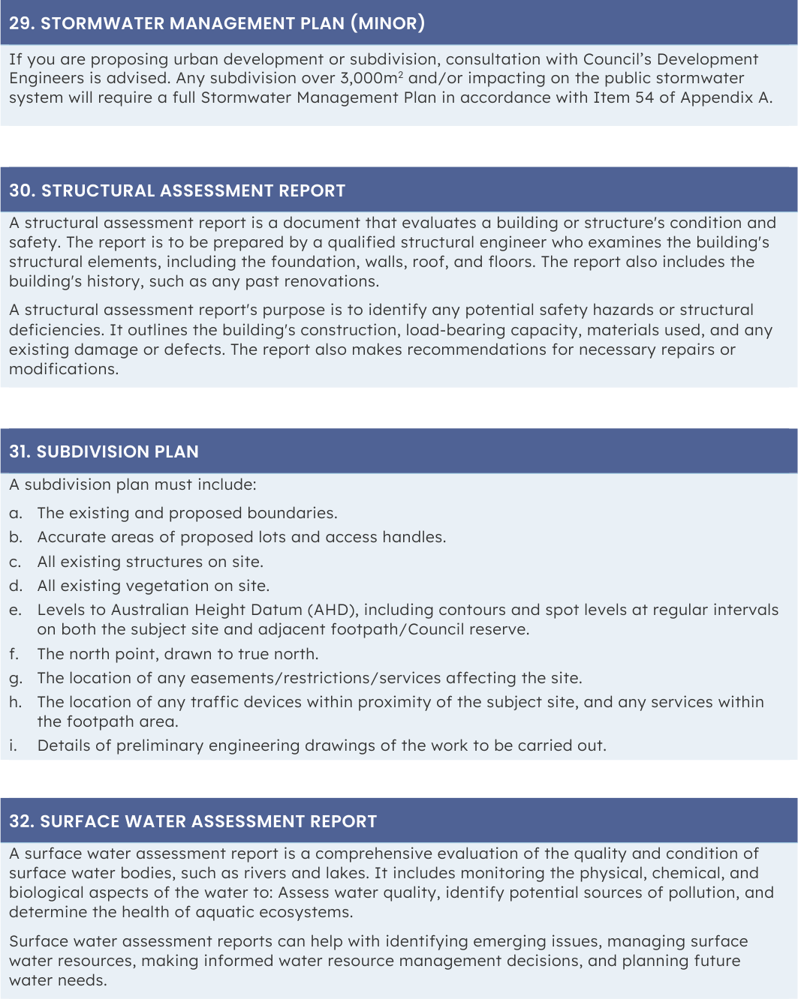

## 29. STORMWATER MANAGEMENT PLAN (MINOR)

The plan must clearly illustrate stormwater infrastructure and be consistent with the Landscape Plan. It should show in concept form the proposed stormwater drainage system and provisions for on-site detention, identify overland flow paths and include any water quality control measures (such as planting areas and swales). The stormwater drainage plan and written description must include information on:

a. Catchment boundaries.

b. Existing surface conditions.

c. Proposed surface contours.

d. Proposed building flood or floor levels.

e. Location and levels of discharge points.

f. Flood liable areas.

g. Location of drainage pits and lines.

h. Location and area of on-site detention easements.

i. Calculations for any proposed on-site detention system.

j. Methods of draining the land.

> [Picture on page 20: a picture, saved as a picture (images/appendix-b-application-requirements-minor-development-page-20-1.gif, 150 dpi).]
