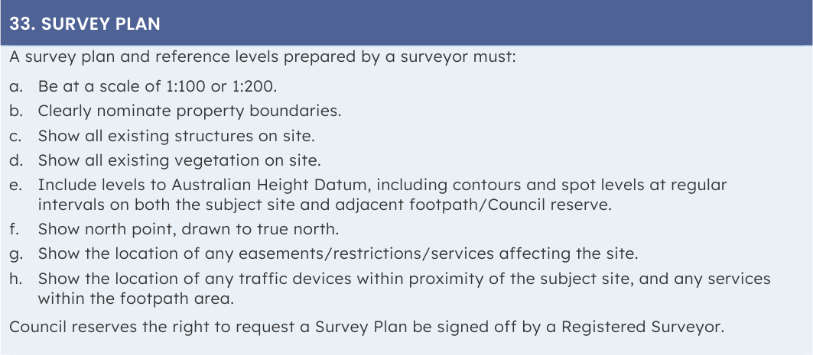

## 32. SURFACE WATER ASSESSMENT REPORT

A surface water assessment report is a comprehensive evaluation of the quality and condition of surface water bodies, such as rivers and lakes. It includes monitoring the physical, chemical, and biological aspects of the water to: Assess water quality, identify potential sources of pollution, and determine the health of aquatic ecosystems. Surface water assessment reports can help with identifying emerging issues, managing surface water resources, making informed water resource management decisions, and planning future

> [Picture on page 21: a picture, saved as a picture (images/appendix-b-application-requirements-minor-development-page-21-1.gif, 150 dpi).]
> Words printed on the picture (title and legend, copied from the PDF):
> within the footpath area.
