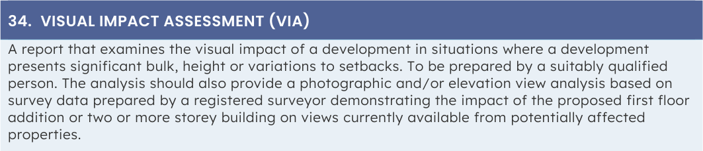

## 33. SURVEY PLAN

A survey plan and reference levels prepared by a surveyor must:

a. Be at a scale of 1:100 or 1:200.

b. Clearly nominate property boundaries.

c. Show all existing structures on site.

d. Show all existing vegetation on site.

e. Include levels to Australian Height Datum, including contours and spot levels at regular

intervals on both the subject site and adjacent footpath/Council reserve.

f. Show north point, drawn to true north.

g. Show the location of any easements/restrictions/services affecting the site.

h. Show the location of any traffic devices within proximity of the subject site, and any services

Council reserves the right to request a Survey Plan be signed off by a Registered Surveyor.

> [Picture on page 21: a picture, saved as a picture (images/appendix-b-application-requirements-minor-development-page-21-14.gif, 150 dpi).]
> Words printed on the picture (title and legend, copied from the PDF):
> properties.
