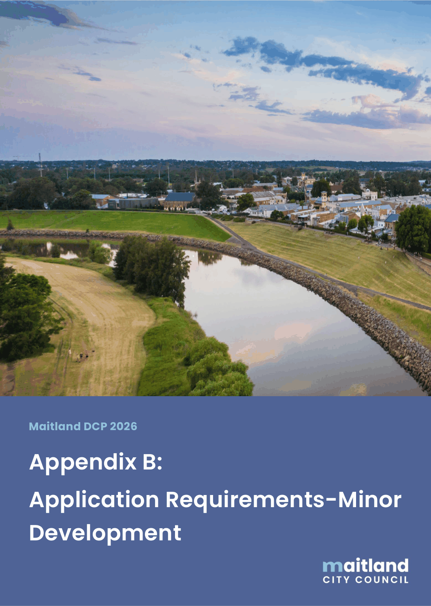
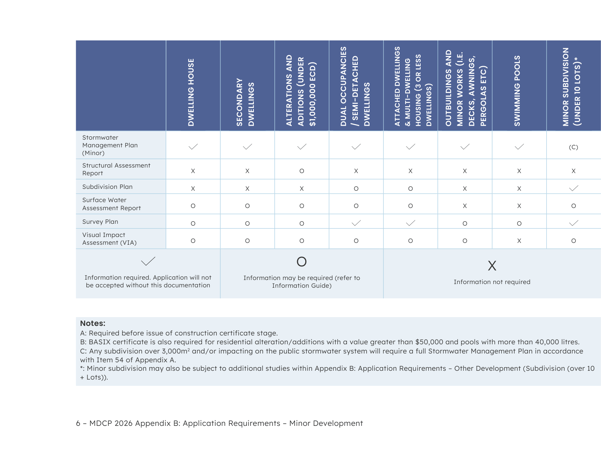
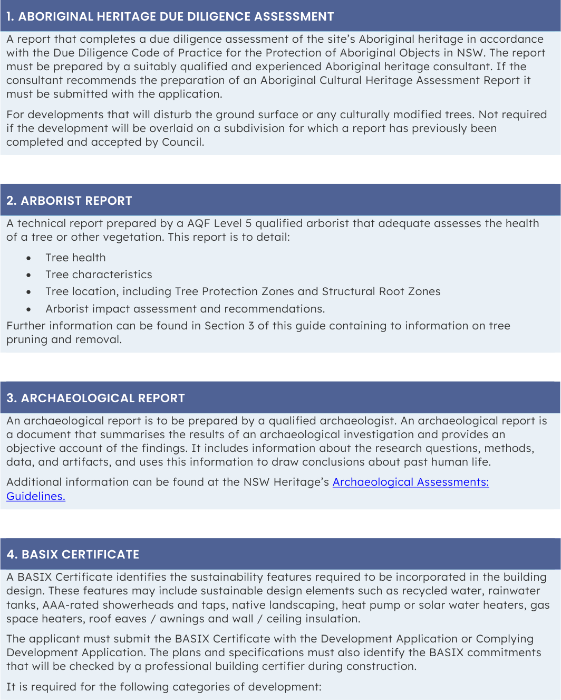

# Maitland Development Control Plan 2026 - Appendix B Application Requirements-Minor Development

> This chapter is split into 41 section file(s), one per numbered heading, in the order they appear in the PDF.

Source PDF: [MDCP 2026 - Appendix B Application Requirements - Minor Development.pdf](https://planfortomorrow.sharepoint.com/sites/Planfortomorrow/Shared%20Documents/00%20NSW-Planning-Resources/dcp/maitland-development-control-plan-2026/appendix-b-application-requirements-minor-development/MDCP%202026%20-%20Appendix%20B%20Application%20Requirements%20-%20Minor%20Development.pdf)

> [Picture on page 1: a picture, saved as a picture (images/appendix-b-application-requirements-minor-development-page-1-1.gif, 150 dpi).]

#### Maitland DCP 2026

### Appendix B: Application Requirements-Minor

### Development

### Table of Contents

Supporting Document Requirements Matrix – Minor Development ............................................3 Supporting Information and Documentation Guide .......................................................................... 7

1\. Aboriginal heritage due diligence assessment ......................................................................................................7

2\. Arborist report ..................................................................................................................................................................7

3\. Archaeological report .....................................................................................................................................................7

4\. BASIX Certificate ............................................................................................................................................................7

5\. Bulk earthworks plan ..................................................................................................................................................... 8

6\. Bushfire assessment report (BAR) ............................................................................................................................ 8

7\. Civil Plans .......................................................................................................................................................................... 9

8\. Colour, Materials and Finishes Schedule ................................................................................................................ 9

9\. Construction Waste Management Plan ................................................................................................................... 9

10\. Contamination Report (PSI or DSI) ..................................................................................................................... 10

11\. Demolition plan ............................................................................................................................................................ 10

12\. Driveway Profile .......................................................................................................................................................... 10

13\. Elevation plans ............................................................................................................................................................ 10

14\. Erosion and Sediment Control Plan (ESCP) ........................................................................................................ 11

15\. Flood Impact Assessment (FIA) ............................................................................................................................. 11

16\. Floor plans .................................................................................................................................................................... 12

17\. Flora and fauna Assessment (FFA) ........................................................................................................................ 13

18\. Landscape plan ............................................................................................................................................................ 13

19\. Notification Plans ........................................................................................................................................................ 13

20\. Operational Waste management plan ................................................................................................................. 13

21\. Owners consent ............................................................................................................................................................ 13

22\. Photomontage ............................................................................................................................................................. 14

23\. Section Plans ................................................................................................................................................................ 14

24\. Shadow Diagrams...................................................................................................................................................... 14

25\. Site plan ......................................................................................................................................................................... 15

26\. Soil and Water Management Plan (SWMP) ....................................................................................................... 16

27\. Statement of Environmental Effects (SEE) ........................................................................................................ 16

28\. Statement of Heritage Impact (SoHI) ................................................................................................................ 18

29\. Stormwater Management Plan (Minor) ............................................................................................................... 19

30\. Structural assessment report ................................................................................................................................. 20

31\. Subdivision plan .......................................................................................................................................................... 20

32\. Surface Water Assessment Report ....................................................................................................................... 20

33\. Survey plan ................................................................................................................................................................... 21

34\. Visual impact assessment (VIA) ........................................................................................................................... 21

### Supporting Document Requirements Matrix – Minor Development

#### Application requirements matrix

This Application Requirement Guideline shows documentation that must or may be provided with your Development Application based on the development type, as demonstrated in the Matrix below. Details on what is to be provided as part of each documentation is provided in the Supporting

Information and Documentation Guide section. Note: Council at its discretion may request additional studies either not being identified under a specific development type or not identified at all within the matrix. This occurrence may be due to the unique elements of a proposed development or its scale and/or size.

#### Further information on development application requirements

The Department of Planning, Housing and Infrastructure (or current equivalent) has prepared an Application Requirements (2022) guideline, for all development applications. This document provides explanation and additional information regarding conditions within the Environmental Planning and Assessment Act 1979 and Environmental Planning and Assessment Regulation 2021 applying to all development. This document should be read in conjunction with Council’s Application Requirements and be considered as a baseline only for supporting information to support development applications.

|  | HOUSE DWELLING | SECONDARY DWELLINGS | AND (UNDER ECD) ALTERATIONS ADITIONS $1,000,000 | OCCUPANCIES SEMI-DETACHED DUAL / DWELLINGS | DWELLINGS MULTI-DWELLING LESS OR ATTACHED & (3 HOUSING DWELLINGS) | AND (I.E. AWNINGS, OUTBUILDINGS WORKS ETC) MINOR DECKS, PERGOLAS | POOLS SWIMMING | SUBDIVISION LOTS)* 10 MINOR (UNDER |
|---|---|---|---|---|---|---|---|---|
| Aboriginal Heritage Due Diligence Assessment | O | O | X | O | O | X | O | O |
| Arborist Report | O | O | O | O | O | O | O | O |
| Archaeological report | X | X | X | X | X | X | O | O |
| BASIX Certificate |  |  | O (B) |  |  | X | O | X |
| Bulk Earthworks Plan |  |  |  |  |  |  |  |  |
| Bushfire Assessment Report (BAR) | O | O | O | O | O | O | O | O |
| Civil Plans |  |  |  |  |  |  |  |  |
| Colour, Materials and Finishes Schedule |  |  |  |  |  | O | X | X |
| Construction Waste Management Plan |  |  |  |  |  |  |  |  |
| Contamination Report (PSI or DSI) | O | O | O | O | O | O | O | O |
| Demolition Plan | O | O | O | O | O | O | O | O |
| Driveway Profile |  | O | X |  |  | X | X | O |
| Elevation Plans |  |  |  |  |  |  | X |  |
| Erosion and Sediment Control Plan (ESCP) (if site is between 250m2 and 2,500m2) | (A) | (A) | (A) | (A) | (A) | (A) | (A) | (A) |

|  | HOUSE DWELLING | SECONDARY DWELLINGS | AND (UNDER ECD) ALTERATIONS ADITIONS $1,000,000 | OCCUPANCIES SEMI-DETACHED DUAL / DWELLINGS | DWELLINGS MULTI-DWELLING LESS OR ATTACHED & (3 HOUSING DWELLINGS) | AND (I.E. AWNINGS, OUTBUILDINGS WORKS ETC) MINOR DECKS, PERGOLAS | POOLS SWIMMING | SUBDIVISION LOTS)* 10 MINOR (UNDER |
|---|---|---|---|---|---|---|---|---|
| Flood Impact Risk Assessment | O | O | O | O | O | O | O | O |
| Floor Plans |  |  |  |  |  |  | O | X |
| Flora and Fauna Assessment (FFA) | O | O | O | O | O | O | O | O |
| Landscape Plan |  |  |  |  |  |  |  |  |
| Notification Plans |  |  |  |  |  |  |  |  |
| Operational Waste Management Plan |  |  |  |  |  | X | X | X |
| Owner(s) Consent |  |  |  |  |  |  |  |  |
| Photomontage | X | X | X | O | O | X | X | O |
| Section Plans |  |  |  |  |  |  | X | X |
| Shadow Diagrams | O | O | O | O | O | X | X | X |
| Site Plan |  |  |  |  |  |  |  |  |
| Soil and Water Management Plan (SWMP) (if site is >2,500m2) | (A) | (A) | (A) | (A) | (A) | (A) | (A) | (A) |
| Statement of Environmental Effects (SEE) |  |  |  |  |  |  |  |  |
| Statement of Heritage Impact (SoHI) | O | O | O | O | O | O | O | O |

> [Picture on page 6: a picture, saved as a picture (images/appendix-b-application-requirements-minor-development-page-6-1.gif, 150 dpi).]
> Words printed on the picture (title and legend, copied from the PDF):
> A: Required before issue of construction certificate stage.
> B: BASIX certificate is also required for residential alteration/additions with a value greater than $50,000 and pools with more than 40,000 litres.
> with Item 54 of Appendix A.
> \*: Minor subdivision may also be subject to additional studies within Appendix B: Application Requirements – Other Development (Subdivision (over 10
> \+ Lots)).

|  | HOUSE DWELLING | SECONDARY DWELLINGS | AND (UNDER ECD) ALTERATIONS ADITIONS $1,000,000 | OCCUPANCIES SEMI-DETACHED DUAL / DWELLINGS | DWELLINGS MULTI-DWELLING LESS OR ATTACHED & (3 HOUSING DWELLINGS) | AND (I.E. AWNINGS, OUTBUILDINGS WORKS ETC) MINOR DECKS, PERGOLAS | POOLS SWIMMING | SUBDIVISION LOTS)* 10 MINOR (UNDER |
|---|---|---|---|---|---|---|---|---|
| Stormwater Management Plan (Minor) |  |  |  |  |  |  |  | (C) |
| Structural Assessment Report | X | X | O | X | X | X | X | X |
| Subdivision Plan | X | X | X | O | O | X | X |  |
| Surface Water Assessment Report | O | O | O | O | O | X | X | O |
| Survey Plan | O | O | O |  |  | O | O |  |
| Visual Impact Assessment (VIA) | O | O | O | O | O | O | X | O |
| Information required. Application will not be accepted without this documentation |  | O Information may be required (refer to Information Guide) |  |  | X Information not required |  |  |  |

#### Notes:

C: Any subdivision over 3,000m2 and/or impacting on the public stormwater system will require a full Stormwater Management Plan in accordance

### Supporting Information and Documentation Guide

> [Picture on page 7: a picture, saved as a picture (images/appendix-b-application-requirements-minor-development-page-7-2.gif, 150 dpi).]

<!-- sections -->
## Sections

1. [1 ABORIGINAL HERITAGE DUE DILIGENCE ASSESSMENT](01-aboriginal-heritage-due-diligence.md)
2. [2 ARBORIST REPORT](02-arborist-report.md)
3. [3 ARCHAEOLOGICAL REPORT](03-archaeological-report.md)
4. [4 BASIX CERTIFICATE](04-basix-certificate.md)
5. [4 BASIX CERTIFICATE](05-4-basix-certificate.md)
6. [5 BULK EARTHWORKS PLAN](06-5-bulk-earthworks-plan.md)
7. [6 BUSHFIRE ASSESSMENT REPORT (BAR)](07-6-bushfire-assessment-report-bar.md)
8. [6 BUSHFIRE ASSESSMENT REPORT (BAR)](08-6-bushfire-assessment-report-bar.md)
9. [7 CIVIL PLANS](09-7-civil-plans.md)
10. [8 COLOUR, MATERIALS AND FINISHES SCHEDULE](10-8-colour-materials-and-finishes-schedule.md)
11. [9 CONSTRUCTION WASTE MANAGEMENT PLAN](11-9-construction-waste-management-plan.md)
12. [10 CONTAMINATION REPORT (PSI OR DSI)](12-10-contamination-report-psi-or-dsi.md)
13. [11 DEMOLITION PLAN](13-11-demolition-plan.md)
14. [12 DRIVEWAY PROFILE](14-12-driveway-profile.md)
15. [13 ELEVATION PLANS](15-13-elevation-plans.md)
16. [13 ELEVATION PLANS](16-13-elevation-plans.md)
17. [14 EROSION AND SEDIMENT CONTROL PLAN (ESCP)](17-14-erosion-and-sediment-control-plan-escp.md)
18. [15 FLOOD IMPACT ASSESSMENT (FIA)](18-15-flood-impact-assessment-fia.md)
19. [16 FLOOR PLANS](19-16-floor-plans.md)
20. [17 FLORA AND FAUNA ASSESSMENT (FFA)](20-17-flora-and-fauna-assessment-ffa.md)
21. [18 LANDSCAPE PLAN](21-18-landscape-plan.md)
22. [19 NOTIFICATION PLANS](22-19-notification-plans.md)
23. [20 OPERATIONAL WASTE MANAGEMENT PLAN](23-20-operational-waste-management-plan.md)
24. [21 OWNERS CONSENT](24-21-owners-consent.md)
25. [22 PHOTOMONTAGE](25-22-photomontage.md)
26. [23 SECTION PLANS](26-23-section-plans.md)
27. [24 SHADOW DIAGRAMS](27-24-shadow-diagrams.md)
28. [25 SITE PLAN](28-25-site-plan.md)
29. [26 SOIL AND WATER MANAGEMENT PLAN (SWMP)](29-26-soil-and-water-management-plan-swmp.md)
30. [27 STATEMENT OF ENVIRONMENTAL EFFECTS (SEE)](30-27-statement-of-environmental-effects-see.md)
31. [27 STATEMENT OF ENVIRONMENTAL EFFECTS (SEE)](31-27-statement-of-environmental-effects-see.md)
32. [27 STATEMENT OF ENVIRONMENTAL EFFECTS (SEE)](32-27-statement-of-environmental-effects-see.md)
33. [28 STATEMENT OF HERITAGE IMPACT (SOHI)](33-28-statement-of-heritage-impact-sohi.md)
34. [28 STATEMENT OF HERITAGE IMPACT (SOHI)](34-28-statement-of-heritage-impact-sohi.md)
35. [29 STORMWATER MANAGEMENT PLAN (MINOR)](35-29-stormwater-management-plan-minor.md)
36. [29 STORMWATER MANAGEMENT PLAN (MINOR)](36-29-stormwater-management-plan-minor.md)
37. [30 STRUCTURAL ASSESSMENT REPORT](37-30-structural-assessment-report.md)
38. [31 SUBDIVISION PLAN](38-31-subdivision-plan.md)
39. [32 SURFACE WATER ASSESSMENT REPORT](39-32-surface-water-assessment-report.md)
40. [33 SURVEY PLAN](40-33-survey-plan.md)
41. [34 VISUAL IMPACT ASSESSMENT (VIA)](41-34-visual-impact-assessment-via.md)
