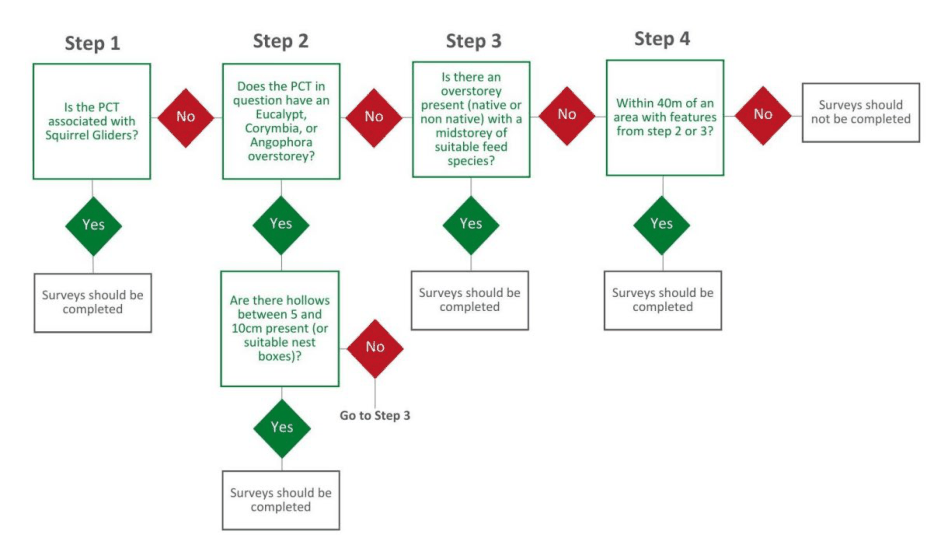
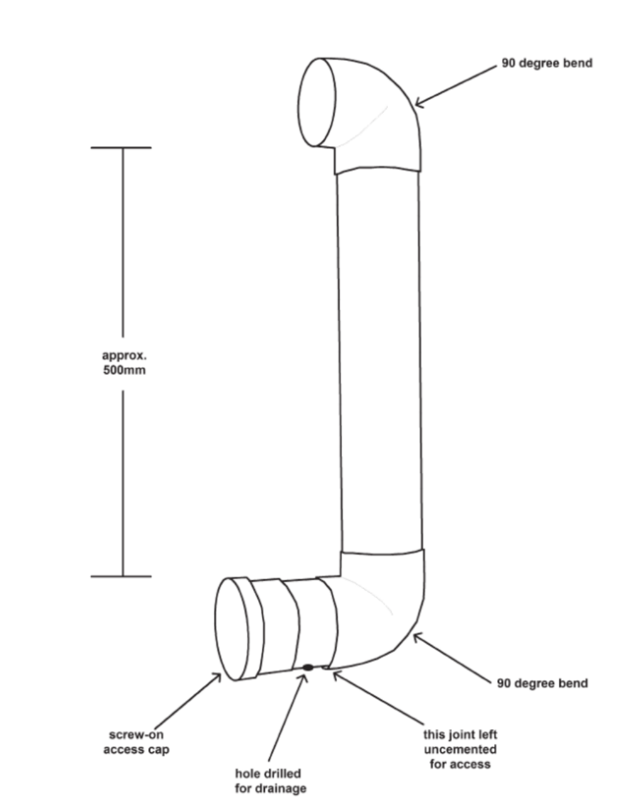

## 4. Squirrel Glider Assessment Considerations

The squirrel glider is listed as a threatened (vulnerable) species under the NSW Biodiversity Conservation Act 2016. This species is commonly found in Maitland’s urban growth areas and is particularly vulnerable to the impacts of urban development, including habitat loss, degradation, and fragmentation. This section of the guidelines outlines special requirements for squirrel glider assessment and impact mitigation. These guidelines are intended to supplement, rather than override, any statutory requirements or approved guidelines. All relevant legal obligations, including those outlined in the NSW Biodiversity Conservation Act 2016 and other applicable regulations, must be adhered to. In cases where these guidelines may conflict with statutory requirements, the statutory requirements take precedence.

### 4.1. Targeted survey requirements

Targeted surveys for squirrel glider must be completed where suitable habitat is available on or adjacent to the study site, regardless of Plant Community Type. The flow chart in Figure 1 has been developed to make this determination and should be addressed within the Flora and Fauna Assessment or Biodiversity Development Assessment Report.

> [Picture on page 15: a picture, saved as a picture (images/appendix-c-biodiversity-guidelines-page-15-1.gif, 150 dpi).]

#### Figure 1: Flow chart used to determine survey requirements for Squirrel Gliders

When targeted surveys are required, the following minimum survey effort must be met:

• Remote camera trapping must be conducted for a minimum of four (4) weeks, with cameras checked

and baits replaced every two (2) weeks. For areas of one hectare or less, a minimum of four (4) traps should be deployed. An additional two cameras should be installed for every additional hectare of habitat.

• Active trapping is recommended as a supplement to camera trapping, using either Elliot traps or

pipe traps (see Figure 2). Six (6) arboreal traps should be installed per hectare of suitable vegetation, with each trap placed on a separate tree containing an appropriate hollow. The traps should remain in place for four (4) consecutive nights and be checked within one hour of dawn to allow for the prompt assessment and release of any captured gliders.

### 4.2. Determining a significant localised impact

Where squirrel gliders have been detected on site, a significant localised impact is assumed under the following circumstances:

• The extent of clearing will create a connectivity gap in native vegetation which is considered an unpassable barrier to squirrel glider, or

• Hollow-bearing trees within a patch of vegetation is reduced to fewer than four (4) per hectare, or

• An existing connectivity corridor is narrowed to less than 60 meters in width. If a significant localised impact is determined, appropriate avoid and minimise measures must be implemented to reduce the impact to an acceptable level.

Determining a significant localised impact on squirrel gliders under these guidelines does not exempt the need to assess whether a 'significant impact' occurs under Part 5 of the NSW Environmental Planning & Assessment Act 1979, or any other applicable legislation or statutory frameworks.

> [Picture on page 16: a picture, saved as a picture (images/appendix-c-biodiversity-guidelines-page-16-1.gif, 150 dpi).]

#### Figure 2: Pipe trap design (Winning and King, 2007)

Source: Winning G. King J. (2007) A new trap design for capturing squirrel gliders and sugar gliders. Australian

Mammalogy 29, 245-249.

> [Picture on page 17, not reproduced as text; see the original PDF.]
> Words on this picture, read by OCR (may contain errors): m maitland CITY COUNCIL
