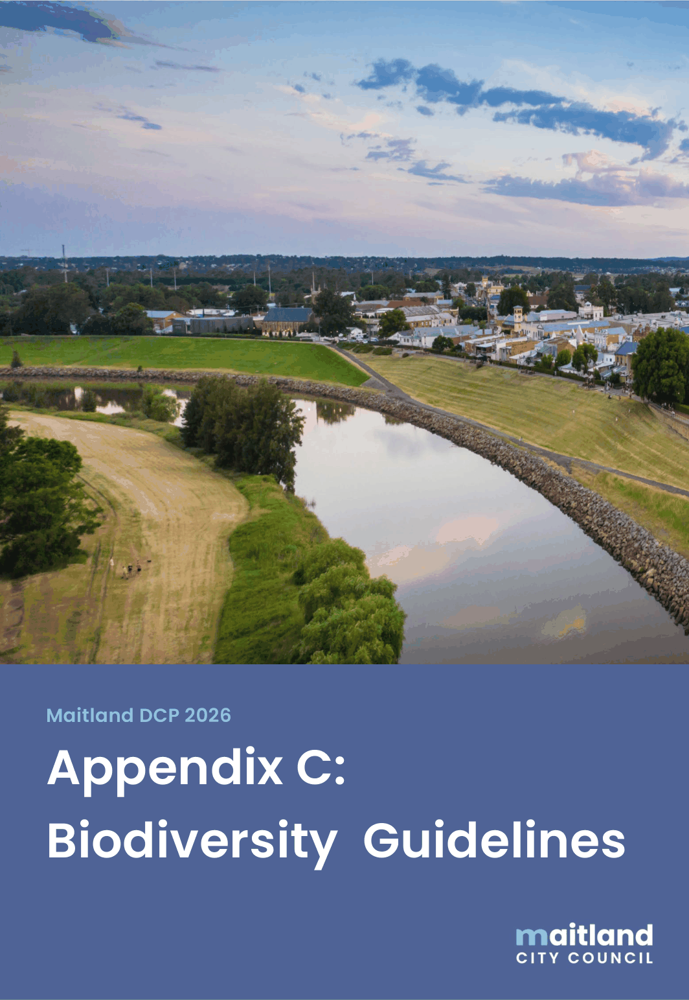

# Maitland Development Control Plan 2026 - Appendix C Biodiversity Guidelines

> This chapter is split into 4 section file(s), one per numbered heading, in the order they appear in the PDF.

Source PDF: [MDCP 2026 - Appendix C Biodiversity Guidelines.pdf](MDCP%202026%20-%20Appendix%20C%20Biodiversity%20Guidelines.pdf)

> [Picture on page 1: a picture, saved as a picture (images/appendix-c-biodiversity-guidelines-page-1-1.gif, 150 dpi).]

### Maitland DCP 2026

### Appendix C:

### Biodiversity Guidelines

> The PDF's contents list (page numbers of the printed document) is not repeated here - see Sections below.

1\. Flora and Fauna Assessments .................................................................................................. 3 1.1. When is a Flora and Fauna Assessment required? .......................................................................... 3 1.2. Who can prepare a Flora and Fauna Assessment? ........................................................................ 3 1.3. What should the report include? ............................................................................................................ 4 1.3.1. Site Summary ............................................................................................................................................ 4 1.3.2. Summary of the Proposal ..................................................................................................................... 4 1.3.3. Survey Methodology ............................................................................................................................... 4 1.3.4. Survey Results .......................................................................................................................................... 5 1.3.5. Assessment of Impacts ......................................................................................................................... 5 1.3.6. Reducing Impacts ................................................................................................................................... 6 1.3.7. Conclusion .................................................................................................................................................. 6

2\. Vegetation Management Plans ............................................................................................... 6 2.1. When is a VMP required? ......................................................................................................................... 6 2.2. Who can prepare a VMP? ........................................................................................................................ 7 2.3. What should the VMP include? .............................................................................................................. 7 2.4. Site Description .......................................................................................................................................... 7 2.5. Aims and Objectives ................................................................................................................................. 7 2.6. Management Zones................................................................................................................................... 7 2.7. Management Actions ................................................................................................................................ 8 2.8. Performance Criteria and Monitoring ................................................................................................. 8 2.9. Costing ........................................................................................................................................................... 9

3\. Biodiversity Management Plans .............................................................................................. 9 3.1. When is a BMP required? ......................................................................................................................... 9 3.2. Who can prepare a BMP? ........................................................................................................................ 9 3.3. What should the BMP include?............................................................................................................... 9 3.4. Minimum Requirements ......................................................................................................................... 10 3.5. Site-specific Requirements ................................................................................................................... 10

4\. Squirrel Glider Assessment Considerations ....................................................................... 14 4.1. Targeted survey requirements ............................................................................................................. 14 4.2. Determining a significant localised impact .................................................................................... 15

| VERSION | DATE ADOPTED | CHANGES |
|---|---|---|
| 1.0 |  | New DCP Appendix |

### Introduction

The Biodiversity Guidelines (this Guideline) have been developed to support Chapter 2: Environmental Considerations, Appendix A: Application Requirements – Other Development, and Appendix B: Application Requirements – Minor Development of the Maitland Development Control Plan 2026 (DCP). The Guideline provides supporting explanatory information and guidance for a series of different assessments and plans required by Council for a series of biodiversity and conservation matters throughout the Maitland Local Government Area (LGA). In summary, these are:

• Flora and Fauna Assessments

• Vegetation Management Plans

• Biodiversity Management Plans

• Squirrel Glider Assessment Considerations

<!-- sections -->
## Sections

1. [1 Flora and Fauna Assessments](01-flora-and-fauna-assessments.md)
2. [2 Vegetation Management Plans](02-vegetation-management-plans.md)
3. [3 Biodiversity Management Plans](03-biodiversity-management-plans.md)
4. [4 Squirrel Glider Assessment Considerations](04-squirrel-glider-assessment.md)
