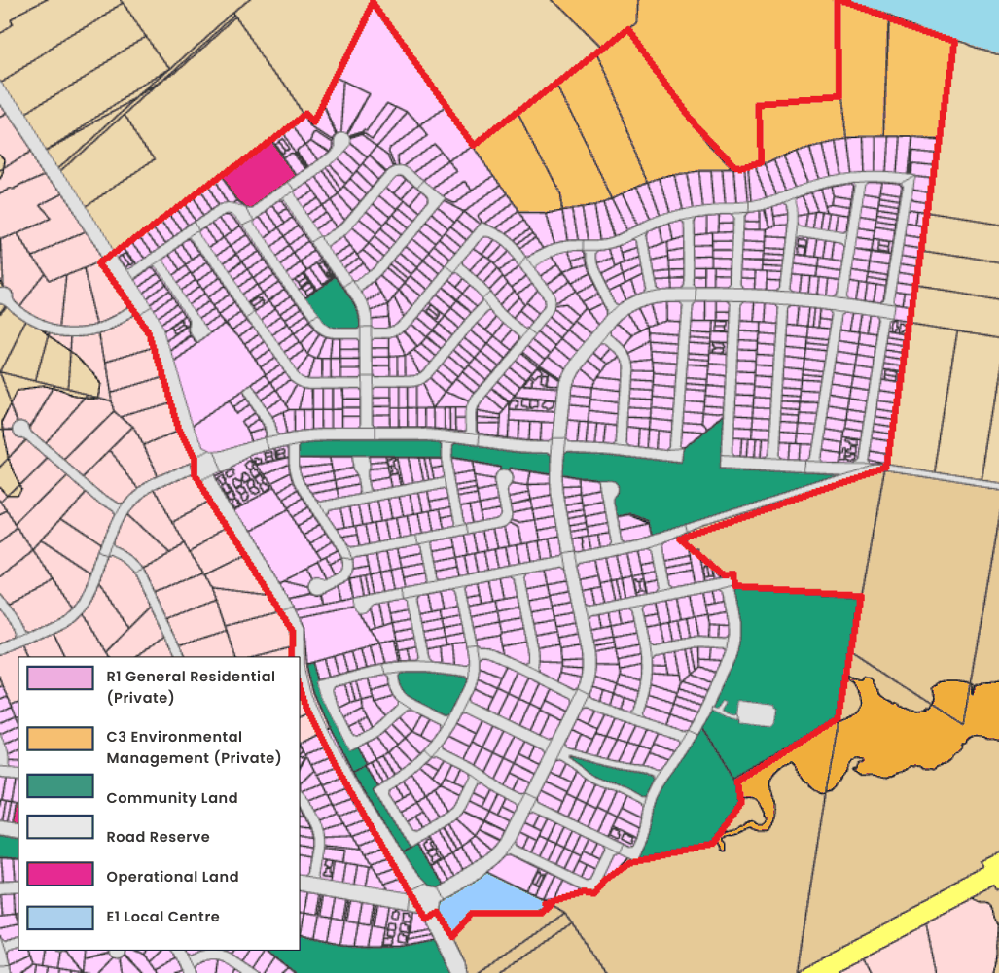
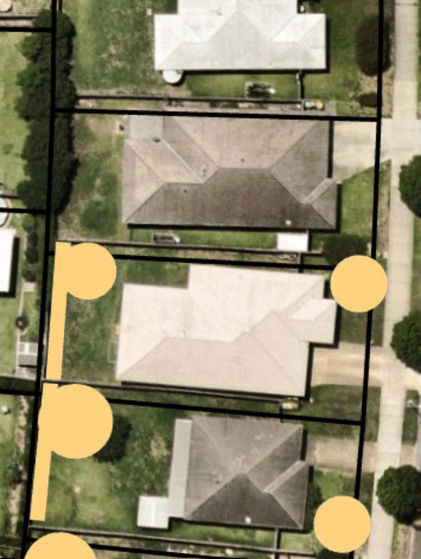
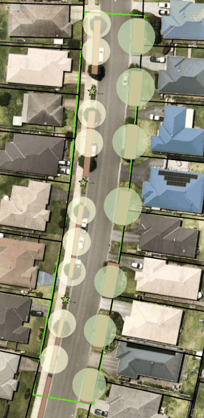

## 4. Achieving 30% Canopy Cover in Urban Areas

While land use distributions vary, the following scenario is typical for new urban residential areas such as Aberglasslyn (Figure 1). Modelling indicates that achieving over 30% canopy cover is possible, as demonstrated in Table 3. This analysis is also consistent with case studies outlined in the NSW Department of Planning, Industry and Environment (2021) Urban Tree Canopy Targets and Development Controls Report. Figure 2 illustrates a typical residential road cross-section designed to achieve 50% canopy cover, highlighting the spatial arrangement and tree planting strategy that may be used to meet this canopy target. Figure 3 depicts a typical canopy cover scenario for a residential lot with an estimated canopy cover of 18-20%, showing the tree planting configuration and space allocation required to achieve this level of cover. In this scenario, it is assumed that a hedge is included along most back fences for dwellings to support the canopy cover.

> [Picture on page 4: a picture, saved as a picture (images/appendix-d-canopy-cover-guidelines-page-4-13.gif, 150 dpi).]
> Words printed on the picture (title and legend, copied from the PDF):
> R1 General Residential
> (Private)
> C3 Environmental
> Management (Private)
> Community Land
> Road Reserve
> Operational Land
> E1 Local Centre

#### Figure 1: Typical Urban Land Classification – Aberglasslyn

#### Table 5: Modelled 30% Canopy Cover Scenario for Aberglasslyn

| LAND TYPE | AREA (M²) | % OF LAND AREA | TARGET COVER % | CANOPY CONTRIBUTION | REFERENCE |
|---|---|---|---|---|---|
| Public Open Space (Community Land) | 142,666 | 10.6% | 40% | 4.2% | Table 2 |
| E1 Local Centre | 8,582 | 0.6% | 0%*, car park plantings required | 0% | - |
| R1 General Residential (Private) | 756,437 | 56.4% | 18% | 10.2% | Table 3 |
| C3 Environment Management (Private) | 119,550 | 8.9% | 50% | 4.5% | Table 3 |
| Road Reserve | 314,730 | 23.5% | 50% | 11.8% | Table 1 |
| Total | 1,341,965 | 100% | - | 30.7% | – |

> [Picture on page 5: a picture, saved as a picture (images/appendix-d-canopy-cover-guidelines-page-5-3.gif, 150 dpi).]

> [Picture on page 5: a picture, saved as a picture (images/appendix-d-canopy-cover-guidelines-page-5-4.gif, 150 dpi).]

#### Figure 3: Typical Canopy Cover Scenario for Residential Lot

#### Figure 2: Typical Residential Road

(18–20%)

#### Scenario Achieving 50% Canopy Cover
