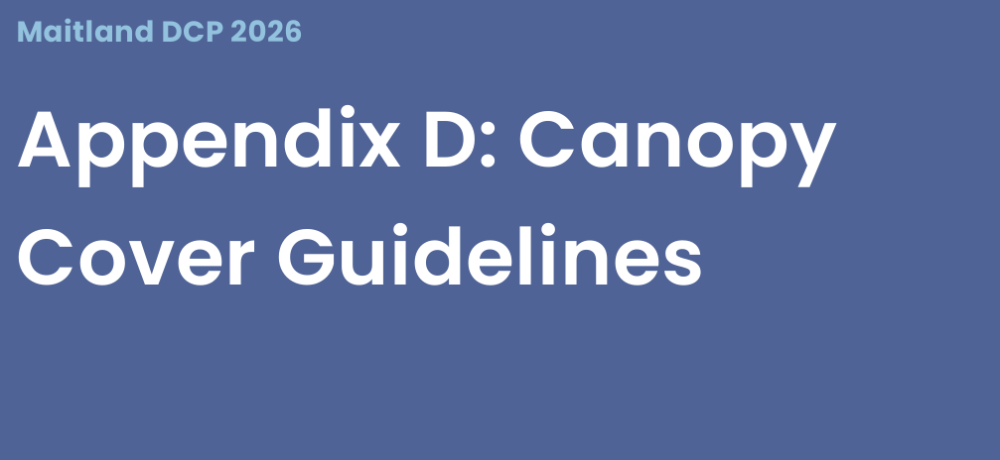

# Maitland Development Control Plan 2026 - Appendix D Canopy Cover Guidelines

> This chapter is split into 5 section file(s), one per numbered heading, in the order they appear in the PDF.

Source PDF: [MDCP 2026 - Appendix D Canopy Cover Guidelines.pdf](https://planfortomorrow.sharepoint.com/sites/Planfortomorrow/Shared%20Documents/00%20NSW-Planning-Resources/dcp/maitland-development-control-plan-2026/appendix-d-canopy-cover-guidelines/MDCP%202026%20-%20Appendix%20D%20Canopy%20Cover%20Guidelines.pdf)

> [Picture on page 1: a picture, saved as a picture (images/appendix-d-canopy-cover-guidelines-page-1-1.gif, 150 dpi).]

### Maitland DCP 2026

### Appendix D: Canopy

### Cover Guidelines

<!-- sections -->
## Sections

1. [1 Strategic Context](01-strategic-context.md)
2. [2 Importance of Public Domain Canopy](02-importance-of-public-domain-canopy.md)
3. [3 Canopy Cover Targets by Land Use](03-canopy-cover-targets-by-land-use.md)
4. [4 Achieving 30% Canopy Cover in Urban Areas](04-achieving-30-canopy-cover-in-urban-areas.md)
5. [5 Implementation Guidance](05-implementation-guidance.md)
