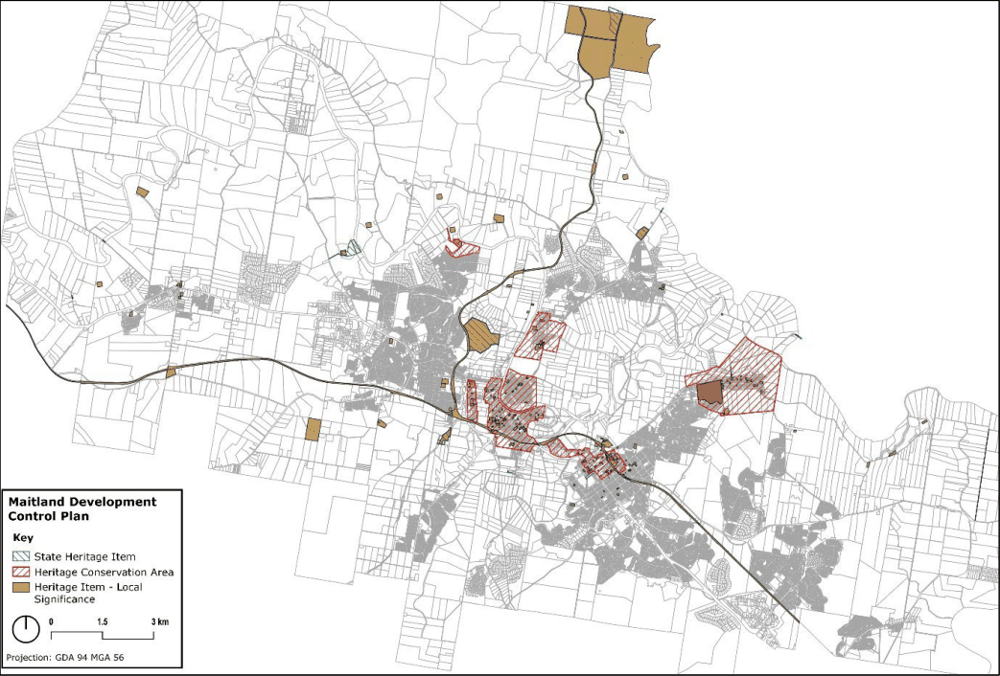

### 1.3. Legislation and other guiding documents

Heritage legislation in Australia and NSW regulates the conservation and development of heritage at national, state and local levels. Some heritage places, items or areas may have significance to the nation, while other places may have significance to the state, or within a local area. The following legislation broadly applies:

• The Environmental Protection and Biodiversity and Conservation Act 1999 (Commonwealth) regulates

matters of World, National and Commonwealth heritage values.

• The NSW Government’s Heritage Act 1977 conserves the state’s heritage through the SHR and

provides for the protection and regulation of archaeological relics.

• The Environmental Planning and Assessment Act 1979 (EPA Act) in New South Wales regulates the

conservation, management and development of Aboriginal, built and cultural heritage.

• The National Parks and Wildlife Act 1974 provides the framework for the conservation of natural,

cultural, and Aboriginal heritage within New South Wales, directly governing care and management of natural environments and First Nations cultural places, objects, and artefacts of significance. Heritage items and heritage conservation areas are identified under:

• The National Heritage List

• The Commonwealth Heritage List

• The Stage Heritage Register

• Schedule 5 of local environmental plans (such as the MLEP 2011)

• Section 170 of the Heritage Act 1977; and

• Non-statutory heritage lists (such as the National Trust Register). In addition, Chapter 4: Heritage of the Maitland DCP 2026 has been prepared based on the best-practice management guidelines for conservation of heritage items and heritage conservation areas in NSW. These include:

• The Burra Charter

• The Conservation Plan: A Guide to the Preparation of Conservation Plans for Places of European

Cultural Significance

• Assessing Heritage Significance: Guidelines for Assessing Places and Objects Against the Heritage

Council of NSW Criteria (assessing heritage significance guidelines)

• Guidelines for Preparing a Statement of Heritage Impact

• NSW Government Architect and Heritage Council of NSW’s Better Placed: Design Guide for Heritage

(Better Placed guidelines).

> [Picture on page 4: a picture, saved as a picture (images/appendix-e-heritage-guidelines-page-4-18.gif, 150 dpi).]

#### Figure 1: Heritage Items and Heritage Conservation Areas in the Maitland LGA.
