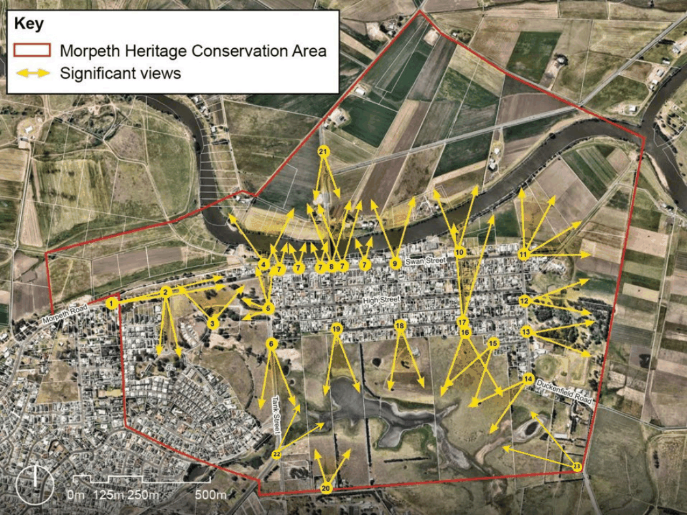
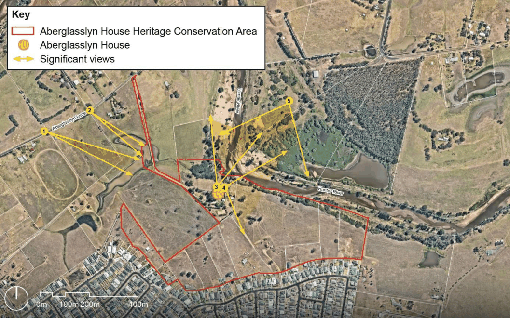

### 1.6. Heritage Conservation Areas

Heritage Conservation Areas (HCAs) are streetscapes, suburbs, areas, landscapes and precincts that are recognised by a community for their distinctive historic character. They often provide evidence of a particular historical period of development and/or a distinct architectural style, and generally have a high proportion of original buildings. HCAs are protected because they create a cohesive sense of place and character that is valued by the community. More than a cohesive group of buildings and a distinctive landscape setting, HCAs have a special character and sense of place that is assessed as being of significance to current and future generations. Important elements that contribute to the heritage significance and character of a HCA may include:

• a historic town plan

• historic subdivision patterns

• historic buildings demonstrating architectural styles and periods

• harmonious building forms, scales, siting, heights and materials

• public and private landscapes, including parks and gardens and historic landscape elements

• a mix of land uses reflecting a particular period in the growth and development of an area

• characteristic elements such as monuments and moveable heritage items

• a cohesive character and streetscape. Maitland’s HCAs are situated on the floodplain of the Hunter River, which has a rural open character. Each heritage conservation area in Maitland has a distinctive character and heritage significance.

#### 1.6.1. Bolwarra Heritage Conservation Area

The heritage significance of the Bolwarra Heritage Conservation Area is attributed to its historic, social, aesthetic, and technical values related to the residential core of the suburb and its broader floodplain landscape. The suburb retains evidence of the place’s early nineteenth century settlement,

subsequent subdivisions, economic, social, and agricultural history, and technical advancements regarding flood mitigation. Many properties are of aesthetic significance, as is the overall setting of the suburb. The HCA sits on the original subdivision of Bolwarra House Estate and its farm. Bolwarra Farm was referred to from the 1820s for its beauty and economic value, its hops and tobacco reputedly the best the colony had produced. The timber and soil on this part of the Estate was equally held in the highest esteem, the latter directly driving settlement on and agrarian use of this landscape from the early nineteenth century. A subdivision of the Bolwarra Estate in 1847 resulted in the development of lots east of Paterson Road, measuring mostly between 18 and 55 acres. West of Paterson Road, a more irregular allotment subdivision occurred, in the vicinity of Bolwarra House. By 1876, Westbourne Road and the southern arm of Kensington Road had been laid out, as had part of Bayswater Road. These streets likely formed part of the original accessways for Bolwarra House. Various properties through the Bolwarra residential core, farms on the abutting floodplain and embankment design are living records of historic land use and development on the northern side of the Hunter River, this history integral to the growth and workings of abutting commercial ‘hubs’, like Maitland, and the use of the Hunter River for commercial transport. With the exception of a handful of properties, the majority of residential Bolwarra is situated to the west of Paterson Road, on a roughly rectangular spur of land above the floodplain. These lands were owned in 1876 by Messrs. Price, Vickery, Bowden, Meyer, and Ferris. These estates are known as the “gentlemen’s houses”. Due to the retention of much of the nineteenth century street pattern west of Paterson Road, and the Paterson Road alignment itself, some of the early subdivision history of the suburb remains identifiable. This interpretability is assisted by being able to identify the relatively defined edges of Bolwarra, principally from the floodplain, on Ekert Lane, Flat Road and from Oakhampton Road to the west. Bolwarra has changed markedly since the 1955 flood, after which substantial further residential subdivision and development occurred. That development has neither been uniform in scale or style, with the prevailing nineteenth and early twentieth century timber clad properties ceasing to be constructed. Additionally, residential development has been denser, on smaller lots, which is evident along Paterson Road, Victoria Street and Canna Street, alongside the post 1970s streets within the old Victorian area of the village. The urban setting starts and stops abruptly at the northern and southern inclines to the town, each approach being a narrow carriageway through open rural landscape. In the south, the town edge is marked by magnificent trees, including a large Bunyah Pine. In the north, an attractive bend in the road marks the entrance to the town. The Paterson Street arterial corridor skirts the eastern side of the core of Bolwarra and is separated from it by some distance courtesy of the large Maitland Road lagoon, an appreciation of the character of Bolwarra’s residential streets and the setting of its building stock is rather hidden by dense landscaping and traffic from and to West Maitland. Whilst not principally of a commercial nature, the section of Paterson Road between Westbourne Road and Maitland Road presents as a compact ‘high street’, with a handful of quite grand late nineteenth and early twentieth century residential properties fronting this section of roadway. Its western side has formalised guttering and footpath, linking with the pedestrian walkway across the floodplain to Lorn.

#### Landscape setting

The Heritage Conservation Area also contains a small section of floodplain land around the southern and eastern perimeter of the Bolwarra spur, land which generally was vital to the workings of the original Estate and to the agricultural history of the Maitland basin.

Most of Bolwarra’s streets are concrete kerb and guttered, lawn verges containing a spartan and inconsistent palette and layout of street trees, many of which appear to be specimens planted by abutting property owners. These includes Eucalypts (some of which may be endemic regrowth), Bottlebrush, Pepper trees, Jacarandas and various other exotics. The most significant verge feature in Bolwarra is the WWI memorial at the junction of Westbourne Road and Addison Road. Bolwarra’s residential core contains an extensive palette of mature cultural plantings, in both front and rear gardens of private properties. Some of these specimens date from the late nineteenth and early twentieth centuries and include Bunya Pines, Phoenix and Washington palms, mature Pepper trees and large Camphor Laurels. Some properties, especially along Kensington Road, Westbourne Road and Paterson Road contain grand street-facing and floodplain-facing large old gardens or remnants thereof. Various properties retain deep frontages to the river and floodplain in the western portion of the Heritage Conservation Area. This includes the site of Bolwarra House. The floodplain landscape along the eastern perimeter of the Heritage Conservation Area contains few landscape features and cultural plantings of particular landmark value. The residential core of the suburb retains remnants of late nineteenth century and early twentieth century landscape layouts – principally in the survival of various landmark trees, garden features and access drives in some of the area’s most prominent properties. Most of the historically significant tree stock is located in and around the northern arm of Kensington Road and the suburban block framed by that road, Bayswater, Westbourne and Paterson Roads and should be retained in any future development.

#### Buildings

The heritage conservation area comprises the original subdivision of Bolwarra House representing the area’s agricultural and commercial use of the Hunter River from the early nineteenth century. The second phase of development in Bolwarra HCA is evident in the collection of “gentlemen’s houses” constructed in the late nineteenth century situated on large, landscaped estates, such as Gowan Brae and Shenstone. The eastern and southern areas of the heritage conservation area include examples of High Victorian and Late Victorian houses on Kensington Road and Westbourne Road, including Virgina House set in landscape gardens. The commercial buildings on Westbourne Road and Maitland Road are of smaller scale and sophistication. These building are a continuation of the high street in Lorn Heritage Conservation Area and small neighbourhood centre. The later subdivision following the flood in 1955 resulted in the development of single storey detached dwellings in garden settings that dominate the heritage conservation area. This era of development is consistent in scale and form but has changed the historic streetscape, particularly the siting and orientation of buildings, front setback, and materiality. Many of the properties comprise heavily landscaped front gardens, however fencing and tree species are varied and inconsistent.

#### Characteristic Elements

• Well defined boundary located above floodplain in a broader agricultural setting.

• Late nineteenth century land subdivision and street pattern comprising “gentleman’s houses” on

large estates.

• Examples of High Victorian villas and Late Victorian cottages in garden settings.

• WWI War Memorial at the junction of Westbourne Road and Addison Road.

• Compact high street comprising small scale commercial buildings on Paterson Road.

• Predominant single storey detached residential character.

• The view to the HCA, rural landscape and landmark trees including a large Bunyah Pine, on approach

from the southern entrance to the town.

• Mature cultural plantings dating from the late nineteenth and early twentieth centuries, including

Bunya Pines, Phoenix and Washington palms, mature Pepper trees and large Camphor Laurels.

#### 1.6.2. Central Maitland Heritage Conservation Area

The first European settlement at Maitland was for convict cedar cutters who built thatched huts in the

bush. The now open plain at Maitland was covered in dense vegetation consisting of giant red cedars, fig trees, myrtle, and softwood brush, with tall gums and swamp oaks along the river. In 1818, the Governor Macquarie allowed a number of people to occupy land on the river flats naming the area Wallis Plains. One of these tenants was Mary Hunt, commonly known as Molly Morgan, whose subsequent land grant comprised much of the area now known as Central Maitland. Unlike East Maitland or Morpeth, Central Maitland developed on the floodplain, initially around what would appear to have been an adventitious bullock track abutting the Hunter River – now High Street. A plan of Central Maitland in 1858 captures just how precariously High Street was formalised adjacent to the river. The setting of the township and its presentation to the river has changed markedly since the establishment of the existing high river embankments and the river’s realignment in the Horseshoe Bend area of the heritage conservation area – both of which have severely restricted visual access from the town to the river. Due to the scale of the embankment, the town now treads along its northern edge in much the same way as Lorn, as an encased island on the floodplain. The Central Maitland HCA is a large area covering the Central Maitland urban centre, between Horseshoe Bend in the east and the floodplain over which Long Bridge stretches in the west. It includes a part of South Maitland, immediately abutting the New England Highway. Especially from high ground in East Maitland and from the spur of land on which Maitland Hospital is located, towers and spires of key buildings in Central Maitland are visible in the landscape. The visual prominence of the township is considerably less in views from Lorn and South Maitland, which are likewise low density. The Central Maitland HCA has an irregular layout creating a compact, intimate character. Its main arteries are relatively narrow and have traditionally been bordered by impressive, commercial, religious, and civic buildings. The irregular pattern of streets branching off High Street follow original tracks and land grants that vary in width and character. The intactness of the mid-nineteenth century street pattern has been impacted by various major government works during both the nineteenth and twentieth centuries. This includes the incision of the northern rail line, Hunter River realignment works and the construction of the by-passing Ken Tubman Drive and New England Highway, the latter two of which resulted in the township’s High Street no longer being part of the region’s primary arterial road corridor. Between the 1950s and the 1990s, lot amalgamation and streetscape upgrades within the centre of the city, altered its homogeneous mid-nineteenth century scale and form.

#### Landscape Setting

The first public landscape in Central Maitland was a racecourse, which was sited between Devonshire Street and Catherine Street, extending over the land on which the railway was built into what is now Maitland Park. Maitland Park was opened in 1884 and has been Central Maitland’s principal passive and active recreation space since that time. The siting of Maitland Park, on the southern side of the rail-line has unfortunately meant that unimpeded access to the park from the commercial centre has never been available. Other public landscapes have existed (and continue to exist) in Central Maitland, most notably on lands owned by the Cohen family behind their High Street premises (now the Maitland Regional Athletics Centre) and on land that is now the Harold Gregson Reserve. Contemporary small parks in the township, including the Turner Rest Park on Church Street and Queen Elizabeth II Park (east of the heritage conservation area), are rare in relation to availability of pocket parks in Central Maitland.

Some institutional and religious buildings in the township were developed within vast garden and planted settings and these remain. This includes the sites of Maitland Public School, Maitland Regional Museum, St. Mary’s on Church Street, St. John the Baptist primary school and All Saints College on Victoria Street. There remain few street tree plantings of heritage significance in Central Maitland. Most of the township’s key mature cultural plantings are located in the grounds of institutions, at Maitland Park or within private gardens. Historical research suggests that during the early to mid-decades of the twentieth century various street tree and park planting events occurred. Apart from Maitland Park, there are few discernible examples of this period of landscape beautification in the town. One of those are the several remaining large Jacarandas in Carrington Street (Horseshoe Bend) which were recorded in newspaper articles from the 1940s. This species was a preferred street, institutional and private garden tree in the 1920s and 1930s. Historic newspaper articles also record that Kurrajongs had been planted somewhere in Central Maitland’s streets during the 1930s, no doubt in association with the same specimen being deployed in Lorn’s main street. 100 Red Flowering Gums were proposed to be procured by Central Maitland Council from the Botanic Gardens, Sydney in 1927 for planting in the parks of the town. These plantings were likely largely made in Maitland Park, the site of a reputed planting of 1500 trees from the Botanic Gardens in 1885. An article in the Maitland Weekly Mercury dated 29 March 1919 referred to the ‘very general neglect of tree planting’ in Central Maitland until that time. There exists a commonality in the palette of historic cultural plantings throughout the heritage conservation area. Many of the specimens in street verges, institutional properties and in private gardens are common to landscape treatments in public and private settings across New South Wales made from the late nineteenth century through to the mid-twentieth century. Existing mature trees in institutional settings throughout the heritage conservation area include Holm Oak, Jacaranda and Fig (Church Street), Camphor Laurel and Eucalypt (Elgin Street), Brushbox, Pepper tree, Silky Oak and Camphor Laurel (Victoria Street), Silky Oak and Hills Fig (Bent Street), Silky Oak and Jacaranda (James Street). The quite limited number of mature trees in street verges include Washingtonia palms (Mount Pleasant Street), Jacaranda and Norfolk Island Pine (Grant Street) and Camphor Laurels (Raglan Street and Radford Street). Mature trees in private gardens throughout the heritage conservation area are somewhat more numerous. They include Cypress pines (Hannan Street), Jacaranda (Hannan Street), Washingtonia palms (Hannan Street), Liquidambar (High Street), Moreton Bay Figs, Silky Oak and Liquidambar (Sempill Street), Jacaranda and Camphor Laurel (Elgin Street), English Oak and Camphor Laurel (Catherine Street), Jacaranda and Washingtonia (Lee Street), Jacaranda (Nicholson Street), Cedar (Grant Street), Washingtonia and Norfolk Island Pine (Old Rose Street), Pines and Washingtonia (Devonshire Street), Jacaranda (Odd Street) and Araucaria species (Carrington Street). Development through Central Maitland expanded south from High Street and into the Horseshoe Bend area during the middle of the nineteenth century. Some of the nineteenth century subdivisions were proposed to cover land both north and south of the rail corridor and several of the earliest north-south roads through the suburb extended from High Street into South Maitland. The incision of the railway unfortunately severed these streetscapes. Historical paintings and photographs suggest that since the time of the establishment of Central Maitland, the core of the township has always been particularly spartan in terms of its landscape treatment. Street tree planting programs from the early decades of the twentieth century look to have never been comprehensively considered and small residential lots sizes through much of the heritage conservation area meant that the inclusion of canopy trees and elaborate gardens in backyards was often not feasible. Historical references suggest that much of the landscape preoccupation in Central Maitland during the nineteenth and early twentieth centuries related to river flood planning, removal and replacement of Willow trees along the riverbanks, competing interests for horse racing and public park sites and the establishment and beautification of Maitland Park.

By the middle of the twentieth century, the only locations in Central Maitland which supported a mature or maturing tree canopy were institutional and religious sites, sections of several streets (e.g. Jacarandas on Carrington Street), several prominent residences and public sites including Maitland Showground and Maitland Park. Trees in private settings were very scarce and most private gardens through the heritage conservation area would have been largely utilitarian in nature. The early to mid-nineteenth century river setting and presentation of the township was markedly changed with the development of levees and embankments along the Hunter River and with the realignment of the river away from High Street in the Horseshoe Bend area. Endemic vegetation of the floodplain landscape was also lost, courtesy of wholesale felling (for urban and agricultural purposes) through Central Maitland in the early decades of the nineteenth century. Heritage landscape attributes of the heritage conservation area (including original street alignments, remnants of non-extant bridges, public recreational sites, key cultural plantings and examples of significant landscape design) should be retained in future town planning and institutional and residential development approvals. This is so that, in association with built heritage assets in the heritage conservation area, the significance of Central Maitland’s historic urban development is retained and interpretable.

#### Buildings

High Street is characterised by a remarkable collection of early buildings which reflect the growth of the town as a centre of commerce in the Hunter Valley. Banks, shops, and offices, together with churches and houses, date from every period of development and exhibit a variety of architectural styles. High Street is the spine from which the majority of streets branch off at an acute angle. The original bullock track became fixed as the line of the main street enclosed by buildings of two and three storeys and punctuated along its length by landmark buildings. Throughout its development, the two-storey building has dominated the streetscape with only a few instances of one or three storey buildings occurring. Maitland’s prominence as a trading centre meant that development and redevelopment was always taking place and, in many areas, the present buildings might be the third or fourth buildings on the

site. This process of growth and redevelopment has caused some unusual groups of buildings - each building being different from one another in style and period - occurring in various parts of the town: for example, Bourke Street, in the heart of the residential area, contains buildings dating from the 1850s, 1880s, 1890s and twentieth century. The earliest buildings are residential buildings including modest slab huts and masonry cottages and they have survived largely because they are on the edge of town, away from the commercial centre. Cottages and houses from the 1850s to 1910 occur in sufficient numbers for a recognisable sequence of styles to be identified, including fashions peculiar to Maitland. The buildings dispersed along Ken Tubman Drive remain as the earliest evidence of development, in the town centre. Each of the residential areas in Central Maitland has its own special character, however they do share some common features. These include an irregular street pattern, predominance of old buildings, many vacant allotments, a scattering of rural uses and few trees. Church Street consists of major residences and private landscapes, and major cultural buildings and public landscapes. Most residential buildings are detached with pairs and terraces being unusual. The two- storey single fronted house with full height verandah built in brick or timber is a particularly special feature of Maitland. The majority of the cottages and houses were commissioned by their first occupants, many of whom were businessmen or traders in the High Street. The existence of several architects in the town suggests that a considerable number of these buildings were designed by architects, particularly those built after 1870.

The character of Maitland’s commercial architecture is very strong and is comprised of two distinct building types. High Street is typified by those buildings having parapets which conceal the roof. Areas away from High Street are typified by buildings having a visible hipped or gable roof. Central Maitland has retained most of its landmark public and private buildings which continue to dominate the skyline. Many buildings in High Street were built before World War I and display recognisable styles characteristic of the locality including examples from each period of Maitland’s growth. Individually, many of these buildings have special architectural and historical significance because of Maitland’s 19th century commercial significance. Together, they represent both the history of the development of High Street and a catalogue of late 19th century facades. Importantly, from a streetscape viewpoint, the smaller buildings complement the larger buildings in both scale and design. The earliest commercial buildings remaining appear to date from the 1850s-1860s. It is possible that the rear timber portions on the buildings on the northern side of High Street backing on to the Hunter River might date from this time, although the facades are much later. The more recent introduction of Maitland Central Shopping Mall and other large scale bulky goods shops to the south of High Street has not only altered the original fine grain grid subdivision pattern but also changed the commercial character of the centre. Large commercial lots are also evident along the southeastern end of High Street, which has changed the historic appearance of the heritage conservation area upon entering.

#### Characteristic Elements

• Maitland’s commercial, civic, and religious centre and largest centre in the Hunter Region.

• An early colonial settlement located on the southern side of the Hunter River.

• A predominant grid street pattern.

• An excellent collection of commercial, civic, religious, and residential buildings dating from the early

to mid-nineteenth century which exhibit a variety of architectural styles.

• High Street has a largely intact streetscape, including many original shopfronts and landmark

buildings.

• Residential character varies from early modest slab huts and cottages to two storey single fronted

housing.

• The key mature cultural plantings are located in the grounds of institutions, at Maitland Park or

within private gardens.

• Public recreation and walking path along the Hunter River.

• Maitland Park and Maitland Showground.

• Central Maitland Railway Station.

• The southern portion of the HCA is physically separated by Les Darcy Drive and the New England

Highway.

• Views to important buildings, spires and other architectural features from the surrounding HCAs and

broader district.

#### 1.6.3. East Maitland Heritage Conservation Area

The East Maitland HCA covers a broad area between Les Darcy Drive in the west and George Street in the east and includes land which forms a junction between East Maitland HCA and Central Maitland HCA, around Wallis Creek. The HCA extends from Markey Lane in the north to Park Street in the south, covering the core of the historic East Maitland town centre and including most of the heritage listed items in the suburb. A large proportion of East Maitland is not covered by the heritage conservation area, including most of the streets south of Newcastle Street.

The regular grid pattern of East Maitland’s street layout remains as per 1829 town plan. The grid pattern is emblematic of the preoccupation of early colonial town planning in NSW and Australia to impose formal street overlays onto the landscape. The plan for the township overlaid a largely symmetrical axial street template between two ridgelines

– the spurs on which Maitland Gaol was built and the one where Stockade Hill Heritage Park is located. A ridge extending broadly north-south, between those two spurs was planned as the eastern extent of the original town, where High Street was sited. The western extent of street layout in the original plan was less defined, as the township approached the floodplain. George Boyle White’s town plan (also of 1829), whilst having the same fundamental design as Mitchell’s, indicated a more expansive street network, extending further west, north and east. Of note is that the 1829 Mitchell and White schemes did not include subdivision in the Pitnacree Road and Fitzroy and Anne Street areas. The early nineteenth century street grid of East Maitland remains a defining characteristic of the suburb. Newcastle Street (and the New England Highway) is a dominant principal thoroughfare through the town, with its contemporary scale, and the volume of traffic it supports, spatially dividing East Maitland in two. Multiple of the suburb’s north-south cross streets are ‘severed’ by the function of Newcastle Street as the region’s principal arterial road, courtesy of traffic islands in that road corridor. This has impacted the ‘pedestrian- ability’ of the township. The incision of the rail line through East Maitland in the 1850s also dramatically impacted the integrity of the township, with the William Street corridor being cut, roads requiring bridging and the surrounds of the courthouse precinct being separated from the town. William Street is the broadest of the ‘cross streets’ of East Maitland, purposefully dimensioned as a dramatic cross-axial corridor between a public park on Stockade Hill and the site of the courthouse and gaol. Historic photographs of East Maitland suggest that William Street may have originally been planned and remained for many years, a pedestrian boulevard or linear park, not designed to support horse and cart or later, motor vehicles. A very small amount of original sandstone kerb and guttering remains through the town, similar to that extant in front of the East Maitland Post Office building in Day Street. This guttering form and scale can also be found in the Morpeth and Central Maitland heritage conservation areas.

#### Landscape Setting

The three principal public landscapes envisioned in the 1829 town plan for East Maitland were the park at Stockade Hill, the surrounds to the public buildings where the goal was sited and the planted feature cross-axis ‘boulevard’ of William Street. These landscapes look to have been formally planted by the 1850s, the surrounds of the courthouse and goal supporting very dense and established conifers and exotic canopy trees by the time photographic panoramas over the town were produced in the 1880s. Photographic evidence shows that various residential and institutional properties through East Maitland supported maturing cultural plantings from the mid to late nineteenth century. By the mid twentieth century, much like Central Maitland, East Maitland was particularly barren in terms of its landscape composition. Many plantings in its main public parks had senesced or been removed for stylistic or maintenance reasons and Fig trees in the southern half of the William Street tree lined corridor had also failed and been taken out. The streets of East Maitland are quite spartanly planted. With the exception of William Street, planted with Fig trees in the late nineteenth century (with subsequent infills), most of the streets within the heritage conservation area are unlikely to have ever been the subject of a comprehensive street tree planting program. Most of the landmark trees which make a key visual contribution to the streetscapes of Maitland lie along the edges of public parks and private gardens – for example Silky Oaks abutting East Maitland cricket ground, Phoenix palms skirting Kind Edward Park and historic Sonte Pines at Cooks Square Park. Anzac Park, fronting the historic courthouse, contains a large number of mature landmark cultural plantings including large Bunya Pines.

A photograph of East Maitland gaol from 1880 shows that what is now Anzac Park and the western surrounds of the gaol had already been planted with a quite extensive palette of pines and feature trees by that time. Assorted species can be found today in the verges of East Maitland’s street, including Jacarandas, Paperbarks, Bottlebrush, Watergums, Waterhousia, Eucalypts and Photinia. There is little consistency in species selection and layout. The East Maitland HCA contains very few historic landmark cultural plantings in private gardens. Several old specimens around Bridge House on Wallis Creek, including a Pepper tree, are rare in the township. There are a smattering of landmark cultural plantings in East Maitland outside the current boundaries of the heritage conservation area, but these are also few in number. Possible old Privet and African Olive windbreak plantings can be found abutting High Street and the rail-line at Pitnacree Road. Historic properties on Old Pitnacree Close support very mature Araucaria pines and Washingtonia palms, as well as other common period plantings. The barren condition of many of East Maitland’s streets is rather at odds with what appears to be a long history in all of Maitland’s townships of active interest and action regarding the landscape fashioning of these suburbs. Historic newspapers articles indicate numerous Arbor Days conducted through the municipality during the early to mid-1900s and various proposals for tree plantings in parks and along streets from the late 1800s. This includes a proposal for planting of an avenue of trees between Victoria Bridge and the East Maitland town centre in 1932 and the recommendation for planting of Stone Pines and Pepper tree varieties in Cooks Square Reserve in 1897. As some Stone Pines do remain in Cooks Square Park, it would seem that a large number of specimens planted either reached senescence or were removed for reasons of poor health.

#### Buildings

The built character of the East Maitland HCA is significant because of its origins as an administrative centre. Although it has experienced a degree of change to its buildings and streetscapes, there is still abundant evidence of its original layout and government functions. The heritage conservation area comprises a collection of residential, commercial, and government and institutional buildings, particularly dating from the mid-nineteenth century. On Banks Street and King Street, adjacent to the rail corridor, the early nineteenth century residential character of town is evident. Melbourne Street retains much of its early nineteenth century commercial precinct character. There is a mix of period, type, and scale of dwellings with the mid-nineteenth century masonry dwellings of one and two storeys strongly represented in and around Banks and William Streets. Smaller timber dwellings are more common on the western and northwestern edges of the heritage conservation area. More substantial Californian Bungalow cottages and later twentieth century infill development are located adjacent to the highway and in High Street. There are also intrusive light industrial developments on the western edge of the heritage conservation area and in King Street. These buildings, including supermarkets and car repair and sales buildings are of inconsistent scale and design. The character of East Maitland HCA is determined by the contribution of streetscape elements, such as the parks at the terminations of its major vistas and wide streets, street plantings on William and Banks streets, and the natural landform. The character of William Street is defined by its central avenue of trees, as well as the domestic scale of its early buildings, while Banks Street is defined by the eastern edge of early commercial development.

#### Characteristic Elements

• A strong axial composition due to the location of Maitland Courthouse and Stockade Hill on two

opposite elevated landforms.

• Significant views from the Stockade Hill and Maitland Courthouse to the HCA and surrounding

district.

• A predominant grid street pattern and town plan established in 1829 by government surveyor

Thomas Mitchell, with wide streets that terminate at public parks.

• Landmark government buildings, with links to the convict period and early immigration, including

Maitland Gaol, Caroline Chisholm House, Maitland Courthouse and Lands Office and the former police buildings and Post Office.

• A collection of residential, commercial, and government and institutional buildings, dating from the

mid-nineteenth century.

• Predominant single storey detached residential character.

• Large non-contributory commercial and light industrial buildings along the highway.

• Significant landscape features and public infrastructure, including cultural plantings, public parks,

wide landscaped median strips, bridges, sandstone kerbing/culverts, street trees and gardens.

• Intact early colonial grouping of buildings and rural landscape on High Street/Newcastle Road in the

vicinity of Wallis Creek.

#### 1.6.4. Lorn Heritage Conservation Area

The Lorn Heritage Conservation Area comprises the western-most portion of the suburb, which in totality extends to Flat Road from Pitnacree in the east and Ekert Lane in the north. The HCA straddles the extent of the early 1900s ‘garden suburb’, established by Bolwarra Council as a key urban centre for the municipality. The Lorn HCA is characterised by an expansive sweeping frontage to the Hunter River, the central transit artery of Belmore Road (predating the early 1900s subdivision), a formal street pattern and various vestiges of historical designed- landscape treatments to its streets and private properties. Within views along the Hunter River, from the floodplain and from Central Maitland levee, Lorn appears an almost submerged island, this sense is magnified by its expansive river embankment and distinct northern floodplain edge. Lorn appears as “an urban island in the flood plain”, contained by a series of levee banks. Due to the high levee banks, the village does not have views to or from the river and countryside beyond. Prior to the laying out of the suburb, this area would have been part of the agricultural working landscape between West Maitland and Bolwarra – cleared of its Cedar forest in the early 1800s and sought after for its rich alluvial soils. A lithograph of Maitland and district from 1878 suggests that Lorn House in Roy Street and two properties fronting Belmore Road may have been the only prominent buildings that had been erected in this area by that date. That image suggests that various fenced paddocks were also in operation on both sides of Belmore Road. The suburb was evidently laid out using the pre-existing artery of Belmore Road as its spine, with proximity to Central Maitland no doubt a consideration. The location of late nineteenth century river embankment works may have also contributed to the suburb siting decision by Bolwarra Council. The original suburb was fashioned essentially as an irregular grid within an overall triangular shape – edged by Melrose Street, Sharkey Lane and The Esplanade. The original format of the suburb remains today, with the exception of its western extent which now includes land within the Nillo Estate subdivision which occurred in 1922.

#### Landscape Setting

Whilst not identifiable from within much of Lorn, its broader floodplain and river-abutting setting is nevertheless a fundamental part of the suburb’s sense of place. Much of Lorn’s charm is a result of remnants of its Garden Suburb composition and sympathetic built and landscape infills in subsequent decades. This includes a portion of its housing stock that dates from the early decades of the twentieth century, remnants of early to mid- twentieth century public space landscape treatments and mature and complementary private gardens.

The suburb’s siting, immediately abutting the Belmore Bridge, provides a landmark entry from West Maitland in the south. From Bolwarra in the north, the arrival experience into Lorn is quite non-descript, with subdivisions from the second half of the twentieth century framing that approach. However, what is distinct is the defined residential and rural boundary that makes the setting of Lorn very distinct. A fragmented arrangement of street trees is present in Lorn, some of these dating from the early decades of the twentieth century, other infill plantings from subsequent decades. Jacarandas are the prevailing street tree through the suburb – this species a common selection in urban and garden landscape planning from the 1920s and 1930s. Various other mature street trees frame Lorn’s roads, including Silky Oak, Brushbox, Liquidambar, Stenocarpus, Tuckeroo and assorted exotic deciduous canopy specimens. Historic aerial photographs suggest that much of the first phase of street tree planting in Lorn may have failed by the late 1950s, with only Belmore Road and King Street containing prominent alignments of verge plantings in the early 1960s. Only a handful of the original plantings of Kurrajongs in Belmore Road now remain. Several very large Eucalypts may be remnants of the endemic vegetation. Some of the garden suburb planning ideals for Lorn have been lost as a result of past street tree failure and patchy replacement. A selection of current street trees appears to have been private plantings rather than as a result of Council planning. Private gardens in Lorn, a selection of which are quite grand, support mature landmark and canopy plantings – these including Araucaria pines, Washingtonia palms and Cedars. There exist some good examples of Federation-era residential grounds layouts in Lorn, including the plant palettes, garden configurations, garden detailing and original fencing. Some of Lorn’s streets retain their original distinctive rolled kerb and gutter edging, this is complementary to the broad lawn verges.

#### Buildings

The built character of Lorn is predominantly single storey Victorian, Federation and Californian Bungalow cottages with generously landscaped front gardens. The street layout is arranged in an irregular grid pattern of wide streets with on-street parking and generous street tree plantings. There are various public parks providing recreational areas along the river and at Lorn Park Oval and Keith Smith Reserve to the north of the heritage conservation area. The northern portion of the HCA, along Melrose Street and Brisbane Street, retains late nineteenth century weatherboard dwellings and some one and two storey late Victorian dwellings. Along Belmore Road, northeast of Nillo Street, are remnants of larger estates such as ‘Warrane’ and its grounds which have been subdivided for new development. The remainder of the heritage conservation area is characterised by late Federation and Californian Bungalow cottages on generous sized lots. Lorn’s Federation and Californian Bungalow style cottages are of high-quality construction and detailing, with consistent front and side setbacks and front gardens. This is especially notable in Roxburgh Street, Allan Street and Queen Street which are characterised by chimneys and tiled roofs, bay windows, low fences, and interesting variations in scale of building elements. Later dwellings constructed between the 1940s and 1950s are less detailed. Overall, the streetscape character has a cohesive building typology of predominant single storey detached dwellings behind low timber and masonry fences. Single storey cottages and shops provide services along Belmore Road. Infill development is evident along Belmore Road in the introduction of small carparks providing vehicular access to new commercial development. More recent infill development has occurred at the northern end of Melrose Street including amalgamation of sites for villa development. These dwellings are very large and many mimic the period elements and features of heritage items and contributory building which should be avoided.

#### Characteristic Elements

• An early twentieth century example of a purposefully planned garden suburb.

• Well defined boundary being located behind the river levees along the northern side of the Hunter

River.

• Small commercial high street comprising mixture of commercial building typologies on Belmore

Road.

• Unified street layout and allotment pattern, comprising typically larger lots with a cohesive building

typology of predominant single storey detached dwellings behind low timber and masonry fences.

• An excellent collection of intact examples of late Victorian, Federation and Californian Bungalow

cottages, as well as landmark houses on extensive grounds.

• Wide streets with: o Wide grassed verges and informal driveway crossovers, including gravel and tyre strips.

o Informal historical street tree planting, predominantly comprising Jacarandas but also some

mature Silky Oak, Brushbox, Liquidambar, Stenocarpus, Tuckeroo and assorted exotic deciduous canopy specimens.

• Mature and well-established gardens, some containing cultural plantings and features, which date

from the time of the suburb’s establishment.

• Public recreation areas on the river levees as well as Lorn Park Oval, Keith Smith Reserve and Ron

Bown Park.

#### 1.6.5. Regent Street Heritage Conservation Area

The Regent Street Heritage Conservation Area includes residential properties, commercial sites and the former Maitland Hospital. This heritage conservation area has been a prominent part of the Central Maitland township since the mid-1800s. The Regent Street HCA is a precinct essentially in two parts – a long largely residential sector on a ‘finger’ of elevated land between the Telarah Lagoon and the floodplain (which Long Bridge straddles) and the institutional site of the former Maitland Hospital (on the flank of Campbell’s Hill). The heritage conservation area comprises residential properties along Bonar Street, High Street and Regent Street. Various properties within this HCA contain either intact nineteenth century gardens or remnants features of nineteenth century landscape compositions.

#### Landscape Setting

The principal landscape attributes of the Regent Street HCA is the Jacaranda street tree avenue in Regent Street, mature gardens and landmark plantings of prominent residential properties along that roadway and remnants of nineteenth and twentieth landscape design on the Maitland Hospital site. A number of the Jacaranda trees in Regent Street are likely to date from the original Council street tree program in the 1930s, with a large number of infill trees being planted in subsequent decades. Some of the properties in Regent Street contain established gardens, elements within which date from the nineteenth century, for example, the landmark plantings in ‘Cintra’. Some properties on the eastern side of Regent Street retain deep rear gardens extending onto the floodplain. It is worth noting that all of the housing stock on the eastern side of Regent Street was designed to face the street, rather than the expansive view across the floodplain – the latter an attraction in the siting of the first two principal Maitland Hospital buildings. A selection of mature cultural plantings lies within the gardens of properties north of Ledsam Street, this sub-precinct land-locked between the High Street and the New England Highway. The section of High Street fronting the Maitland Hospital site is a very spartan section of road corridor and creates a visual separation within the heritage conservation area.

#### Buildings

The built character of Regent Street HCA includes medical, commercial, and residential building typologies. The northern portion of the heritage conservation area contains the site of the former Maitland Hospital established in 1849. Various phases of infill development on the grounds of the hospital have compromised its original setting and frontage to the floodplain. To the north of the hospital, along Mount Pleasant Street, is a collection of Federation and early twentieth century dwellings that have been adapted for medical and allied services uses to support the hospital. High Street physically separates this portion of the heritage conservation area from the southern commercial sites and residential area. Regent Street has a small but cohesive collection of residential buildings on Regent Street which includes excellent examples of High Victorian mansions, late Victorian and Federation cottages and early twentieth century dwellings. Later development constructed during the early twentieth century have introduced Art Deco features and details. These buildings have contributed to the character of the heritage conservation area by maintaining the consistent building form, scale, and setbacks along Regent Street. Later development constructed between 1930s and 1950s, particularly along Bonar Street, has weakened the cohesive character of the heritage conservation area.

#### Characteristic Elements

• The former Maitland Hospital and grounds established in 1849.

• The historic relationship to the floodplain to the east of the HCA and the Central Maitland HCA via

Long Bridge.

• Well-defined edges to the floodplain, with clustering of built forms on the high ground adjacent to

the street.

• Fine grain residential subdivision pattern along High Street and Regent Street.

• An excellent collection of two-storey High Victorian mansions, one storey late Victorian and

Federation cottages and large residences and early twentieth century dwellings.

• Semi-rural use of sites along Regent Street and Bonar Street.

• A cohesive building typology of one and two storey detached dwellings, with established gardens

and eclectic front fencing styles.

• Mature trees, landmark plantings, and Jacarandas on Regent Street.

• The location of the former Regent Street Mill.

#### 1.6.6. Morpeth Heritage Conservation Area

The boundary of the Morpeth Heritage Conservation Area comprises part of the land grant of the early settlement established in 1823 and the Georgian period town plan. The HCA extends west along the Hunter River to Raworth and extends east to Morpeth Common and Morpeth Oval. Morpeth Bridge provides access from Swan Street to the rural flats on the northern side of the Hunter River. The surrounding agricultural land forms the agricultural setting of the HCA, extending from Butchers Lane in the south to Lawlers Road and Phoenix Park Road in the north. Morpeth is sited on the southern side of the Hunter River on a high ridge above the floodplain. Morpeth retains the original ordered grid street plan drawn up in 1834, including three main streets with lanes between, and five minor cross streets. A key factor in the plan is the location of the church at the top of the ridge, within clear view of Closebourne, at the end of High Street and visible from many parts of the town. High Street is close to the top of the ridge, and James Street is at the top of the rise. The allotments between Swan Street and High Street are greater in depth than those between High Street and James Street. Historical paintings and photographs indicate that during the nineteenth century, Morpeth expanded north and east from the initial village which was framed by Tank, High and Northumberland streets.

High Street projected considerably further north by the end of the 1840s, by which time various other cross-streets had been established. The river punt at the northern tip of Swan Street (now Brisbane Fields Road) was evidently also in operation by this time. A photograph of the township, likely from the 1870s or 1880s, indicates that cultural plantings (including conifers) had been made in the town during the early to middle decades of the nineteenth century – amid a landscape completely clear-felled of its endemic forest. Large canopy trees, like Moreton Bay Figs, had also been planted in some residential properties in that period. Several grand residential and institutional garden settings remain in the township, for example at The Villa, Marlborough House and in churchyards – these retaining components of their nineteenth century configuration. Street trees were not a feature of Morpeth during the late nineteenth and early twentieth centuries – streetscapes and the townscape, generally, being quite barren in terms of canopy cover and mature garden settings. The only formal historic street tree alignments established in Morpeth would appear to be the Brushbox avenue in High Street and the line of Fig trees at the southern and northern town entries in Swan Street and Morpeth Road. Brushbox were a common choice for Council verge plantings in the early decades of the twentieth century and Fig trees were a popular street tree and park planting of the late 1800s. The sandstone drainage and swale drain system of Morpeth constitutes one the most significant elements of the Morpeth streetscape due to its intact nature throughout the township. It remains uninterrupted in the principal streets of the town and sandstone swale drains are present in some secondary streets. The lack of formed drains in some areas, where grassed drains exist, is equally as significant. In more recently developed areas of the town, concrete kerb and guttering is predominant. The streets within Morpeth have traditionally had unformed edges. Gravel shoulders to principal streets and bitumen running to grass swale drains on minor streets characterize the town, except for Swan Street where bitumen runs to the sandstone gutter. Sandstone kerb and guttering is located along the principal streets of Morpeth that include Swan, High and Tank Streets with parts of Northumberland, Robert and Close streets also featuring sandstone kerb and guttering and stone swale drains. The footpaths within Morpeth take three forms:

• hard paving generally full width in the Commercial precinct of Swan Street

• narrow paved paths with grass verges in adjoining streets to the Commercial precinct, and

• grass with small sections of formed paths in the remainder of the residential area. There is diversity within the paving types in the commercial precinct. The paving types include sandstone flagging, brick pavers, bitumen and concrete with sandstone flagging. This last type is typically located adjacent to original shopfronts, identifying it as an important characteristic of this commercial area. Wharves on the Hunter River and a train line from East Maitland were prominent utilitarian features of Morpeth’s nineteenth century landscape - these were fundamental for trade, supply and distribution throughout the region. With the development of Queens Wharf in 1833 opening the trade route with Sydney, the town soon became a major industrial and agricultural hub.

#### Landscape Setting

Morpeth’s axial and regular grid layout is the prevailing town planning characteristic of the township, a pattern borne from the alignment of the original river-abutting Swan Street. The grid was extended to the north in regular increments from the extent of Closebourne House to the site of Morpeth Common, the latter sited on the tip of the Morpeth spur of land. From Swan Street, the offsets to the grid were made up onto the ridge of the Morpeth spur, where High Street and Princess Street were aligned. As the landscape began to fall away to the east, the town grid stopped. There remain

considerable lengths of the original sandstone kerb and guttering in Morpeth’s streets. Archetypal sections of this are present in Tank Street, Swan Street and High Street. The townscape supports a variety of old and prominent cultural plantings, including Araucaria pines and large Fig trees, in both public and private settings. Many of these are visible from the floodplain, from within Morpeth’s streets and from nearby suburbs. The most prominent of these are located at the entries to the town on Morpeth Road, the northern end of Swan Street, within and around Morpeth Common and Morpeth Oval, in the town’s former colonial mansions and within several churchyards and historic homes. A line of lopped Brushbox extends along the majority of High Street, some of these plantings present in a 1930 aerial photograph of the town. This monoculture street tree planting is the only one of its type in Morpeth, which otherwise contains a random mix of verge specimens – accretions since at least the middle of the twentieth century. Street tree species include Silky Oak, Paperbark, Eucalypts, Crepe Myrtle, Casuarina and Waterhousia. Various tall shrubs are also present in various streets, some of these likely to have been plantings made by nearby residents. These include dwarf Magnolias, Callistemon, Wattle, Murraya and Hibiscus. Swan Street in quite spartan in terms of street trees. The large Fig trees which provide a grand entry into Morpeth from East Maitland and which line the north end of Swan Street (from the former river

punt) do not appear to have ever existed comprehensively through the central section of Swan Street, likely for reasons of convenience in front of commercial properties. That central section of Swan Street contains an ad-hoc collection of verge plantings including Jacaranda, Eucalypt, Crepe Myrtle, Agonis, Oleander and Leptospermum – which collectively do not contribute to the sense of place for Morpeth’s main road. Some mature trees evident in gardens from historic aerial photo assessment no longer remain – due to subdivision, senescence and / or general property development. Many gardens of the nineteenth century and early twentieth century in Morpeth appear to have been unembellished in form and detailing – except in the case of the town’s grandest homes. Today, as across all of the LGA’s townships, there are many different types of private gardens in Morpeth. Some of these contain old mature shrubs and trees, some have been fashioned with contemporary layouts, some retain various overlays of historic garden design on the property, some are well tended to, and others are in a neglected state. Likewise with front boundary fence typologies and treatments which are numerous. Various examples of steel and timber picket, timber paling, woven wire, brick, Colorbond are present in Morpeth, as are front boundaries which are just demarcated by hedges. Expansive views over the Hunter River floodplain are available from highpoints in Morpeth’s landscape, particularly from the surrounds of Closebourne House, from the streets extending east-west across the ridge, from sections of Swan Street and from James and Little James Street.

#### Buildings

Morpeth HCA contains civic, commercial, industrial, and residential buildings of various ages and architectural periods and styles. The civic, commercial, and industrial buildings are primarily located along Swan Street which fronts the Hunter River and reflects the township’s commercial use of the river. Landmark buildings on Swan Street include the former Courthouse, the former Bond Store group, the former CBC Bank, and former Post Office. The buildings are complemented by modest houses, churches, and schools arranged in a Georgian grid pattern south of Swan Street. The pattern and age of houses broadly reflects the development of the town south of the river. The earliest buildings were constructed from 1830. With a second layer of buildings constructed in the nineteenth and twentieth centuries. More than half of the residential buildings in Morpeth were constructed since the 1950s. These houses are generally sympathetic in form and scale to the heritage items and earlier contributory buildings. Other landmark buildings include Morpeth House and Closebourne House including the adjoining chapels, Diocesan Registry and extensive grounds and avenue of Brush Box trees. More information about Morpeth’s buildings is provided under Precincts.

#### Characteristic Elements

• Early settlement on the Hunter River, established in the 1820s.

• Intact Georgian period grid land subdivision and street pattern, comprising three main streets with

lanes between, and five minor cross streets. The township maintains a clear edge and distinctive village form in its rural landscape setting.

• Continuous relationship to the Hunter River.

• Large industrial buildings along the Hunter River, evidence of the early settlement and industry on

the river.

• Queens Wharf.

• Morpeth Bridge.

• Landmark civic buildings designed by Government architects.

• Commercial streetscape character containing one, two and three storey examples of shops on Swan

Street.

• Morpeth House and Closebourne House.

• A variety of dwelling types constructed from the 1830s to the present.

• Predominant single storey detached residential character.

• Eclectic fencing types and garden layouts in residential development.

• Old and prominent cultural plantings, including Araucaria pines and large Figs, located at the entries

to the town on Morpeth Road, the northern side of Swan Street, within and around Morpeth Common and Morpeth Oval, in the town’s former colonial mansions and within several churchyards and historic homes.

• A line of mature lopped Brushbox on High Street.

• Morpeth Common and Morpeth Oval.

• Sandstone gutters, kerbing, and swale drain system.

• Expansive views over the Hunter River floodplain are available from numerous vantage points in

Morpeth.

#### Significant Views

The significant views to and from the Morpeth Heritage Conservation Area include:

1\. View from Morpeth Road to Morpeth Heritage Conservation Area on entry to the town.

2\. View from Morpeth Road to Morpeth House.

3\. View from Closebourne House towards Hunter River and northern rural landscape.

4\. View from Queens Wharf Road to Hunter River.

5\. Views from the western end of High Street towards Closebourne House, its grounds, the river and

northern rural landscape.

6\. View to the cemetery from Tank Street.

7\. Views between buildings on Swan Street to the Hunter River.

8\. View from the Morpeth Bridge to the northern rural landscape.

9\. View from the intersection of Robert and Swan streets to the northern rural landscape.

10\. View from the intersection of George and Swan streets to the northern rural landscape.

11\. Views from the intersection of Swan and Edward streets to the rural landscape.

12\. View from Edward Street to Morpeth Common and western rural landscape.

13\. View from Edward Street to Morpeth Oval and the western rural landscape.

14\. View from Duckenfield Road to the southern rural landscape and lake.

15\. View from the corner of John Street and Duke streets to the southern rural landscape and lake.

16\. View from Little James Street to the southern rural landscape.

17\. View from the intersection of George and James streets looking north.

18\. View from the intersection of James and Robert streets to the southern rural landscape.

19\. View from the intersection of James and Northumberland streets to the southern rural landscape.

20\. View from Butchers Lane to the north across the southern rural landscape, including the southern

extent of the township and the lake.

21\. View from the floodplain to Morpeth Bridge and the township.

> [Picture on page 21: a picture, saved as a picture (images/appendix-e-heritage-guidelines-page-21-10.gif, 150 dpi).]

#### Above: Significant views within the Morpeth HCA

#### 1.6.7. Aberglasslyn Heritage Conservation Area

The Aberglasslyn House Heritage Conservation Area surrounds Aberglasslyn House, a grand eighteenth century two storey Greek revival villa on the Hunter River, constructed between 1840 and 1842 and designed by John Verge. Aberglasslyn House is an individual heritage item listed on the State Heritage Register. The HCA includes the item’s extended curtilage, which includes the immediate surrounds of the historic house, its principal garden (to the immediate north-west of the house) and a driveway providing vehicular access from Aberglasslyn Lane.

The boundary of the HCA extends east roughly to the line of Dunnart Street in the adjoining residential development abutting Warbler Road and south to the ridgeline, which screens the residential development from the Aberglaslyn House. A small section of the heritage conservation area projects north of Plover Circuit. The HCA does not include vast sections of the former estate. This includes a large zone supporting an orangery and vineyard further towards Aberglasslyn Lane and large paddocks, some cropped, which were likely integral to the operations of the property during the nineteenth century. A survey from 1840 of the Aberglasslyn Estate, indicates the original property covered a very large tract of land. This extended south to Aberglasslyn Road, west to the Melville Ford bridge, included all the lands to the river west of Aberglasslyn Lane and projected east to roughly the line defined by the current eastern extent of the heritage conservation area. The eastern portion of the heritage conservation area appears to contain remnants of a variety of agricultural elements, including animal holding yards.

#### Landscape Setting

Owing to almost two centuries of timber felling, land clearing and pastoral use on the former Aberglasslyn Estate lands (and through the adjoining properties), the setting of Aberglasslyn House is a very denuded one. The immediate grounds of the mansion support two enormous Fig trees to its west, which screen and frame the building in views from Aberglasslyn Lane. Several features in the immediate surrounds of the residence are likely contemporaneous with the building’s construction, chiefly the retaining / ha-ha wall in front of the house. Assorted other cultural plantings, trees and shrubs surround the residence. This includes display and utilitarian specimens, like wind break and bordering shrubberies and fruit trees, many likely installed by the current owners. Built garden fixtures have also been recently added to the surrounds of the house including large retaining sandstone blocks to form northern terraces, sculptural elements and gravel paths (some of which are located over nineteenth century pathway alignments). With the exception of a quite dense belt of riverbank vegetation to the immediate north and west of the house, much of the edges of the river toward Aberglasslyn Lane are reasonably bare. As is the expansive grass hillside south of the house, which supports only a scattered handful of Eucalypts – which are likely regrowth of the endemic Eucalypt Forest which existed in this landscape pre-European settlement. It is an archetypal pastoral landscape, representative in layout and function of a typology of colonial and mid to late nineteenth century rural estates in terms of its establishment, evolution and workings. It is one of a diminishing number of properties of its type in NSW on which nineteenth century land grants can be easily interpreted and on which the sequence and facets of its nineteenth century estate planning and farming remain identifiable. As the immediate surrounds of Aberglasslyn House remain agricultural land, the form and function of this rural landscape and colonial estate can be readily appreciated. Whilst some of the detail of the nineteenth century arcadian composition of the place has been lost, remnant cultural plantings of the homestead, utilitarian features of the grounds and the open rural setting of the property’s larger landscape add considerably to the significance of the place.

#### Buildings

Aberglasslyn House is a fine example of a Greek revival villa and a local landmark in Aberglasslyn. It is built of Ravensfield sandstone with a slate roof. It is a large rectangular house with well-proportioned rooms arranged around a central square hall containing a geometric staircase describing a circular wall beneath a hemispherical dome. The house was not finished to the original plan and is incomplete. The planned rear single storey wings containing offices were not built and only part of the interior detailing was completed. In the late 1850s, most of the unfinished detailing was made good in a simple manner with moulded architraves instead of the elaborate aedicular forms of the original work. At this time, two storied verandahs of

cast iron columns on sandstone plinths were built instead of the single storey colonnade originally planned, for which sandstone columns had been quarried and moulded.

#### Characteristic Elements

• Aberglasslyn House, its principal garden and grounds.

• The pastoral landscape setting surrounding Aberglasslyn House, which is partially included in the

boundary of the HCA.

• The historic relationship to the Hunter River.

• The natural landform to the south of the HCA.

• Views to and from Aberglaslyn House and the heritage conservation area from the Aberglasslyn

Lane and the northern side of the Hunter River.

> [Picture on page 23: a picture, saved as a picture (images/appendix-e-heritage-guidelines-page-23-11.gif, 150 dpi).]

Above: Significant views within the Aberglasslyn House Heritage Conservation Area
