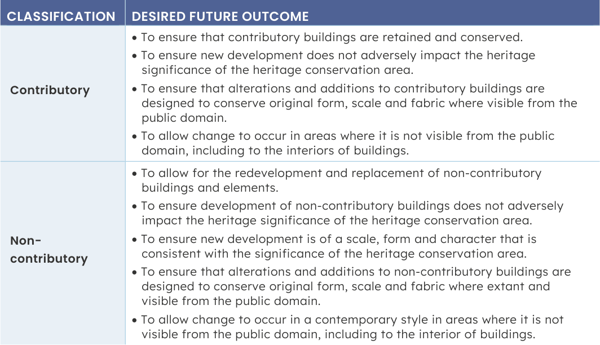

### 1.7. Classification of buildings within heritage conservation areas

Buildings within each heritage conservation area will in future be identified by these guidelines as contributory, neutral or non-contributory. Heritage listed items are separate to these definitions.

• Contributory buildings generally originate from a significant era of historical development of a

heritage conservation area and display key characteristics of the area through their architectural style, building typology, use, scale, form, features and materials. Contributory buildings contribute to the public domain and this can be appreciated from the street.

• Non-contributory buildings are usually buildings from a later era, or buildings that have been so

altered, that are inconsistent with the setbacks, scale, bulk, form or materials of characteristic historical development. They are considered to detract from the heritage significance of the area. The desired future character of each classification is provided below:

> [Picture on page 24: a picture, saved as a picture (images/appendix-e-heritage-guidelines-page-24-5.gif, 150 dpi).]
> Words printed on the picture (title and legend, copied from the PDF):
> public domain.
> buildings and elements.

#### CLASSIFICATION DESIRED FUTURE OUTCOME

• To ensure that contributory buildings are retained and conserved.

• To ensure new development does not adversely impact the heritage

significance of the heritage conservation area.

#### Contributory

• To ensure that alterations and additions to contributory buildings are

designed to conserve original form, scale and fabric where visible from the

• To allow change to occur in areas where it is not visible from the public

domain, including to the interiors of buildings.

• To allow for the redevelopment and replacement of non-contributory

• To ensure development of non-contributory buildings does not adversely

impact the heritage significance of the heritage conservation area.

#### Non-

• To ensure new development is of a scale, form and character that is

consistent with the significance of the heritage conservation area.

contributory

• To ensure that alterations and additions to non-contributory buildings are

designed to conserve original form, scale and fabric where extant and visible from the public domain.

• To allow change to occur in a contemporary style in areas where it is not

visible from the public domain, including to the interior of buildings.
