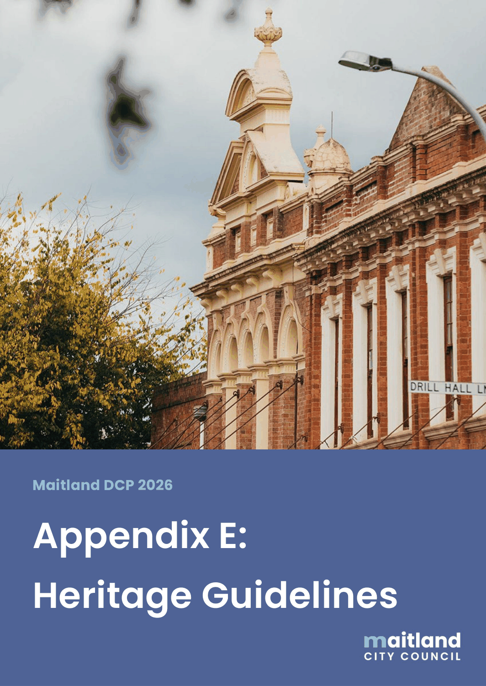

# Maitland Development Control Plan 2026 - Appendix E Heritage Guidelines

> This chapter is split into 21 section file(s), one per numbered heading, in the order they appear in the PDF.

Source PDF: [MDCP 2026 - Appendix E Heritage Guidelines.pdf](MDCP%202026%20-%20Appendix%20E%20Heritage%20Guidelines.pdf)

> [Picture on page 1: a picture, saved as a picture (images/appendix-e-heritage-guidelines-page-1-1.gif, 150 dpi).]

### Maitland DCP 2026

### Appendix E:

### Heritage Guidelines

### Table of Contents

1.1. Application ............................................................................................................................................................................................. 3 1.2. Maitland’s heritage context........................................................................................................................................................... 3 1.3. Legislation and other guiding documents .............................................................................................................................. 3 1.4. Explaining heritage significance ................................................................................................................................................5 1.5. Heritage Items ....................................................................................................................................................................................5 1.6. Heritage Conservation Areas .......................................................................................................................................................5 1.6.1. Bolwarra Heritage Conservation Area..................................................................................................................................5 1.6.2. Central Maitland Heritage Conservation Area ................................................................................................................ 8 1.6.3. East Maitland Heritage Conservation Area ...................................................................................................................... 11 1.6.4. Lorn Heritage Conservation Area ........................................................................................................................................ 14 1.6.5. Regent Street Heritage Conservation Area .................................................................................................................... 16 1.6.6. Morpeth Heritage Conservation Area ................................................................................................................................ 17 1.6.7. Aberglasslyn Heritage Conservation Area ...................................................................................................................... 21 1.7. Classification of buildings within heritage conservation areas ................................................................................ 23 1.8. Requirements for development consent .............................................................................................................................. 24 1.9. Exemptions for minor works, repair and maintenance ................................................................................................. 25 1.10. Local heritage items .................................................................................................................................................................... 25 1.11. State Heritage Register listed items .................................................................................................................................... 26 1.12. Guidelines for the preparation of heritage management documents ................................................................ 26 1.13. Character assessment ................................................................................................................................................................. 26 1.14. Statement of Heritage Impact............................................................................................................................................... 27 1.15. Heritage assessment ................................................................................................................................................................... 27 1.16. Conservation Management Plan............................................................................................................................................ 28 1.17. Structural Assessment ................................................................................................................................................................ 28 1.18. Demolition report .......................................................................................................................................................................... 28 1.19. Photographic archival recording ........................................................................................................................................... 29 1.20. Where to get heritage advice and further information ............................................................................................. 29

<!-- sections -->
## Sections

1. [1 Introduction](01-introduction.md)
2. [1.1 Application](02-1-1-application.md)
3. [1.2 Maitland’s heritage context](03-1-2-maitland-s-heritage-context.md)
4. [1.3 Legislation and other guiding documents](04-1-3-legislation-and-other-guiding-documents.md)
5. [1.4 Explaining heritage significance](05-1-4-explaining-heritage-significance.md)
6. [1.5 Heritage Items](06-1-5-heritage-items.md)
7. [1.6 Heritage Conservation Areas](07-1-6-heritage-conservation-areas.md)
8. [1.7 Classification of buildings within heritage conservation areas](08-1-7-classification-of-buildings-within.md)
9. [1.8 Requirements for development consent](09-1-8-requirements-for-development-consent.md)
10. [1.9 Exemptions for minor works, repair and maintenance](10-1-9-exemptions-for-minor-works-repair-and.md)
11. [1.10 Local heritage items](11-1-10-local-heritage-items.md)
12. [1.11 State Heritage Register listed items](12-1-11-state-heritage-register-listed-items.md)
13. [1.12 Guidelines for the preparation of heritage management documents](13-1-12-guidelines-for-the-preparation-of.md)
14. [1.13 Character assessment](14-1-13-character-assessment.md)
15. [1.14 Statement of Heritage Impact](15-1-14-statement-of-heritage-impact.md)
16. [1.15 Heritage assessment](16-1-15-heritage-assessment.md)
17. [1.16 Conservation Management Plan](17-1-16-conservation-management-plan.md)
18. [1.17 Structural Assessment](18-1-17-structural-assessment.md)
19. [1.18 Demolition report](19-1-18-demolition-report.md)
20. [1.19 Photographic archival recording](20-1-19-photographic-archival-recording.md)
21. [1.20 Where to get heritage advice and further information](21-1-20-where-to-get-heritage-advice-and-further.md)
