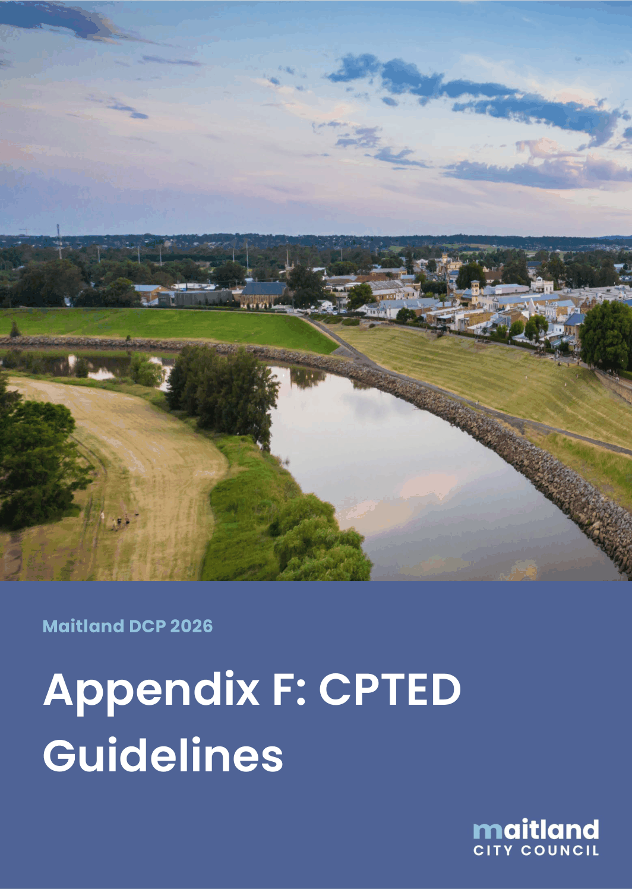

# Maitland Development Control Plan 2026 - Appendix F CPTED Guidelines

> This chapter is split into 10 section file(s), one per main heading, in the order they appear in the PDF.

Source PDF: [MDCP 2026 - Appendix F CPTED Guidelines.pdf](https://planfortomorrow.sharepoint.com/sites/Planfortomorrow/Shared%20Documents/00%20NSW-Planning-Resources/dcp/maitland-development-control-plan-2026/appendix-f-cpted-guidelines/MDCP%202026%20-%20Appendix%20F%20CPTED%20Guidelines.pdf)

> [Picture on page 1: a picture, saved as a picture (images/appendix-f-cpted-guidelines-page-1-1.gif, 150 dpi).]

<!-- sections -->
## Sections

1. [Maitland DCP 2026](01-maitland-dcp-2026.md)
2. [Introduction](02-introduction.md)
3. [CPTED Principles](03-cpted-principles.md)
4. [Objectives of this Guideline](04-objectives-of-this-guideline.md)
5. [Building Design and Orientation](05-building-design-and-orientation.md)
6. [Shared and Communal Spaces](06-shared-and-communal-spaces.md)
7. [Lighting](07-lighting.md)
8. [Security and Anti-Vandalism](08-security-and-anti-vandalism.md)
9. [Shopfronts](09-shopfronts.md)
10. [Public Facilities and Carparks](10-public-facilities-and-carparks.md)
