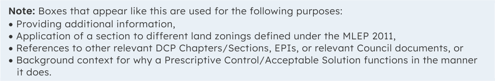

### 1.7. How to use this DCP

This DCP applies to all development that may be carried out with development consent in the Maitland LGA. Any development application within the Maitland LGA will need to address the relevant provisions contained in this DCP. The DCP contains objectives and two forms of controls to guide development outcomes. These serve the following purposes: Objectives are the broad metrics that the proposed development is to achieve. These are located at

the start of each section and sub-section of a DCP Chapter, appearing under the title ‘Objectives’. Objectives communicate what outcomes Council is seeking to achieve from each section and sub-section of the DCP. Prescriptive Controls (PC) are requirements that an Applicant is to address in order to achieve an

outcome that is consistent with the relevant objectives for each Section. Prescriptive Controls are identified by the code ‘PC’, which appears to the left of each control. Prescriptive Controls generally

use language such as ‘must’, ‘will’, ‘is to’, ‘are to’, and ‘shall’. Acceptable Solutions (AS) are controls that have language more in line with that of the Objectives.

Alternatively, they have content that provide a method to meeting the Objectives while communicating that Council is open to other solutions that may be proposed. Acceptable Solutions are identified by the code ‘AS’, which appears to the left of each solution. These Acceptable Solutions

generally use language such as ‘should’, ‘may’, ‘encourage’, and ‘possible’.

> [Picture on page 4: a picture, saved as a picture (images/ch-01-00-introduction-and-administration-page-4-27.gif, 150 dpi).]
> Words printed on the picture (title and legend, copied from the PDF):
> • Providing additional information,
> it does.

Note: Boxes that appear like this are used for the following purposes:

• Application of a section to different land zonings defined under the MLEP 2011,

• References to other relevant DCP Chapters/Sections, EPIs, or relevant Council documents, or

• Background context for why a Prescriptive Control/Acceptable Solution functions in the manner
