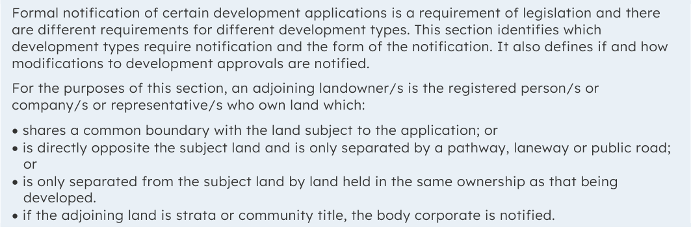
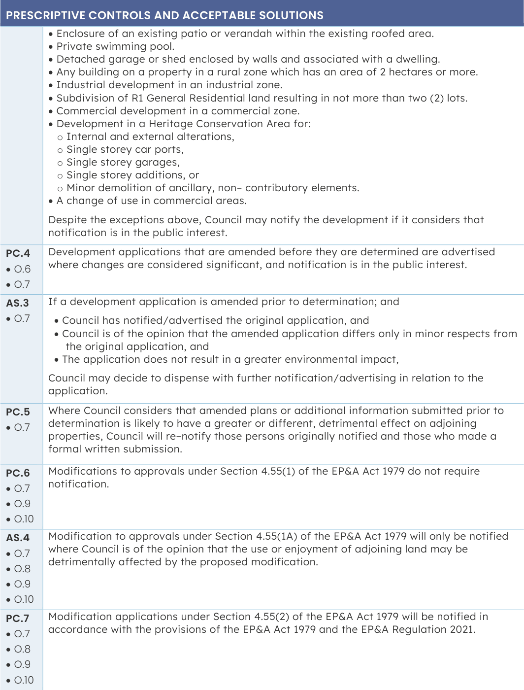
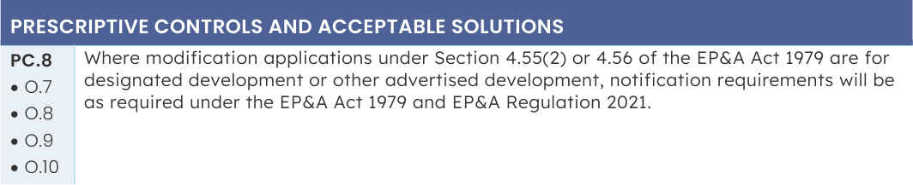

### 1.12. Public Notification

> [Picture on page 8: a picture, saved as a picture (images/ch-01-00-introduction-and-administration-page-8-27.gif, 150 dpi).]
> Words printed on the picture (title and legend, copied from the PDF):
> or
> developed.

Formal notification of certain development applications is a requirement of legislation and there are different requirements for different development types. This section identifies which development types require notification and the form of the notification. It also defines if and how modifications to development approvals are notified. For the purposes of this section, an adjoining landowner/s is the registered person/s or company/s or representative/s who own land which:

• shares a common boundary with the land subject to the application; or

• is directly opposite the subject land and is only separated by a pathway, laneway or public road;

• is only separated from the subject land by land held in the same ownership as that being

• if the adjoining land is strata or community title, the body corporate is notified.

#### Objectives

O.1 To ensure that Development Applications are notified locally.

O.2 To ensure reasonable time is given for the public to review applications and prepare submissions.

O.3 To ensure that applications and supporting material are easily accessible.

O.4 To ensure that adequate information is provided to the adjoining landowners so that they can

understand what is proposed and how they can participate.

O.5 To ensure that any adjoining owner, for the purpose of notification, is clearly defined.

O.6 To ensure that parties that are likely to be affected by larger or more intrusive impacts are notified of

development.

O.7 To ensure that Development Applications that are amended before they are determined are

advertised where changes are considered significant, and notification is in the public interest.

O.8 To ensure Development Applications that are modified after the application was determined are

advertised where changes are considered significant, and notification is in the public interest.

O.9 To ensure Development Applications modified under Sections 4.56 of the EP&A Act 1979 are

advertised as required.

O.10 To ensure Council will notify and/or advertise an application under Section 4.56 of the EP&A Act 1979

in accordance with the requirements of the original application.

| PRESCRIPTIVE CONTROLS AND ACCEPTABLE SOLUTIONS |  |
|---|---|
| AS.1 | Where the development is likely to result in impacts over a large area, Council may, at its discretion, expand the notification area. |
| • O.1 |  |
| • O.4 |  |
| • O.5 |  |
| PC.1 | Where a development application is to be advertised, advertising will occur in accordance with Council’s Community Participation Plan. |
| • O.1 |  |
| • O.2 |  |
| • O.3 |  |
| • O.4 |  |
| • O.5 |  |
| • O.6 |  |
| PC.2 • O.3 • O.4 • O.6 | Any of the following development requires advertising: a. All development and/or demolition proposed affecting a heritage item identified under MLEP 2011 (except private swimming pools). b. Major works, including any proposal for two storey or greater development in a Heritage Conservation Area. c. Major council projects (excluding utility services with a value exceeding $100,000 or likely to be of significant community interest). d. Multi-dwelling housing, group homes, boarding houses, hostel, residential flat buildings, seniors housing or similar type of developments. e. Non-residential uses in or adjacent to a residential zone. f. Subdivision of land zoned R5 Large Lot Residential or C4 Environmental Living. g. Subdivision of residential land into more than 2 allotments. h. Development for the purpose of hotel or motel accommodation, pubs, hospitals, places of worship and sex services premises in any zone. |
| AS.2 • O.1 | Where Council is of the opinion that the proposed development is minor in nature and its location, size, height, bulk and proposed use will not adversely affect the amenity of the adjoining land, advertising of the development may not be required. |
| PC.3 • O.1 • O.2 • O.3 • O.4 • O.5 | Any development application that involves alteration to the external configuration of a building or the erection of a new building requires notification except the following: • New residential dwelling houses, additions and alterations (including second storeys) with a height of up to 8.5 metres measured from the existing ground level. • Dual occupancies up to and including two–storeys with a height of up to 8.5 metres measured from existing ground level, provided they meet the privacy, setbacks and overshadowing provisions of the Residential Uses chapter of this DCP. • Open carport, pergola, verandah or similar development. |

> [Picture on page 10: a map, saved as a picture (images/ch-01-00-introduction-and-administration-page-10-1.gif, 150 dpi); the street names and other small labels are on the picture.]
> Words printed on the picture (title and legend, copied from the PDF):
> • Private swimming pool.
> • O.7 • Council has notified/advertised the original application, and
> the original application, and

#### PRESCRIPTIVE CONTROLS AND ACCEPTABLE SOLUTIONS

• Enclosure of an existing patio or verandah within the existing roofed area.

• Detached garage or shed enclosed by walls and associated with a dwelling.

• Any building on a property in a rural zone which has an area of 2 hectares or more.

• Industrial development in an industrial zone.

• Subdivision of R1 General Residential land resulting in not more than two (2) lots.

• Commercial development in a commercial zone.

• Development in a Heritage Conservation Area for:

o Internal and external alterations,

o Single storey car ports,

o Single storey garages,

o Single storey additions, or

o Minor demolition of ancillary, non– contributory elements.

• A change of use in commercial areas. Despite the exceptions above, Council may notify the development if it considers that notification is in the public interest.

#### PC.4

Development applications that are amended before they are determined are advertised where changes are considered significant, and notification is in the public interest.

If a development application is amended prior to determination; and

#### AS.3

• Council is of the opinion that the amended application differs only in minor respects from

• The application does not result in a greater environmental impact, Council may decide to dispense with further notification/advertising in relation to the application.

#### PC.5

Where Council considers that amended plans or additional information submitted prior to determination is likely to have a greater or different, detrimental effect on adjoining properties, Council will re–notify those persons originally notified and those who made a formal written submission.

#### PC.6

Modifications to approvals under Section 4.55(1) of the EP&A Act 1979 do not require

#### AS.4

Modification to approvals under Section 4.55(1A) of the EP&A Act 1979 will only be notified where Council is of the opinion that the use or enjoyment of adjoining land may be detrimentally affected by the proposed modification.

#### PC.7

Modification applications under Section 4.55(2) of the EP&A Act 1979 will be notified in accordance with the provisions of the EP&A Act 1979 and the EP&A Regulation 2021.

> [Picture on page 11: a picture, saved as a picture (images/ch-01-00-introduction-and-administration-page-11-1.gif, 150 dpi).]
> Words printed on the picture (title and legend, copied from the PDF):
> • O.7
> • O.8
> • O.9
> • O.10

#### PRESCRIPTIVE CONTROLS AND ACCEPTABLE SOLUTIONS

#### PC.8

Where modification applications under Section 4.55(2) or 4.56 of the EP&A Act 1979 are for designated development or other advertised development, notification requirements will be as required under the EP&A Act 1979 and EP&A Regulation 2021.
