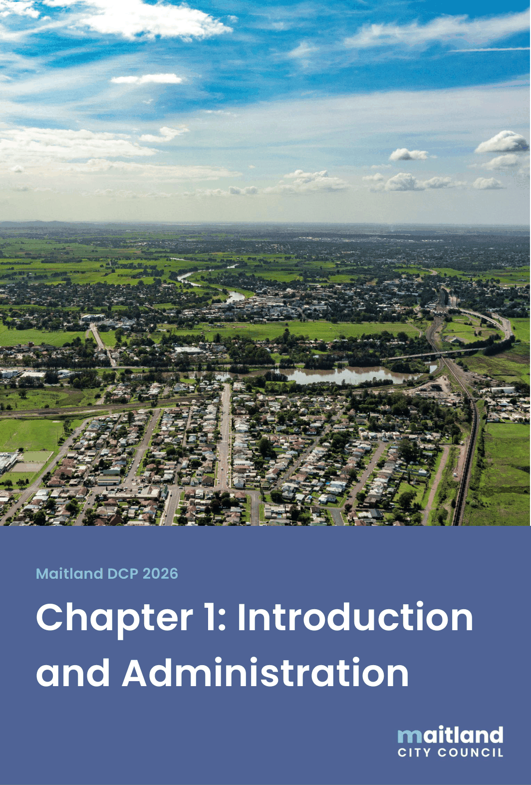
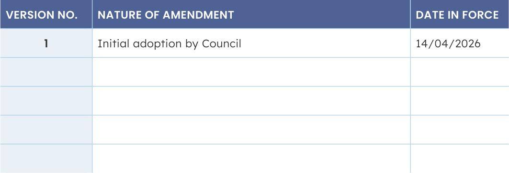

# Maitland Development Control Plan 2026 - Chapter 1 Introduction and Administration

> This chapter is split into 13 section file(s), one per numbered heading, in the order they appear in the PDF.

Source PDF: [MDCP 2026 - Chapter 1 Introduction and Administration_0.pdf](https://planfortomorrow.sharepoint.com/sites/Planfortomorrow/Shared%20Documents/00%20NSW-Planning-Resources/dcp/maitland-development-control-plan-2026/ch-01-00-introduction-and-administration/MDCP%202026%20-%20Chapter%201%20Introduction%20and%20Administration_0.pdf)

> [Picture on page 1: a picture, saved as a picture (images/ch-01-00-introduction-and-administration-page-1-1.gif, 150 dpi).]

### Maitland DCP 2026

## Chapter 1: Introduction

### and Administration

### Version Amendment History

> [Picture on page 2: a picture, saved as a picture (images/ch-01-00-introduction-and-administration-page-2-2.gif, 150 dpi).]

| VERSION NO. | NATURE OF AMENDMENT | DATE IN FORCE |
|---|---|---|
| 1 | Initial adoption by Council | 14/04/2026 |

<!-- sections -->
## Sections

1. [1.1 Adoption and Commencement](01-1-1-adoption-and-commencement.md)
2. [1.2 Disclaimer](02-1-2-disclaimer.md)
3. [1.3 Interpretation](03-1-3-interpretation.md)
4. [1.4 Status and Purpose of this Plan](04-1-4-status-and-purpose-of-this-plan.md)
5. [1.5 Aims of this Plan](05-1-5-aims-of-this-plan.md)
6. [1.6 Land Application](06-1-6-land-application.md)
7. [1.7 How to use this DCP](07-1-7-how-to-use-this-dcp.md)
8. [1.8 Variations to this DCP](08-1-8-variations-to-this-dcp.md)
9. [1.9 DCP Structure](09-1-9-dcp-structure.md)
10. [1.10 Relationship to Other Plans, Policies and Legislation](10-1-10-relationship-to-other-plans-policies-and.md)
11. [1.11 Preparing a Development Application](11-1-11-preparing-a-development-application.md)
12. [1.12 Public Notification](12-1-12-public-notification.md)
13. [1.13 Post Determination Matters](13-1-13-post-determination-matters.md)
