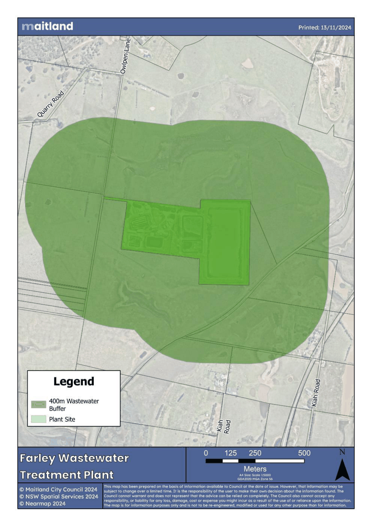
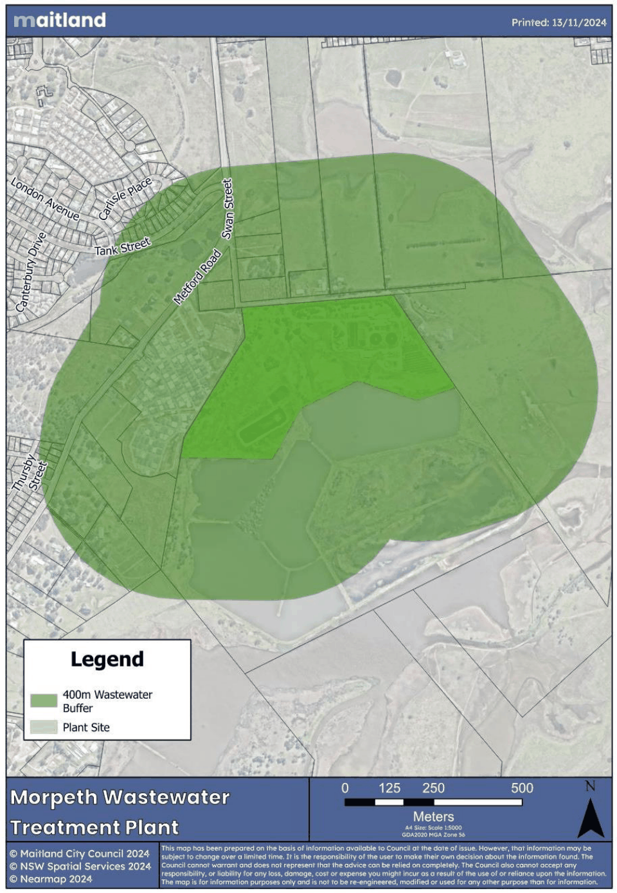

### 2.5. Environmental Hazard Management

#### 2.5.1. Bushfire

| The aim of this sub-section is to ensure that properties identified within or adjacent to bushfire |
|---|
| prone land undertake the necessary mitigation measures to avoid or reduce the impact of bushfire |
| to property. Relevant legislation and policy that should be read in conjunction with this Chapter are |
| listed below: |
| • Environment Protection and Biodiversity Conservation Act 1999 |
| • Rural Fires Act 1997 |
| • Planning for Bush Fire Protection 2019 |
| • Rural Fires Regulation 2022 |
| Further property information on identifying whether a property is within or near bushfire prone |
| land can be found on Council’s Mapping webpage, or the NSW Planning Portal Spatial Viewer. |

#### Objectives

O.32 To ensure that risks associated with bushfire are appropriately and effectively managed on the development site.

O.33 To ensure that bushfire risk is managed in connection with the preservation of the ecological values of the site and adjoining lands.

| PRESCRIPTIVE CONTROLS AND ACCEPTABLE SOLUTIONS |  |
|---|---|
| PC.1 • O.32 • O.33 | A Bushfire Assessment is required to be prepared by a suitably qualified consultant and submitted with any application involving bushfire prone land, in accordance with Appendix A: Application Requirements – Other Development or Appendix B: Application Requirements – Minor Development, whichever is applicable. |
| PC.2 • O.32 | Vegetation management for the purposes of bushfire risk management must not be achieved through the clearing, adjustment or management of vegetation on land managed by Council. Note: Vegetation management for private benefit cannot be imposed on any land managed by Council or any other public land. |
| PC.3 • O.33 | Any Asset Protection Zone must be located outside of areas of environmental significance, including: a. a key habitat such as threatened species and populations and threatened ecological communities b. vegetated riparian zones c. other vegetation to be retained or protected due to environmental constraints. Note: Asset Protection Zones for private benefit cannot be imposed on any land managed by Council or any other public land. |
| PC.4 • O.32 • O.33 | Clearing of native vegetation or trees for the purposes of reducing bushfire risk must be consistent with any current applicable Bushfire Risk Management Plan prepared under the Rural Fires Act 1997. |

#### 2.5.2. Mine subsidence

| This section applies to all development consisting of a new building or structure, extension or |
|---|
| structural alteration, or subdivision located on land within a proclaimed mine subsidence district. |
| Mine Subsidence Districts (districts) are proclaimed in areas where there are potential subsidence |
| risks from active or non-active underground coal mining. A district is a land zoning tool |
| administered by Subsidence Advisory NSW under the Coal Mine Subsidence Compensation Act |
| 2017. Subsidence Advisory NSW regulates building and subdivision works within districts to ensure |
| new homes, buildings and structures are built to an appropriate standard that reduces the risk of |
| damage should subsidence occur. |
| Relevant legislation and policy that may be read in conjunction with this Chapter are listed below: |
| • Coal Mine Subsidence Compensation Act 2017 |
| • Subsidence Advisory NSW Surface Development guidelines |
| Further information to find out if a site is located within a proclaimed mine subsidence district can |
| be found at Council’s Mapping webpage, NSW Planning Portal Spatial Viewer, or contacting |
| Subsidence Advisory NSW. |

#### Objectives

O.34 Identify historic or ongoing underground mining risk. O.35 Minimise the risk of potential mine subsidence damage through sensitive design.

| PRESCRIPTIVE CONTROLS AND ACCEPTABLE SOLUTIONS |  |
|---|---|
| PC.1 • O.35 | All development proposed within a declared mine subsidence district is to be designed to mitigate the risks of potential mine subsidence, including in accordance with any applicable Geotechnical Assessment prepared for the site. |
| AS.1 | Development should be designed in accordance with relevant development guidelines from Subsidence Advisory NSW. Documentation must include appropriate notes and detail to confirm compliance with the guidelines. |
| • O.34 |  |
| • O.35 |  |

#### 2.5.3. Contamination

| Relevant legislation and policy that may be read in conjunction with this Section are listed below: |
|---|
| • National Environment Protection (Assessment of Site Contamination) Measure |
| • Contaminated Land Management Act 1997 |
| • State Environmental Planning Policy (Resilience and Hazards) 2021 |
| • NSW Contaminated Land Planning Guidelines |
| Refer to SEPP Resilience and Hazards and the NSW State Government’s ‘Managing Land |
| Contamination: Planning Guidelines’ for more information on activities that may cause of potentially |
| cause contamination. In addition, refer to Council’s Contaminated Land Policy – Land Use Planning |
| for further information on identifying whether your site may be contaminated and the development |
| process. |
| Consideration of Acid Sulfate Soils is covered by Clause 7.1 of the Maitland Local Environmental |
| Plan 2011. Relevant policy that should be read in conjunction with this Chapter are listed below: |
| • NSW Acid Sulfate Soils Planning Manual |
| • NSW EPA Waste Classification Guidelines Part 4: Acid sulfate soils |
| Further information to find out if a site is contaminated, potentially contaminated, or impacted by |
| acid sulfate soils can be found on Council’s Mapping webpage, or the NSW Planning Portal Spatial |
| Viewer. |

#### Objectives

O.36 To ensure that land is fit for its intended land use based on the National Environment Protection (Assessment of Site Contamination) Measure thresholds for contaminants.

O.37 To ensure that contaminated land is identified through appropriate investigations in line with current legislation and best practice.

O.38 To ensure that contaminated land is appropriately and effectively managed or remediated prior to development taking place.

O.39 To ensure that changes to land use will not increase the risk to public health or the environment because of contamination on site, or on adjacent properties.

| PRESCRIPTIVE CONTROLS AND ACCEPTABLE SOLUTIONS |  |
|---|---|
| PC.1 | Information regarding any potential contamination present on the site is to be provided as part of any Statement of Environmental Effects lodged with Council. |
| • O.36 |  |
| • O.37 |  |
| PC.2 | If a site has the potential for contamination to exist in relation to historical activities on the site, a Preliminary Site Investigation (PSI) must be prepared by a professionally qualified consultant and submitted with the development application. |
| • O.36 |  |
| • O.37 |  |
| PC.3 • O.36 • O.37 | A Detailed Site Investigation Report (DSI) is required in the following circumstances: a. Where the PSI indicates that the land may be contaminated, or b. When the site is, or was, formally used for an activity listed in Table 1 of the Managing Land Contamination Planning Guidelines within Council’s Contaminated Land Policy, or other potentially contaminating activities known to Council, and a land use change is proposed that has the potential to increase the risk of exposure to contamination, or c. To accompany a remediation proposal or notification. |
| PC.4 | Where a Detailed Site Investigation Report identifies the need for remediation, a Remedial Action Plan (RAP) must be prepared and submitted prior to issue of the development consent, or in certain circumstances the issue of the construction certificate or subdivision works certificate as determined relevant by Council staff. |
| • O.36 |  |
| • O.38 |  |
| • O.39 |  |

#### 2.5.4. Noise and Vibration

| Development that is likely to produce an adverse noise or vibration impact on occupants of the |
|---|
| site or of nearby properties include: |
| • clubs, hotels and pubs with outdoor smoking, dining and gaming areas, mechanical plant, |
| carparks, |
| • function centres, |
| • childcare centres, |
| • educational establishments, |
| • industrial uses that interface with residential or sensitive land uses, |
| • residential flat buildings (RFBs) with ventilation and air-conditioning plant, and |
| • commercial developments with workshops, mechanical and ventilation plant such as air exhaust |
| and supply fans, chillers, cooling towers, truck and freight train movements, loading docks and |
| the like. |
| Relevant legislation and policy that should be read in conjunction with this Chapter are: |
| • Protection of the Environment Operations Act 1997 |
| • NSW EPA Noise Policy for Industry |
| Further information can be found at the NSW EPA website on noise legislation and guidelines. |

#### Objectives

O.40 To minimise the generation of noise and, or vibration, and to mitigate associated adverse impacts on the amenity of neighbouring properties and their occupants, and on occupants of the proposed development.

| PRESCRIPTIVE CONTROLS AND ACCEPTABLE SOLUTIONS |  |
|---|---|
| PC.1 h. O.40 | Where development has the potential to produce an adverse noise or vibration impact on occupants of the site or of nearby properties, an acoustic and vibration assessment must be prepared by a qualified consultant in accordance with Appendix A: Application Requirements – Other Development or Appendix B: Application Requirements – Minor Development, whichever is applicable. |
| PC.2 i. O.40 | Noise or vibration generated by development either during construction or operation must not exceed the criteria stipulated in the NSW EPA Noise Policy for Industry or the Noise Guide for Local Government at the property boundary of the noise source, or at a receiving lot boundary. |

#### 2.5.5. Air Quality

| The aim of this sub-section is to ensure that air quality is not negatively impacted on by dust and |
|---|
| odour from development. |
| Relevant legislation and policy that may be read in conjunction with this Chapter are listed below: |
| a. Protection of the Environment Operations Act 1997 |
| b. Buffer Zones to Reduce Land Use Conflict with Agriculture – An Interim Guideline (2018) |
| c. Chapter 9: Rural and Other Land Uses of the MDCP 2026 |
| Further information can be found at the NSW EPA website on noise legislation and guidelines. |

#### Objectives

O.41 To ensure air quality is not negatively impacted on by dust and odour in recognition of the associated human health impacts.

O.42 To ensure that measures are implemented to maintain air quality.

| PRESCRIPTIVE CONTROLS AND ACCEPTABLE SOLUTIONS |  |
|---|---|
| PC.1 • O.41 • O.42 | An Air Quality Impact Assessment (AQIA) and/or Odour Report is required to be prepared in accordance with Appendix A: Application Requirements – Other Development and/or Appendix B: Application Requirements – Minor Development, whichever is applicable, in instances where development has potential to adversely impact surrounding areas in terms of air quality and/or odour. This includes: • Rural industries • Heavy Industry • Sewage treatment plants • Waste or resource management facilities • Extractive industry • Other development types if requested by Council |

#### 2.5.6. Hazardous and Offensive Land Use Buffers

| The aim of this sub-section is to ensure that ensure development is not adversely impacted by |
|---|
| hazardous or offensive development. |
| Refer to Chapter 9, Section 9.2.1 of this DCP for buffer requirements for agricultural activities, such |
| as intensive agriculture. |
| Refer to SEPP Resilience and Hazards, Chapter 3 Hazardous and Offensive Development and the |
| NSW State Government’s Planning Circular PS 21-031 Planning and assessment guidelines for |
| hazardous industry for further information on hazardous and offensive development requirements. |

#### Objectives

O.43 To ensure development is not adversely impacted by noise or air quality of hazardous or offensive development, such as wastewater treatment facilities or extractive industries.

| PRESCRIPTIVE CONTROLS AND ACCEPTABLE SOLUTIONS |  |
|---|---|
| PC.1 • O.43 | Unless a building is for non-habitable purposes, development within 400m of a wastewater treatment plant is generally not supported. Refer to Figure 2- and Figure 2-4 for wastewater treatment plant locations and associated 400m buffers. |

| PRESCRIPTIVE CONTROLS AND ACCEPTABLE SOLUTIONS |  |
|---|---|
| AS.1 • O.43 | Should a development seek to provide habitable structures within the identified wastewater treatment plant buffer zones, they are to demonstrate that: a. The proposed structure is ancillary to the applicable wastewater treatment plant, OR b. The proposed development lot is either wholly or partially within the buffer zone and cannot otherwise be positioned outside of the buffer zone (in the case of a lot partially within the buffer), AND c. An Odour Assessment and Air Quality Assessment are prepared by suitably qualified professionals in accordance with, at a minimum, the requirements for each assessment under Appendix A: Application Requirements – Other Development or Appendix B: Application Requirements – Minor Development, whichever is applicable, AND d. The Applicant has demonstrated communication has been had with Hunter Water regarding the development, AND e. The Odour Assessment and Air Quality Assessment find that any impacts can be suitably mitigated through additional measures, and that any requirement for outside Private Open Space or Communal Open Space is not compromised as a result of unacceptable odour or air quality impacts. |
| PC.2 • O.43 | Unless a building is for non-habitable purposes, development within 200m of an extractive industry is generally not supported. Refer to Section 9.4 of Chapter 9 regarding reciprocal setbacks for extractive industries. |
| AS.2 • O.43 | Should a development seek to provide habitable structures within 200m of an extractive industry operation, they are to demonstrate that: a. The proposed structure is associated with the relevant extractive industry, OR b. The proposed development lot is either wholly or partially within the buffer zone and cannot otherwise be positioned outside of the buffer zone (in the case of a lot partially within the buffer), AND c. An Odour Assessment, Air Quality Assessment, and Noise and Vibration Assessment are prepared by suitably qualified professionals in accordance with, at a minimum, the requirements for each assessment under Appendix A: Application Requirements – Other Development or Appendix B: Application Requirements – Minor Development, whichever is applicable, AND d. The Odour Assessment, Air Quality Assessment, and Noise and Vibration Assessment find that any impacts can be suitably mitigated through additional measures, and that any requirement for outside Private Open Space or Communal Open Space is not compromised as a result of unacceptable odour or air quality impacts, AND e. A Land Use Conflict Risk Assessment (LUCRA) in accordance with the Land Use Conflict Risk Assessment (LUCRA) Guide (Department of Primary Industries, 2011) (or as amended) has been prepared. Note: Any non-associated habitable dwelling developed in this manner will forego its right to the setback criteria of extractive industries established in PC.1 and PC.2 of Section 9.4.3. Extractive Industries in Chapter 9. |

> [Picture on page 27: a picture, saved as a picture (images/ch-02-00-environmental-considerations-page-27-1.gif, 150 dpi).]

#### Figure 2-3: Farley Wastewater Treatment Plant

> [Picture on page 28: a picture, saved as a picture (images/ch-02-00-environmental-considerations-page-28-1.gif, 150 dpi).]

#### Figure 2-4: Morpeth Wastewater Treatment Plant
