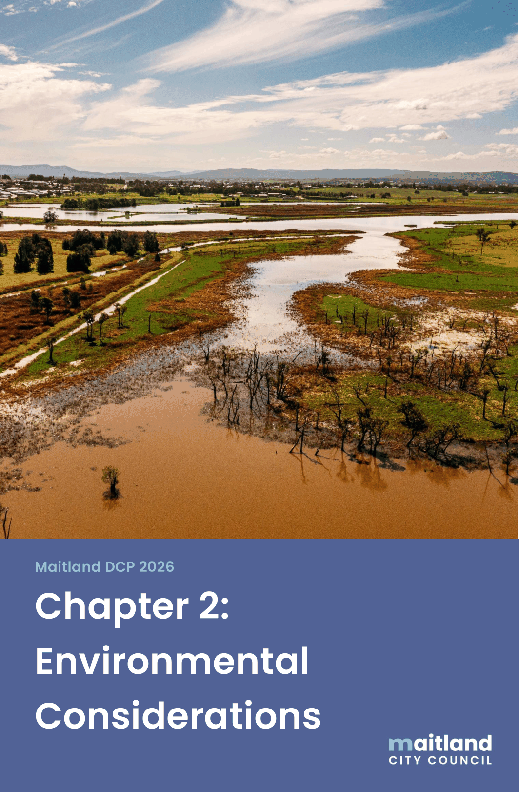

# Maitland Development Control Plan 2026 - Chapter 2 Environmental Considerations

> This chapter is split into 5 section file(s), one per numbered heading, in the order they appear in the PDF.

Source PDF: [MDCP 2026 - Chapter 2 Environmental Considerations.pdf](MDCP%202026%20-%20Chapter%202%20Environmental%20Considerations.pdf)

> [Picture on page 1: a picture, saved as a picture (images/ch-02-00-environmental-considerations-page-1-1.gif, 150 dpi).]

### Maitland DCP 2026

## Chapter 2: Environmental Considerations

### Table of Contents – Chapter 2: Environmental Considerations

2.1. Introduction ....................................................................................................................................................3 2.1.1. Application ................................................................................................................................................. 3 2.1.2. Relationship to other Chapters ........................................................................................................... 3 2.1.3. How to use this Chapter ........................................................................................................................ 3 2.1.4. Intent of this Chapter ............................................................................................................................ 4 2.2. Environmental Management ................................................................................................................. 5 2.2.1. Biodiversity ................................................................................................................................................ 5 2.2.2. Waterways and Riparian Corridors................................................................................................... 8 2.2.3. Green and Blue Grid .............................................................................................................................. 11 2.3. Vegetation Management ...................................................................................................................... 13 2.3.1. Tree and Vegetation Management.................................................................................................. 13 2.3.2. Street Trees and Canopy Cover ....................................................................................................... 19 2.3.3. Vegetation Management Plans ........................................................................................................ 20 2.4. Flood and Floodplain Management ................................................................................................. 20 2.5. Environmental Hazard Management............................................................................................... 21 2.5.1. Bushfire..................................................................................................................................................... 21 2.5.2. Mine subsidence .................................................................................................................................... 22 2.5.3. Contamination ....................................................................................................................................... 23 2.5.4. Noise and Vibration ............................................................................................................................. 24 2.5.5. Air Quality ............................................................................................................................................... 25 2.5.6. Hazardous and Offensive Land Use Buffers ............................................................................... 25

<!-- sections -->
## Sections

1. [2.1 Introduction](01-2-1-introduction.md)
2. [2.2 Environmental Management](02-2-2-environmental-management.md)
3. [2.3 Vegetation Management](03-2-3-vegetation-management.md)
4. [2.4 Flood and Floodplain Management](04-2-4-flood-and-floodplain-management.md)
5. [2.5 Environmental Hazard Management](05-2-5-environmental-hazard-management.md)
