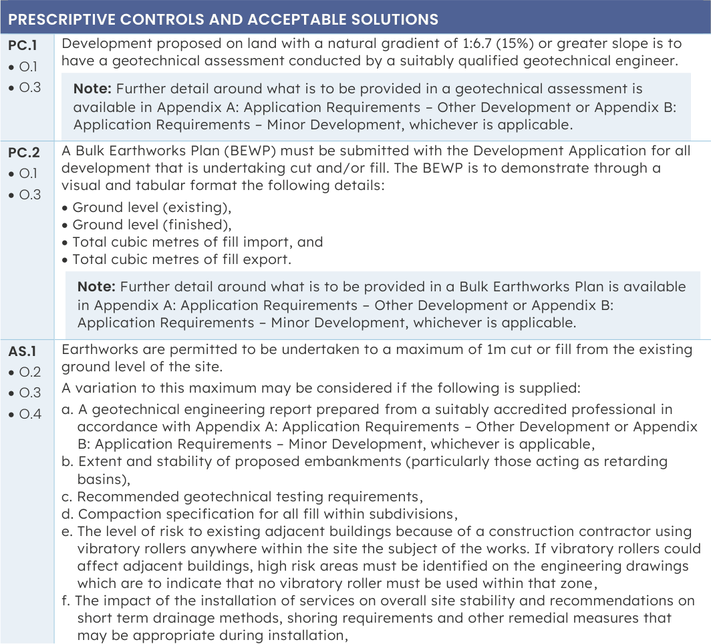
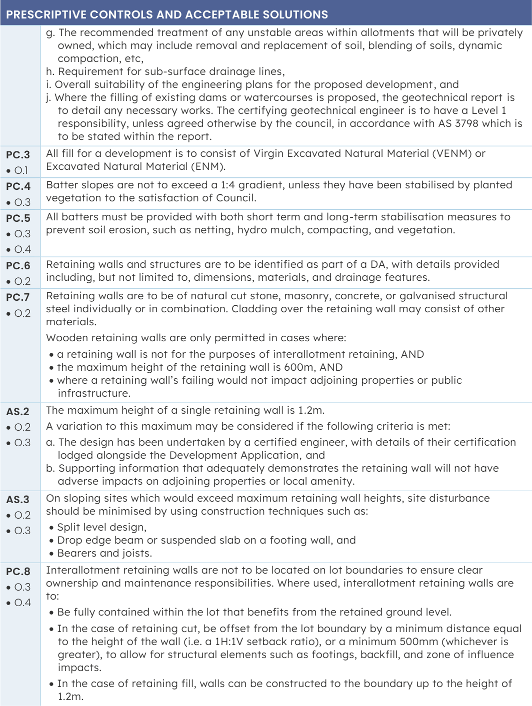
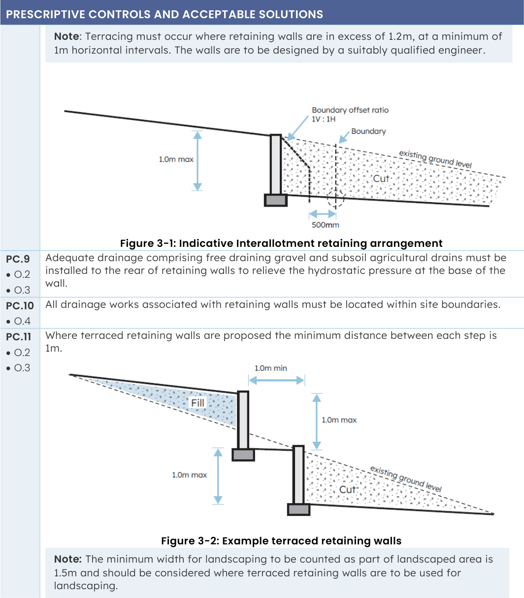

### 3.2. Earthworks and Retaining Walls

All development involving Earthworks and Retaining Walls is to utilise the relevant sections of Council’s MoES, including the MoES Design and Construction Documents, alongside this section.

#### Objectives

O.1 To ensure that development is designed to minimise cut and fill required for site preparation, construction, and operation.

O.2 To accommodate development on a site without the need for excessive excavation and fill or construction of high retaining walls adjacent to site boundaries.

O.3 To minimise the effect of disturbance of land and ensure that dangerous or unstable excavations are avoided, or where necessary, are properly retained.

O.4 To ensure that adequate provision is made for drainage in relation to cut and fill practices.

> [Picture on page 4: a picture, saved as a picture (images/ch-03-00-site-requirements-page-4-12.gif, 150 dpi).]
> Words printed on the picture (title and legend, copied from the PDF):
> • O.1
> • O.3 Note: Further detail around what is to be provided in a geotechnical assessment is
> • O.1
> • O.3
> • O.2
> • O.3
> • O.4
> basins),

#### PRESCRIPTIVE CONTROLS AND ACCEPTABLE SOLUTIONS

#### PC.1

Development proposed on land with a natural gradient of 1:6.7 (15%) or greater slope is to have a geotechnical assessment conducted by a suitably qualified geotechnical engineer.

available in Appendix A: Application Requirements – Other Development or Appendix B: Application Requirements – Minor Development, whichever is applicable.

#### PC.2

A Bulk Earthworks Plan (BEWP) must be submitted with the Development Application for all development that is undertaking cut and/or fill. The BEWP is to demonstrate through a visual and tabular format the following details:

• Ground level (existing),

• Ground level (finished),

• Total cubic metres of fill import, and

• Total cubic metres of fill export. Note: Further detail around what is to be provided in a Bulk Earthworks Plan is available in Appendix A: Application Requirements – Other Development or Appendix B: Application Requirements – Minor Development, whichever is applicable.

#### AS.1

Earthworks are permitted to be undertaken to a maximum of 1m cut or fill from the existing ground level of the site. A variation to this maximum may be considered if the following is supplied:

a. A geotechnical engineering report prepared from a suitably accredited professional in accordance with Appendix A: Application Requirements – Other Development or Appendix B: Application Requirements – Minor Development, whichever is applicable,

b. Extent and stability of proposed embankments (particularly those acting as retarding

c. Recommended geotechnical testing requirements,

d. Compaction specification for all fill within subdivisions,

e. The level of risk to existing adjacent buildings because of a construction contractor using vibratory rollers anywhere within the site the subject of the works. If vibratory rollers could affect adjacent buildings, high risk areas must be identified on the engineering drawings which are to indicate that no vibratory roller must be used within that zone,

f. The impact of the installation of services on overall site stability and recommendations on short term drainage methods, shoring requirements and other remedial measures that may be appropriate during installation,

> [Picture on page 5: a map, saved as a picture (images/ch-03-00-site-requirements-page-5-1.gif, 150 dpi); the street names and other small labels are on the picture.]

g. The recommended treatment of any unstable areas within allotments that will be privately owned, which may include removal and replacement of soil, blending of soils, dynamic compaction, etc,

h. Requirement for sub-surface drainage lines,

i. Overall suitability of the engineering plans for the proposed development, and

j. Where the filling of existing dams or watercourses is proposed, the geotechnical report is to detail any necessary works. The certifying geotechnical engineer is to have a Level 1 responsibility, unless agreed otherwise by the council, in accordance with AS 3798 which is to be stated within the report.

#### PC.3

All fill for a development is to consist of Virgin Excavated Natural Material (VENM) or Excavated Natural Material (ENM).

#### PC.4

Batter slopes are not to exceed a 1:4 gradient, unless they have been stabilised by planted vegetation to the satisfaction of Council.

#### PC.5

All batters must be provided with both short term and long-term stabilisation measures to prevent soil erosion, such as netting, hydro mulch, compacting, and vegetation.

#### PC.6

Retaining walls and structures are to be identified as part of a DA, with details provided including, but not limited to, dimensions, materials, and drainage features.

#### PC.7

Retaining walls are to be of natural cut stone, masonry, concrete, or galvanised structural steel individually or in combination. Cladding over the retaining wall may consist of other materials. Wooden retaining walls are only permitted in cases where:

• a retaining wall is not for the purposes of interallotment retaining, AND

• the maximum height of the retaining wall is 600m, AND

• where a retaining wall’s failing would not impact adjoining properties or public

The maximum height of a single retaining wall is 1.2m.

#### AS.2

A variation to this maximum may be considered if the following criteria is met:

a. The design has been undertaken by a certified engineer, with details of their certification lodged alongside the Development Application, and

b. Supporting information that adequately demonstrates the retaining wall will not have adverse impacts on adjoining properties or local amenity.

#### AS.3

On sloping sites which would exceed maximum retaining wall heights, site disturbance should be minimised by using construction techniques such as:

• Split level design,

• Drop edge beam or suspended slab on a footing wall, and

• Bearers and joists.

#### PC.8

Interallotment retaining walls are not to be located on lot boundaries to ensure clear ownership and maintenance responsibilities. Where used, interallotment retaining walls are to:

• Be fully contained within the lot that benefits from the retained ground level.

• In the case of retaining cut, be offset from the lot boundary by a minimum distance equal to the height of the wall (i.e. a 1H:1V setback ratio), or a minimum 500mm (whichever is greater), to allow for structural elements such as footings, backfill, and zone of influence impacts.

• In the case of retaining fill, walls can be constructed to the boundary up to the height of

> [Picture on page 6: a picture, saved as a picture (images/ch-03-00-site-requirements-page-6-1.gif, 150 dpi).]
> Words printed on the picture (title and legend, copied from the PDF):
> • O.2
> • O.3
> • O.4
> • O.2
> • O.3

Figure 3-1: Indicative Interallotment retaining arrangement

Figure 3-2: Example terraced retaining walls

Note: Terracing must occur where retaining walls are in excess of 1.2m, at a minimum of 1m horizontal intervals. The walls are to be designed by a suitably qualified engineer.

#### PC.9

Adequate drainage comprising free draining gravel and subsoil agricultural drains must be installed to the rear of retaining walls to relieve the hydrostatic pressure at the base of the wall. All drainage works associated with retaining walls must be located within site boundaries.

#### PC.10

#### PC.11

Where terraced retaining walls are proposed the minimum distance between each step is 1m.

Note: The minimum width for landscaping to be counted as part of landscaped area is 1.5m and should be considered where terraced retaining walls are to be used for landscaping.
