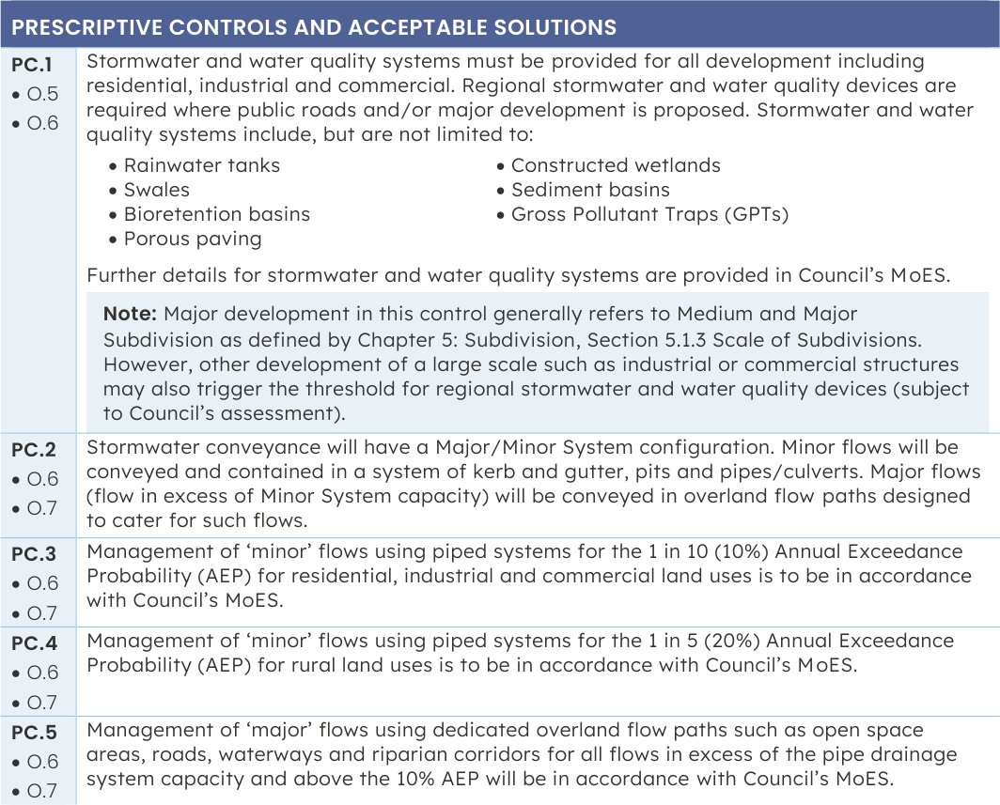
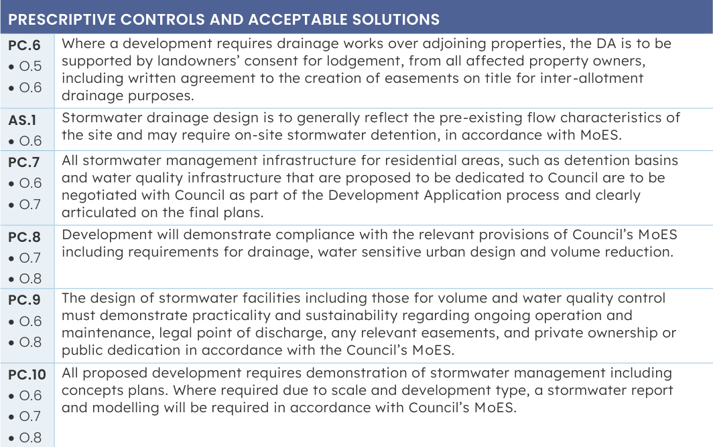

#### 3.3.1. Stormwater and Drainage

#### Objectives

O.5 To ensure that land can be adequately drained of storm water to not impact on adjacent sites and that the development does not contribute to drainage or flooding problems.

O.6 To provide direction regarding Council’s requirements for the management regarding both the quality and quantity of stormwater runoff.

O.7 To provide a stormwater system that can be economically and practically maintained and managed. O.8 To ensure an integrated approach to drinking water, wastewater and stormwater services is considered to drive more sustainable water management outcomes.

O.9 To ensure that water management measures for development incorporate key principles of water sensitive urban design to help protect, maintain or restore waterway health of identified high value waterways with a minimum requirement of maintaining current health.

> [Picture on page 7: a map, saved as a picture (images/ch-03-00-site-requirements-page-7-16.gif, 150 dpi); the street names and other small labels are on the picture.]
> Words printed on the picture (title and legend, copied from the PDF):
> • Rainwater tanks
> • Bioretention basins
> • Porous paving

#### PRESCRIPTIVE CONTROLS AND ACCEPTABLE SOLUTIONS

#### PC.1

Stormwater and water quality systems must be provided for all development including residential, industrial and commercial. Regional stormwater and water quality devices are required where public roads and/or major development is proposed. Stormwater and water quality systems include, but are not limited to:

• Constructed wetlands

• Sediment basins

• Gross Pollutant Traps (GPTs)

Further details for stormwater and water quality systems are provided in Council’s MoES. Note: Major development in this control generally refers to Medium and Major Subdivision as defined by Chapter 5: Subdivision, Section 5.1.3 Scale of Subdivisions. However, other development of a large scale such as industrial or commercial structures may also trigger the threshold for regional stormwater and water quality devices (subject to Council’s assessment).

#### PC.2

Stormwater conveyance will have a Major/Minor System configuration. Minor flows will be conveyed and contained in a system of kerb and gutter, pits and pipes/culverts. Major flows (flow in excess of Minor System capacity) will be conveyed in overland flow paths designed to cater for such flows.

#### PC.3

Management of ‘minor’ flows using piped systems for the 1 in 10 (10%) Annual Exceedance Probability (AEP) for residential, industrial and commercial land uses is to be in accordance with Council’s MoES.

#### PC.4

Management of ‘minor’ flows using piped systems for the 1 in 5 (20%) Annual Exceedance Probability (AEP) for rural land uses is to be in accordance with Council’s MoES.

#### PC.5

Management of ‘major’ flows using dedicated overland flow paths such as open space areas, roads, waterways and riparian corridors for all flows in excess of the pipe drainage system capacity and above the 10% AEP will be in accordance with Council’s MoES.

> [Picture on page 8: a map, saved as a picture (images/ch-03-00-site-requirements-page-8-1.gif, 150 dpi); the street names and other small labels are on the picture.]

#### PC.6

Where a development requires drainage works over adjoining properties, the DA is to be supported by landowners’ consent for lodgement, from all affected property owners, including written agreement to the creation of easements on title for inter-allotment drainage purposes.

#### AS.1

Stormwater drainage design is to generally reflect the pre-existing flow characteristics of the site and may require on-site stormwater detention, in accordance with MoES.

#### PC.7

All stormwater management infrastructure for residential areas, such as detention basins and water quality infrastructure that are proposed to be dedicated to Council are to be negotiated with Council as part of the Development Application process and clearly articulated on the final plans.

#### PC.8

Development will demonstrate compliance with the relevant provisions of Council’s MoES including requirements for drainage, water sensitive urban design and volume reduction.

#### PC.9

The design of stormwater facilities including those for volume and water quality control must demonstrate practicality and sustainability regarding ongoing operation and maintenance, legal point of discharge, any relevant easements, and private ownership or public dedication in accordance with the Council’s MoES.

#### PC.10

All proposed development requires demonstration of stormwater management including concepts plans. Where required due to scale and development type, a stormwater report and modelling will be required in accordance with Council’s MoES.
