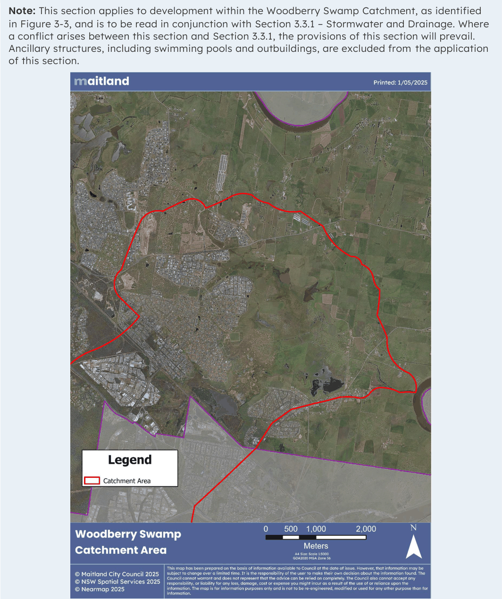
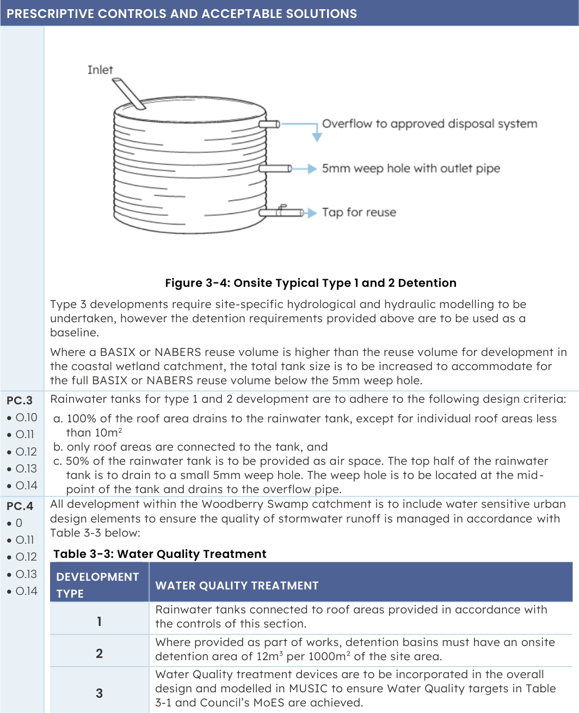

#### 3.3.2. Stormwater Management within the Woodberry Swamp Catchment

> [Picture on page 9: a picture, saved as a picture (images/ch-03-00-site-requirements-page-9-3.gif, 150 dpi).]

Note: This section applies to development within the Woodberry Swamp Catchment, as identified in Figure 3-3, and is to be read in conjunction with Section 3.3.1 – Stormwater and Drainage. Where a conflict arises between this section and Section 3.3.1, the provisions of this section will prevail. Ancillary structures, including swimming pools and outbuildings, are excluded from the application of this section.

#### Figure 3-3: Woodberry Swamp Catchment Area

#### Objectives

O.10 To ensure an appropriate quality of water entering the Woodberry Swamp Catchment. O.11 Ensure that post development runoff matches the natural water runoff regime as closely as possible within the Woodberry Swamp Catchment.

O.12 To promote sustainable stormwater management practices that reduce the impact of urban development on downstream waterways.

O.13 To ensure developments integrate stormwater detention and retention measures to mitigate potential flooding and erosion risks within the Woodberry Swamp Catchment.

O.14 To require stormwater treatment infrastructure that effectively removes sediment, litter, oils, and other pollutants before discharge into receiving waterways for the Woodberry Swamp Catchment.

| PRESCRIPTIVE CONTROLS AND ACCEPTABLE SOLUTIONS |  |
|---|---|
| PC.1 • O.10 • O.11 • O.12 • O.13 • O.14 | Development involving stormwater and/or drainage works are to provide plans in accordance with Table 3-1 below: Table 3-1: General Requirements DEVELOPMENT TYPE GENERAL REQUIREMENTS 1. Small-scale development (Dual occupancy or lesser) of more than 450m2 lot area Note: Ancillary structures, including A Stormwater Management Plan (SWMP) is to be swimming pools and outbuildings, prepared in accordance with the controls and are excluded from this section. acceptable solutions in this section, Council’s MoES, 2. Development that has a site and Appendix A: Application Requirements - Other area under 5000m2 and of a Development or Appendix B: Application scale larger than a dual Requirements - Minor Development, whichever is occupancy that involves: applicable. <20 dwellings, OR <50 people onsite during normal construction or operation. 3. Development that: A Water Cycle Management Plan, including hydrological and hydraulic modelling (MUSIC Is more than 5000m2, AND/OR modelling is preferred), is to be prepared in 20 or more dwellings, AND/OR accordance with the controls and acceptable solutions 50 or more people onsite during in this section, Council’s MoES, and Appendix A: normal construction or Application Requirements - Other Development or operation. Appendix B: Application Requirements - Minor Development, whichever is applicable. |
| PC.2 • O.10 • O.11 • O.12 • O.13 • O.14 | To meet the hydrology objectives for development in the coastal wetland catchment, baseline controls are provided for Type 1 and 2 developments in accordance with Table 3-2. Table 3-2: Detention Requirements DEVELOPMENT DETENTION REQUIREMENTS (M3) TYPE Roof area (m2) x 0.02. Minimum 2m3 per dwelling. 1 Upper 50% capacity draining to 5mm weep hole for slow discharge. Roof area (m2) x 0.04. Minimum 4m3 per dwelling. 2 Upper 50% capacity draining to 5mm weep hole for slow discharge. |

> [Picture on page 11: a map, saved as a picture (images/ch-03-00-site-requirements-page-11-1.gif, 150 dpi); the street names and other small labels are on the picture.]

Figure 3-4: Onsite Typical Type 1 and 2 Detention

Table 3-3 below:

Table 3-3: Water Quality Treatment

Type 3 developments require site-specific hydrological and hydraulic modelling to be undertaken, however the detention requirements provided above are to be used as a baseline. Where a BASIX or NABERS reuse volume is higher than the reuse volume for development in the coastal wetland catchment, the total tank size is to be increased to accommodate for the full BASIX or NABERS reuse volume below the 5mm weep hole. Rainwater tanks for type 1 and 2 development are to adhere to the following design criteria:

#### PC.3

a. 100% of the roof area drains to the rainwater tank, except for individual roof areas less

b. only roof areas are connected to the tank, and

c. 50% of the rainwater tank is to be provided as air space. The top half of the rainwater tank is to drain to a small 5mm weep hole. The weep hole is to be located at the mid-point of the tank and drains to the overflow pipe.

#### PC.4

All development within the Woodberry Swamp catchment is to include water sensitive urban design elements to ensure the quality of stormwater runoff is managed in accordance with

#### DEVELOPMENT TYPE

#### WATER QUALITY TREATMENT

Rainwater tanks connected to roof areas provided in accordance with the controls of this section. Where provided as part of works, detention basins must have an onsite detention area of 12m3 per 1000m2 of the site area. Water Quality treatment devices are to be incorporated in the overall design and modelled in MUSIC to ensure Water Quality targets in Table 3-1 and Council’s MoES are achieved.
