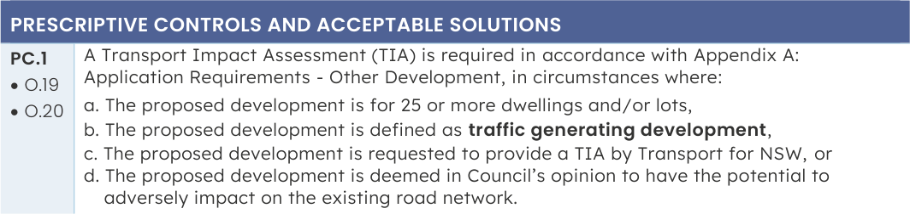

### 3.4. Parking and Vehicle Access

#### 3.4.1. Traffic Impacts

#### Objectives

O.19 To ensure that a development has duly considered the impact of traffic generation on the existing road network.

O.20 To limit conflicts between existing modes of transport and new development without the provision of sufficiently safe and effective traffic facilities.

> [Picture on page 13: a picture, saved as a picture (images/ch-03-00-site-requirements-page-13-8.gif, 150 dpi).]
> Words printed on the picture (title and legend, copied from the PDF):
> • O.19
> • O.20

#### PRESCRIPTIVE CONTROLS AND ACCEPTABLE SOLUTIONS

#### PC.1

A Transport Impact Assessment (TIA) is required in accordance with Appendix A: Application Requirements - Other Development, in circumstances where:

a. The proposed development is for 25 or more dwellings and/or lots,

b. The proposed development is defined as traffic generating development,

c. The proposed development is requested to provide a TIA by Transport for NSW, or

d. The proposed development is deemed in Council’s opinion to have the potential to adversely impact on the existing road network.
