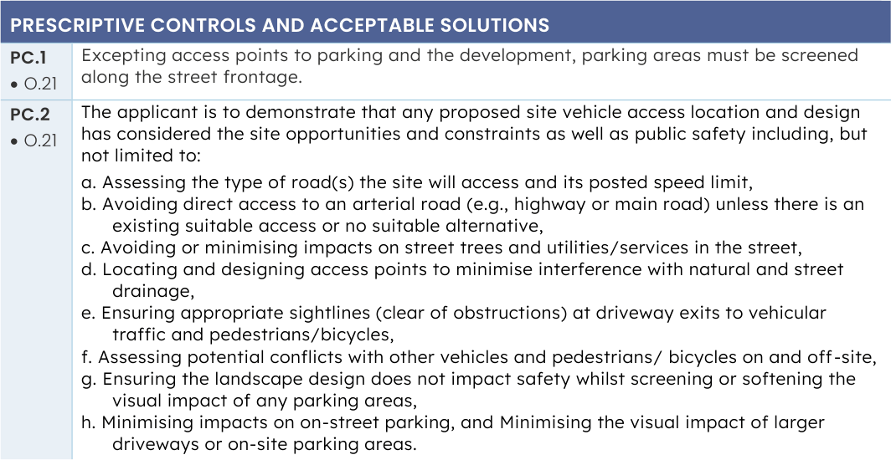
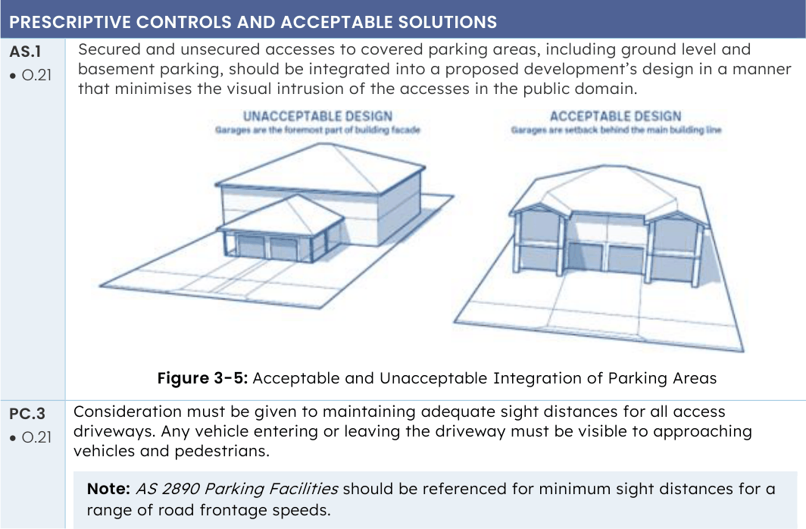

#### 3.4.2. Vehicle Access

Note: This section does not apply to any type of residential accommodation or ancillary development. Controls for vehicle access and driveways for residential accommodation and ancillary development are contained in Chapter 6: Residential Uses.

#### Objectives

O.21 To ensure that the location and design of parking areas and vehicle accesses are able to function efficiently in a manner that is safe, convenient, appropriately visually screened, and integrated into a development’s design.

> [Picture on page 13: a picture, saved as a picture (images/ch-03-00-site-requirements-page-13-26.gif, 150 dpi).]
> Words printed on the picture (title and legend, copied from the PDF):
> • O.21
> • O.21
> drainage,
> traffic and pedestrians/bicycles,

#### PRESCRIPTIVE CONTROLS AND ACCEPTABLE SOLUTIONS

#### PC.1

Excepting access points to parking and the development, parking areas must be screened along the street frontage.

#### PC.2

The applicant is to demonstrate that any proposed site vehicle access location and design has considered the site opportunities and constraints as well as public safety including, but not limited to:

a. Assessing the type of road(s) the site will access and its posted speed limit,

b. Avoiding direct access to an arterial road (e.g., highway or main road) unless there is an existing suitable access or no suitable alternative,

c. Avoiding or minimising impacts on street trees and utilities/services in the street,

d. Locating and designing access points to minimise interference with natural and street

e. Ensuring appropriate sightlines (clear of obstructions) at driveway exits to vehicular

f. Assessing potential conflicts with other vehicles and pedestrians/ bicycles on and off-site,

g. Ensuring the landscape design does not impact safety whilst screening or softening the visual impact of any parking areas,

h. Minimising impacts on on-street parking, and Minimising the visual impact of larger driveways or on-site parking areas.

> [Picture on page 14: a picture, saved as a picture (images/ch-03-00-site-requirements-page-14-1.gif, 150 dpi).]
> Words printed on the picture (title and legend, copied from the PDF):
> • O.21
> • O.21

Figure 3-5: Acceptable and Unacceptable Integration of Parking Areas

#### AS.1

Secured and unsecured accesses to covered parking areas, including ground level and basement parking, should be integrated into a proposed development’s design in a manner that minimises the visual intrusion of the accesses in the public domain.

#### PC.3

Consideration must be given to maintaining adequate sight distances for all access driveways. Any vehicle entering or leaving the driveway must be visible to approaching vehicles and pedestrians.

Note: AS 2890 Parking Facilities should be referenced for minimum sight distances for a range of road frontage speeds.
