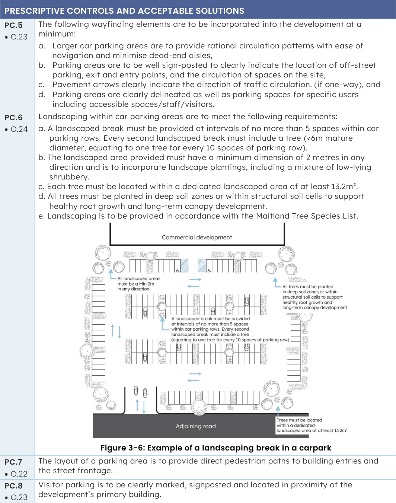
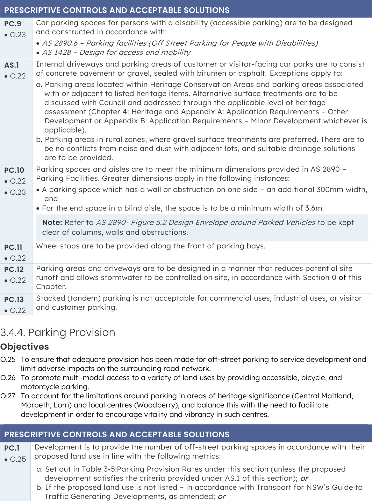

#### 3.4.3. Parking, Circulation and Design

Note: This section does not apply to any type of residential accommodation or ancillary development. Controls for parking, circulation, and design for residential accommodation and ancillary development are contained in Chapter 6: Residential Uses.

#### Objectives

O.22 To ensure that design of circulation and manoeuvring areas has accommodated the largest design vehicle for the site, addressing safety, ease of access, navigation, and swept paths.

O.23 To minimise potential conflict between vehicular and pedestrian movement. O.24 To provide increased visual and practical amenity for car parks by increasing vegetation and canopy cover.

| PRESCRIPTIVE CONTROLS AND ACCEPTABLE SOLUTIONS |  |
|---|---|
| PC.1 | Lighting for parking areas is to be provided in accordance with AS 2890.1 – Parking Facilities Off Street Parking. |
| • O.22 |  |
| PC.2 • O.24 | Parking areas are to incorporate landscape plantings, including a mixture of low-lying shrubbery and small trees (<6m mature diameter). PC.6 of this section provides further criteria. |
| PC.3 • O.23 | Pedestrian routes through parking areas over 50 spaces in size are to incorporate wayfinding elements, including markings, signage, grade separation and crossings, in accordance with AS 2890 – Parking Facilities. |
| PC.4 | Parking areas with over 50 spaces are to create circulation patterns that minimise usage of dead-end parking aisles wherever possible. |
| • O.22 |  |

> [Picture on page 15: a picture, saved as a picture (images/ch-03-00-site-requirements-page-15-1.gif, 150 dpi).]
> Words printed on the picture (title and legend, copied from the PDF):
> • O.23
> including accessible spaces/staff/visitors.
> • O.24
> • O.22
> • O.23

Figure 3-6: Example of a landscaping break in a carpark

#### PC.5

The following wayfinding elements are to be incorporated into the development at a minimum:

a. Larger car parking areas are to provide rational circulation patterns with ease of navigation and minimise dead-end aisles,

b. Parking areas are to be well sign-posted to clearly indicate the location of off-street parking, exit and entry points, and the circulation of spaces on the site,

c. Pavement arrows clearly indicate the direction of traffic circulation. (if one-way), and

d. Parking areas are clearly delineated as well as parking spaces for specific users

Landscaping within car parking areas are to meet the following requirements:

#### PC.6

a. A landscaped break must be provided at intervals of no more than 5 spaces within car parking rows. Every second landscaped break must include a tree (<6m mature diameter, equating to one tree for every 10 spaces of parking row).

b. The landscaped area provided must have a minimum dimension of 2 metres in any direction and is to incorporate landscape plantings, including a mixture of low-lying shrubbery.

c. Each tree must be located within a dedicated landscaped area of at least 13.2m².

d. All trees must be planted in deep soil zones or within structural soil cells to support healthy root growth and long-term canopy development.

e. Landscaping is to be provided in accordance with the Maitland Tree Species List.

#### PC.7

The layout of a parking area is to provide direct pedestrian paths to building entries and the street frontage.

#### PC.8

Visitor parking is to be clearly marked, signposted and located in proximity of the development’s primary building.

> [Picture on page 16: a picture, saved as a picture (images/ch-03-00-site-requirements-page-16-1.gif, 150 dpi).]
> Words printed on the picture (title and legend, copied from the PDF):
> • O.23
> • O.22
> • O.22
> • O.23
> and
> • O.22
> • O.22
> • O.22

#### PC.9

Car parking spaces for persons with a disability (accessible parking) are to be designed and constructed in accordance with:

• AS 2890.6 – Parking facilities (Off Street Parking for People with Disabilities)

• AS 1428 – Design for access and mobility

#### AS.1

Internal driveways and parking areas of customer or visitor-facing car parks are to consist of concrete pavement or gravel, sealed with bitumen or asphalt. Exceptions apply to:

a. Parking areas located within Heritage Conservation Areas and parking areas associated with or adjacent to listed heritage items. Alternative surface treatments are to be discussed with Council and addressed through the applicable level of heritage assessment (Chapter 4: Heritage and Appendix A: Application Requirements – Other Development or Appendix B: Application Requirements – Minor Development whichever is applicable).

b. Parking areas in rural zones, where gravel surface treatments are preferred. There are to be no conflicts from noise and dust with adjacent lots, and suitable drainage solutions are to be provided.

#### PC.10

Parking spaces and aisles are to meet the minimum dimensions provided in AS 2890 – Parking Facilities. Greater dimensions apply in the following instances:

• A parking space which has a wall or obstruction on one side – an additional 300mm width,

• For the end space in a blind aisle, the space is to be a minimum width of 3.6m. Note: Refer to AS 2890- Figure 5.2 Design Envelope around Parked Vehicles to be kept clear of columns, walls and obstructions. Wheel stops are to be provided along the front of parking bays.

#### PC.11

#### PC.12

Parking areas and driveways are to be designed in a manner that reduces potential site runoff and allows stormwater to be controlled on site, in accordance with Section 0 of this Chapter.

#### PC.13

Stacked (tandem) parking is not acceptable for commercial uses, industrial uses, or visitor and customer parking.
