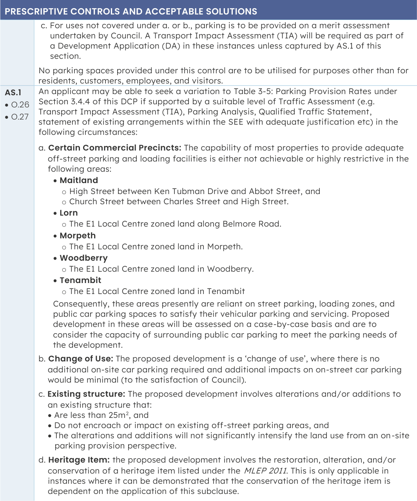
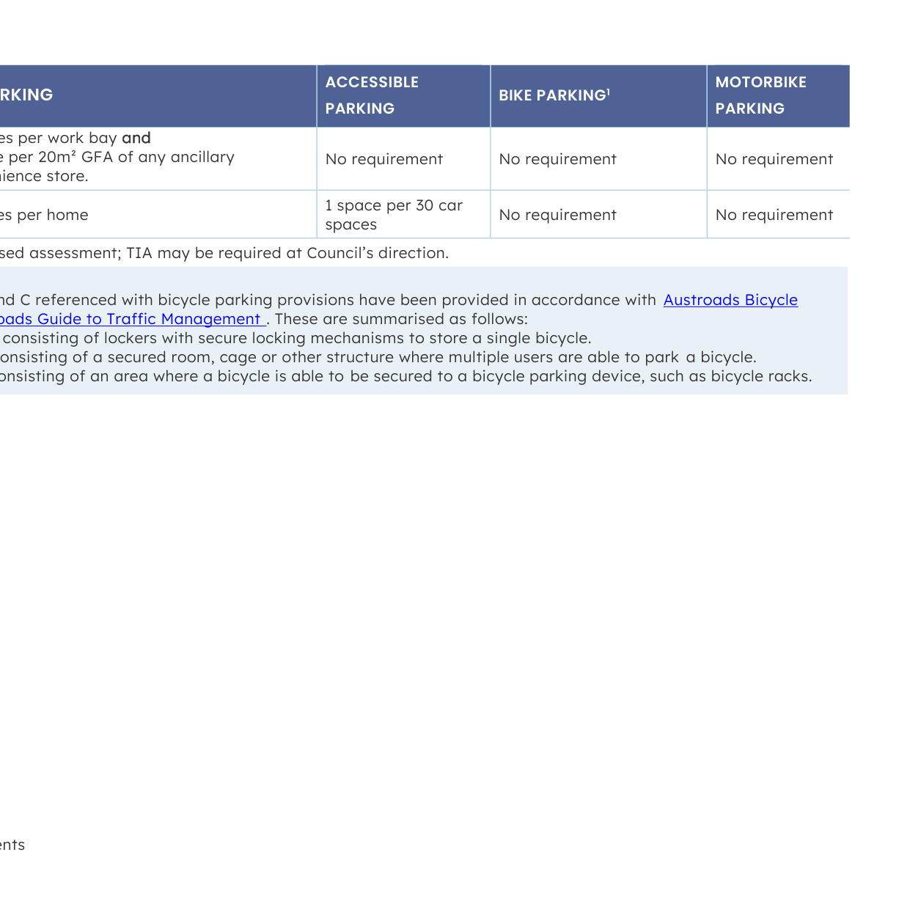

#### 3.4.4. Parking Provision

#### Objectives

O.25 To ensure that adequate provision has been made for off-street parking to service development and limit adverse impacts on the surrounding road network.

O.26 To promote multi-modal access to a variety of land uses by providing accessible, bicycle, and motorcycle parking.

O.27 To account for the limitations around parking in areas of heritage significance (Central Maitland, Morpeth, Lorn) and local centres (Woodberry), and balance this with the need to facilitate development in order to encourage vitality and vibrancy in such centres.

#### PRESCRIPTIVE CONTROLS AND ACCEPTABLE SOLUTIONS

#### PC.1

Development is to provide the number of off-street parking spaces in accordance with their proposed land use in line with the following metrics:

a. Set out in Table 3-5:Parking Provision Rates under this section (unless the proposed development satisfies the criteria provided under AS.1 of this section); or

b. If the proposed land use is not listed – in accordance with Transport for NSW’s Guide to Traffic Generating Developments, as amended; or

> [Picture on page 17: a picture, saved as a picture (images/ch-03-00-site-requirements-page-17-1.gif, 150 dpi).]
> Words printed on the picture (title and legend, copied from the PDF):
> • O.26
> • O.27
> • Maitland
> • Lorn
> • Morpeth
> • Woodberry
> • Tenambit
> parking provision perspective.

c. For uses not covered under a. or b., parking is to be provided on a merit assessment undertaken by Council. A Transport Impact Assessment (TIA) will be required as part of a Development Application (DA) in these instances unless captured by AS.1 of this section. No parking spaces provided under this control are to be utilised for purposes other than for residents, customers, employees, and visitors.

#### AS.1

An applicant may be able to seek a variation to Table 3-5: Parking Provision Rates under Section 3.4.4 of this DCP if supported by a suitable level of Traffic Assessment (e.g. Transport Impact Assessment (TIA), Parking Analysis, Qualified Traffic Statement, statement of existing arrangements within the SEE with adequate justification etc) in the following circumstances:

a. Certain Commercial Precincts: The capability of most properties to provide adequate off-street parking and loading facilities is either not achievable or highly restrictive in the following areas:

o High Street between Ken Tubman Drive and Abbot Street, and o Church Street between Charles Street and High Street.

o The E1 Local Centre zoned land along Belmore Road.

o The E1 Local Centre zoned land in Morpeth.

o The E1 Local Centre zoned land in Woodberry.

o The E1 Local Centre zoned land in Tenambit Consequently, these areas presently are reliant on street parking, loading zones, and public car parking spaces to satisfy their vehicular parking and servicing. Proposed development in these areas will be assessed on a case-by-case basis and are to consider the capacity of surrounding public car parking to meet the parking needs of the development.

b. Change of Use: The proposed development is a ‘change of use’, where there is no additional on-site car parking required and additional impacts on on-street car parking would be minimal (to the satisfaction of Council).

c. Existing structure: The proposed development involves alterations and/or additions to an existing structure that:

• Are less than 25m2, and

• Do not encroach or impact on existing off-street parking areas, and

• The alterations and additions will not significantly intensify the land use from an on-site

d. Heritage Item: the proposed development involves the restoration, alteration, and/or conservation of a heritage item listed under the MLEP 2011. This is only applicable in instances where it can be demonstrated that the conservation of the heritage item is dependent on the application of this subclause.

#### Table 3-5: Parking Provision Rates

| LAND USE | CAR PARKING | ACCESSIBLE PARKING | BIKE PARKING1 | MOTORBIKE PARKING |
|---|---|---|---|---|
| Residential Accommodation |  |  |  |  |
| Dwelling houses | • One- or two-bedroom dwelling: 1 covered space • Three or more-bedroom dwellings: 2 spaces, 1 being covered | No requirement | No requirement | No requirement |
| Dual occupancies and Semi- detached dwellings | • One-or two- bedroom dwelling: 1 covered space per dwelling • Three or more-bedroom dwellings: 2 spaces per dwelling, 1 being covered | No requirement | No requirement | No requirement |
| Secondary dwellings | No requirement | No requirement | No requirement | No requirement |
| Residential flat buildings, Multi dwelling housing, Attached dwellings, and Shop- top housing | • One- or two-bedroom dwelling: 1 covered space per dwelling OR • Three or more-bedroom dwellings: 2 spaces per dwelling, 1 being covered PLUS • 1 dedicated visitor space for the first three dwellings and 1 space for every five dwellings thereafter or part thereof | No requirement | No requirement | No requirement |
| Seniors housing | 1 space for 5 dwellings + visitor parking if there are more than 8 dwellings | 1 car space per 10 car spaces | No requirement | No requirement |
| Residential care facilities | 1 space per 10 beds (visitors) +1 space per 2 employees + 1 space suitable for an ambulance | 1 car space per 10 car spaces | No requirement | No requirement |
| Hostels | • 1 space per 7 beds and • 1 space per 2 employees and • 1 parking space for services and deliveries. | No requirement | 1 space per 20 beds (Security Level B) | No requirement |
| Boarding houses, Co-living, and Group homes | • 1 space per 2 bedrooms and • 1 space for employees | 1 space per 10 bedrooms | • 1 space per 10 bedrooms (Security Level B or C) and | No requirement |

| LAND USE | CAR PARKING | ACCESSIBLE PARKING | BIKE PARKING1 • 1 space per 20 bedrooms (Security Level C) for visitors | MOTORBIKE PARKING |
|---|---|---|---|---|
| Home business and Home | 1 space in addition to the dwelling requirements | No requirement | No requirement | No requirement |
| industry |  |  |  |  |
| Educational establishments |  |  |  |  |
| Child care centre | 1 space per 4 children in attendance (or part thereof). | 1 car space | No requirement | No requirement |
| Educational establishment | • 1 space per employee or staff member and • 1 space for every 30 students over 17 years old for High Schools / 1 space for every 5 students for Tertiary Education establishments (e.g. TAFE, universities) and • provision for a drop off / pick up area | 1 car space per 20 car spaces | • 1 space per 20 staff (Security Level B) and • 1 space per 25 students (Security Level B) and • 1 space per 25 students (Security Level C) | 1 space per 50 car spaces |
| Business & Office premises |  |  |  |  |
| Business premises | 1 space per 40m2 of GFA | 1 car space per 30 car spaces | 1 space per 100m2 of GFA (Security Level C) | 1 space per 20 car spaces |
| Office premises | 1 space per 50m2 of GFA | 1 car space per 30 car spaces | • For developments under 400m2, 1 space per 200m2 of GFA (Security Level C) • For developments over 400m2, 1 space per 400m2 of GFA (Security Level B) and • 1 space per 400m2 of GFA (Security Level C) | 1 space per 20 car spaces |
| Retail premises |  |  |  |  |
| Restaurants and cafes | • 1 space per 3 seats, or | 1 car space per 30 car spaces | 2 spaces per 100m2 of GFA (Security Level C) | 1 space per 20 car spaces |

| LAND USE | CAR PARKING • 1 space per 10m2 of customer service area (including outdoor dining areas) | ACCESSIBLE PARKING | BIKE PARKING1 | MOTORBIKE PARKING |
|---|---|---|---|---|
| Takeaway food and drink premises | For developments with no on-site seating and no drive through :1 space per 20m2 of GFA For developments with on-site seating and no drive-through, the greater of either: • 1 space per 20m2 of GFA, or • 1 space per 6 seats For developments with on-site seating and drive- through facilities, a minimum queueing area for 5-12 cars, and the greater of either: • 1 space per 10m2 of GFA, or • 1 space per 3 seats plus • 2 waiting bays | 1 car space per 30 car spaces | 2 spaces per 200m2 of GFA (Security Level C) | 1 space per 20 car spaces |
| Pubs and Registered Clubs Note: Additional parking to be provided for other activities, such as restaurants or hotel and motel accommodation. | The greater of either: • 1 space per 10 seats, or • 1 space per 10m2 of licensed floor area | 1 car space 20 car spaces | 1 space per m2 of GFA (Security Level C) | 1 space per 30 car spaces |
| Garden centres and Plant nursery | The greater of either: • 1 space per 130m2 of GFA, or • 15 spaces | 1 car space per 45 car spaces | No requirement | No requirement |
| Hardware and building supplies | 1 space per 50m2 of GFA | 1 car space per 30 car spaces | 1 space per 20 employees (Security Level B or C) | No requirement |
| Landscaping material supplies, Timber yards, Rural supplies, and Wholesale supplies | 1 space per 130m2 of GFA | 1 car space per 45 car spaces | No requirement | No requirement |
| Markets | 2 spaces per stall | No requirement | No requirement | No requirement |

| LAND USE | CAR PARKING | ACCESSIBLE PARKING | BIKE PARKING1 | MOTORBIKE PARKING |
|---|---|---|---|---|
| Roadside stalls | Merit-based assessment | No requirement | No requirement | No requirement |
| Shopping centres | 0-10,000m2 GLFA • 6.3 spaces per 100m2 GLFA 10,000-20,000m2 GLFA • 5.8 spaces per 100m2 GLFA 20,000-30,000m2 GLFA • 4.5 spaces per 100m2 GLFA Over 30,000m2 GLFA • 4.3 spaces per 100m2 GLFA | 1 car space per 30 car spaces | • 1 space per 1000m2 of GFA (Security Level B) and • 1 space per 500m2 of GFA (Security Level C) | 1 space per 20 car spaces |
| Shops (including | 1 space per 30m2 of GFA | 1 car space per 30 car spaces | 1 space per 200m2 of GFA (Security Level C) | 1 space per 20 car spaces |
| neighbourhood shops) |  |  |  |  |
| Specialised retail premises | 1 space per 50m2 of GFA | 1 car space per 30 car spaces | 1 space per 20 employees (Security Level B or C) | No requirement |
| (formerly bulky goods) |  |  |  |  |
| Vehicle sales or hire premises | 1 space per 130m2 of GFA and 3 spaces per work bay if including a vehicle body repair workshop or vehicle repair station. | 1 car space per 30 car spaces | 1 space per 20 employees (Security Level B or C) | No requirement |
| Commercial premises (other) |  |  |  |  |
| Entertainment facilities and Function centres | Merit-based assessment, TIA required. | 1 car space per 20 car spaces | • 1 space per 25 employees (Security Level B) and • 1 space per 10 seats (Security Level C) | 1 space per 20 car spaces |
| Amusement centres | 1 space per 50m2 of GFA | 1 car space per 30 car spaces | No requirement | 1 space per 20 car spaces |
| Service station | 2 spaces per pump (excluding pump station) | 1 car space per 10 | No requirement | No requirement |
| Sex services premises | 1 space per 40m2 of GFA | 1 car space per 20 car spaces | No requirement | No requirement |

| LAND USE | CAR PARKING | ACCESSIBLE PARKING | BIKE PARKING1 | MOTORBIKE PARKING |
|---|---|---|---|---|
| Restricted premises (including | 1 space per 25m2 of GFA | 1 car space per 20 car spaces | No requirement | No requirement |
| Sexual aid establishments) |  |  |  |  |
| Health service facilities |  |  |  |  |
| Medical centres / Health consulting rooms | 2 spaces per practitioner / professional person | 1 car space per 7 car spaces | 2 spaces per 10 employees (Security Level C) | 1 space per 20 car spaces |
| Hospitals | • 1 space per 1.5 staff and • 1 space per 3 beds (visitor parking) | 1 car space per 20 car spaces | 1 space / 30 beds. Min 2 spaces | 1 space per 10 car spaces |
| Tourist and visitor accommodation |  |  |  |  |
| Bed and breakfast | • 1 space per guest room and • 1 space for employees | No requirement | No requirement | 1 space per 20 car spaces |
| accommodation and Farm |  |  |  |  |
| stay accommodation |  |  |  |  |
| Backpacker accommodation | • 1 space per 5 beds and • 1 space per 2 employees | 1 car space per 20 car spaces | 1 space per 20 beds (Security Level B) | 1 space per 20 car spaces |
| Hotel and Motel | • 1 space per unit and • 1 space per 2 employees | 1 car space per 20 car spaces | 1 space per 20 units (Security Level B) | 1 space per 20 car spaces |
| accommodation |  |  |  |  |
| Serviced apartments | • 1 space per apartment and • 1 space per 2 employees | 1 car space per 20 car spaces | 1 space per 10 apartments | 1 space per 20 car spaces |
| Industry |  |  |  |  |
| Artisan food and drink | 1 space per 40m2 of GFA | 1 car space per 20 car spaces | 1 space per 250m2 of GFA (Security Level C) | 1 space per 30 car spaces |
| industry |  |  |  |  |
| Light, General, and Heavy | 1 space per 100m2 | 1 space per 100m2 | 1 space per 20 staff | 1 space per 50 car spaces |
| industry in urban areas |  |  |  |  |
| Recreation |  |  |  |  |
| Bowling alleys | 3 spaces per alley | 1 car space per 20 car spaces | 1 space per 4 alleys (Security Level C) | 1 space per 30 car spaces |

| LAND USE | CAR PARKING | ACCESSIBLE PARKING | BIKE PARKING1 | MOTORBIKE PARKING |
|---|---|---|---|---|
| Bowling greens | 30 spaces for the first green, and 15 spaces for each additional green. | 1 car space per 20 car spaces | 1 space per green (Security Level C) | 1 space per 30 car spaces |
| Gymnasium | 7.5 spaces per 100m2 of GFA | 1 car space per 20 car spaces | • 1 space per 150m2 of GFA (Security Level C) and • 1 space per 10 staff (Security Level B) | 1 space per 30 car spaces |
| Tennis or Squash courts | 3 spaces per court | 1 car space per 20 car spaces | 1 space per 2 courts (Security Level C) | 1 space per 30 car spaces |
| Indoor soccer / cricket / | 15 spaces per court/pitch | 1 car space per 20 car spaces | 2 space per court (Security Level C) | 1 space per 30 car spaces |
| netball / basketball |  |  |  |  |
| Swimming pools | 1 space per 200m2 | 1 car space per 20 car spaces | 1 space per 30 car spaces | 1 space per 30 car spaces |
| Other land uses |  |  |  |  |
| Eco-tourist facility | • 1 space per 2 staff and • 1 space per dwelling | 1 car space per 5 dwellings | No requirement | No requirement |
| Place of public worship | 1 space per 10m2 of GFA | 1 car space per 20 car spaces | No requirement | No requirement |
| Community facilities | 1 space per 15m2 of GFA | 1 car space per 20 car spaces | 1 space per 250m2 of GFA | 1 space per 45 car spaces |
| Veterinary hospital | • 3 spaces per surgery or consulting room, and • 1 space for each professional practitioner and other staff present at any one time. | 1 car space per surgery | 1 space per 4 practitioners | No requirement |
| Warehouse or distribution | • 1 space per 200m² GFA or • 1 space per 2 staff (whichever is greater) | 1 space per 400m2 | 1 space per 15 staff | 1 space per 20 spaces |
| centre |  |  |  |  |
| Camping grounds, Caravan | Rates for residents, visitors, and accessible parking are set by Clauses 96-98 of the Local Government (Manufactured Home Estates, Caravan Parks, Camping Grounds and Movable Dwellings) Regulation 2021. |  | No requirement | No requirement |
| parks and Manufactured |  |  |  |  |
| Home Estates |  |  |  |  |

|  |  | ACCESSIBLE |  | MOTORBIKE |
|---|---|---|---|---|
| LAND USE | CAR PARKING | PARKING | BIKE PARKING1 | PARKING |
| Vehicle body repair workshops and Repair stations | • 6 spaces per work bay and • 1 space per 20m² GFA of any ancillary convenience store. | No requirement | No requirement | No requirement |
| Exhibition villages | 1.5 spaces per home | 1 space per 30 car spaces | No requirement | No requirement |
| Uses not defined in this table | Merit based assessment; TIA may be required at Council’s direction. |  |  |  |

#### Notes:

> [Picture on page 24: a picture, saved as a picture (images/ch-03-00-site-requirements-page-24-3.gif, 150 dpi).]

1\. Bicycle Parking: Security Level A, B, and C referenced with bicycle parking provisions have been provided in accordance with Austroads Bicycle Parking Facilities: Updating the Austroads Guide to Traffic Management . These are summarised as follows:

a. Security Level A (Bicycle Lockers): consisting of lockers with secure locking mechanisms to store a single bicycle.

b. Security Level B (Bicycle Cages): consisting of a secured room, cage or other structure where multiple users are able to park a bicycle.

c. Security Level C (Bicycle Racks): consisting of an area where a bicycle is able to be secured to a bicycle parking device, such as bicycle racks.
